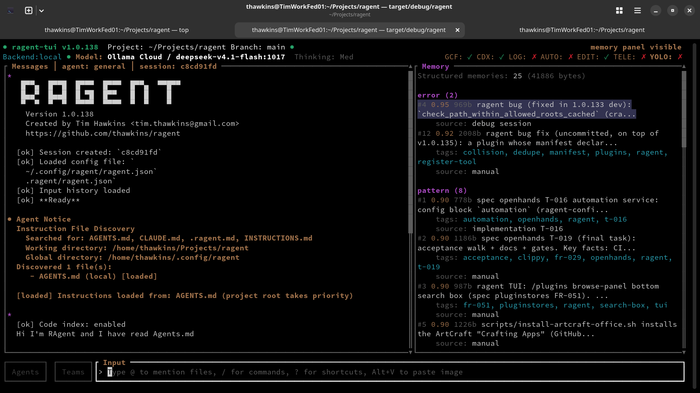
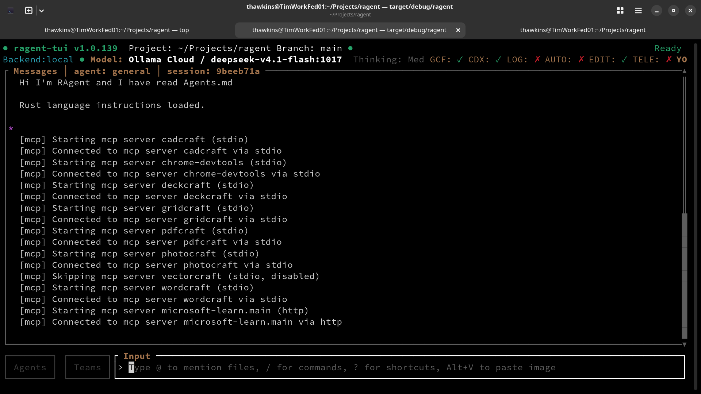
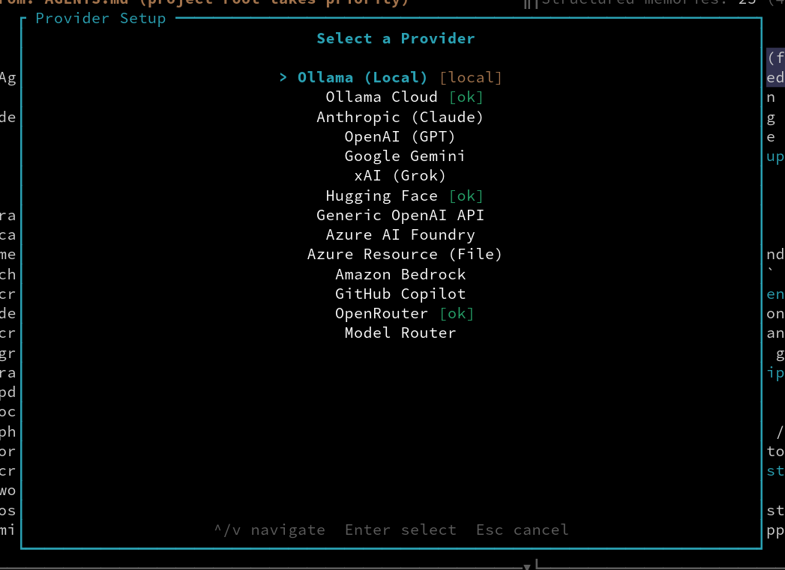
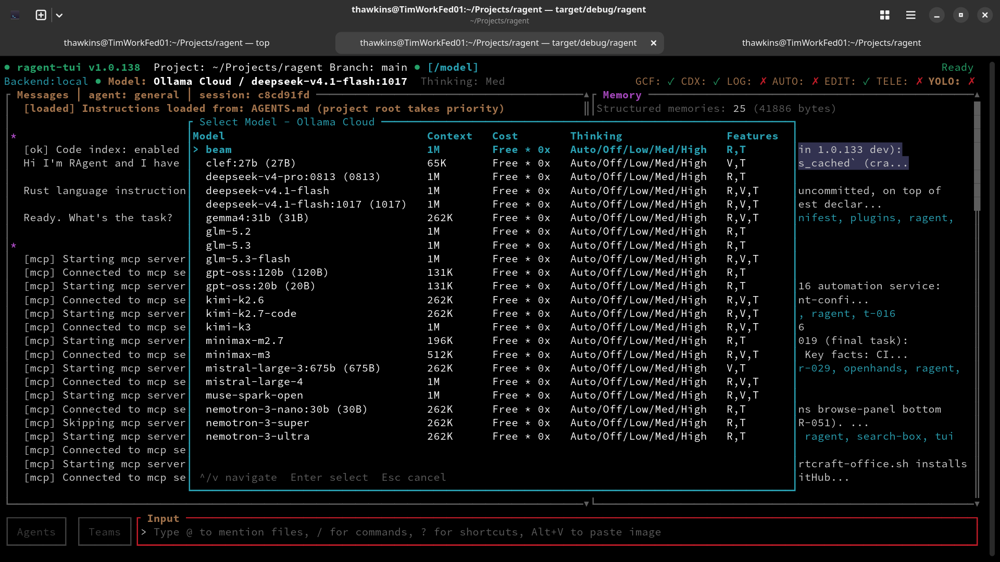
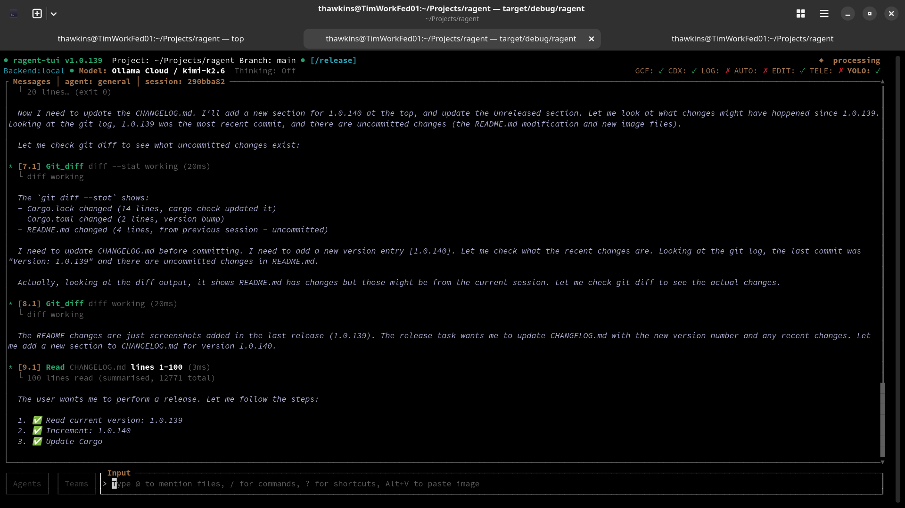
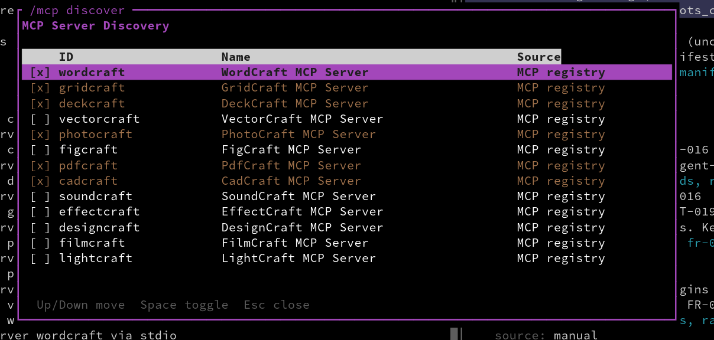
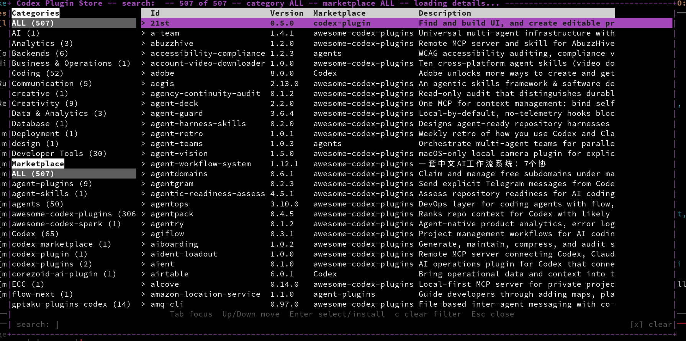
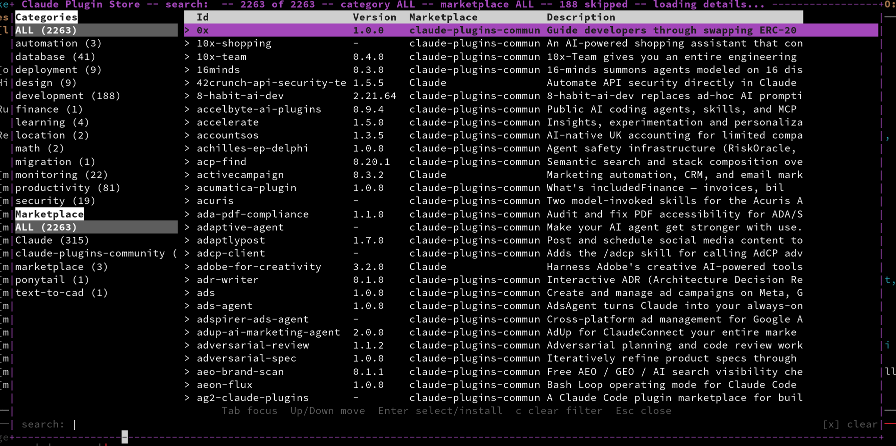

# ragent

An AI coding agent for the terminal, built in Rust.





ragent is a Rust coding agent inspired by RooCode, Claude Code, Copilot CLI and
OpenCode. It provides multi-provider LLM orchestration, a comprehensive built-in
tool system, a terminal UI, and a client/server architecture — all compiled into a
single statically-linked binary with zero runtime dependencies.

It is implemented in Rust as a learning exercise for the author.

Start with [TUI-QUICKSTART.md](TUI-QUICKSTART.md) to run it, or
[QUICKSTART.md](QUICKSTART.md) for the guided tour.

## Features

- **Multi-provider LLM support** — Anthropic, OpenAI (Chat Completions and the
  Responses API), Google Gemini, Hugging Face, GitHub Copilot, xAI, Ollama (local
  and cloud), Generic OpenAI-compatible endpoints, Azure AI Foundry, Azure Resource
  (File), Amazon Bedrock, OpenRouter, and a Model Router cluster — 15 registry
  entries behind an extensible provider trait





- **Local-first defaults** — when no model is explicitly configured, ragent resolves
  to the first available local/self-hosted provider (e.g. Ollama) rather than
  hard-wiring a cloud provider
- **Pluggable execution backends** — select *where* a session's tools run without
  changing the agent loop: `local` (host, the default), `docker`/`podman` (a
  per-session container whose workspace is a named volume, never a host bind mount),
  and `remote` (drive a second ragent server over REST+SSE and mirror its events
  locally). A durable backend registry reports each backend's health, the TUI
  `/backend` switcher shows and changes the active backend, sandbox credentials are
  resolved from the encrypted store at spawn time and injected as container
  environment variables, and a provisioning failure fails the turn rather than
  falling back to the host. The 7-layer bash validation, path containment, and
  permission system are unchanged and apply before any backend dispatch
- **LLM security analyzer** — an opt-in permission mode (`/security on`, or the
  `security_analyzer` config block) where each proposed tool action is judged by an
  LLM that returns an `allow`/`ask`/`deny` verdict with a rationale, published before
  the action is permitted or refused; it is a tightening-only layer over the static
  rules (a `deny` is hard, an `allow` never overrides an explicit policy `deny`, and
  any analyzer failure degrades to the normal interactive prompt)
- **Comprehensive tool system** — **148 registered tools across 21 categories** in
  the default build (the engine-gated `mf_screenshot` tool registers only when a
  drivable headless browser is present, taking the count to 149 — spec `openhands`
  FR-029). `ragent run --dry-run` prints the live per-category counts; the groups
  are:
 
 

  - **File** (27) — read, write, create, edit, multiedit, apply_patch, patch, rm,
    move, copy, mkdir, append, file_info, diff, glob, list, grep, the `update_file`
    alias, get_env, the PDF pair (`pdf_read`, `pdf_write`), the structured-memory
    trio (`memory_store`, `memory_recall`, `memory_forget`), plus
    `conversation_search` and `session_search`. Read-only tools require `file:read`;
    mutating tools require `file:write`
  - **Bash** (3) — bash, bash_reset and the `run_code` alias. Bash carries 7-layer
    security: safe-command whitelist, banned commands, denied patterns,
    directory-escape prevention, syntax validation, obfuscation detection, and user
    allowlist/denylist
    - **Bang commands** — prefix any prompt with `!` (e.g. `! ls -la`) to run a
      shell command directly; the output is sent to the model for review and
      error resolution
  - **Shell** (1) — open (cross-platform file/URL reveal)
  - **Web** (5) — webfetch, websearch, mf_fetch, mf_search, mf_crawl
    (`mf_search` runs the keyless DuckDuckGo, Brave, OpenAlex and Wikipedia backends
    in parallel, plus LangSearch / Tavily / Perplexity / Exa when configured)
  - **Code intelligence** (10) — codeindex_search, codeindex_symbols,
    codeindex_references, codeindex_dependencies, codeindex_status, codeindex_reindex,
    codeindex_explain, codeindex_path, codeindex_communities, codeindex_godnodes
    (read-only, hardwired always-allowed)
  - **Git** (18) — git_status, git_log, git_diff, git_branch, git_show, git_remote,
    git_tag, git_add, git_reset, git_checkout, git_commit, git_stash, git_cherry_pick,
    git_push, git_pull, git_fetch, git_clone, git_merge
  - **GitHub** (11) and **GitLab** (19) — issues, PRs/MRs, pipelines, jobs, and CI/CD
  - **Teams** (19) — the full team lifecycle, shared tasks, mailbox messaging, and
    coordination surface
  - **Agent** (4) — new_agent, cancel_agent, list_agents, wait_agents
  - **Spec** (5) — spec_list, spec_read, spec_search, spec_task_update, spec_coverage
  - **Task** (4) — task_create, task_update, task_get, task_list
  - **Cron** (5) — cron_add, cron_remove, cron_list, cron_enable, cron_disable
  - **Plan** (2) — plan_enter, plan_exit
  - **None** (8) — calculator, think, agent_complete, ragent_info (running version,
    build time, git commit, compiler, plus this instance's pid, uptime, memory and
    thread count), os_info (read-only host report: OS identity and Linux
    distribution, CPU, graphics adapters and graphics-API versions, physical
    hardware, memory, uptime, and process environment; also `/osinfo show`),
    tool_info and commands_info (registry and slash-command dumps)
  - One each: **model** (model_info), **network** (http_request), **system**
    (mf_version, mf_cache_clear), **skill** (skill_manage), **storage** (initiative),
    **ask_user** (ask_user)
  - **MCP** — mcp_tool (McpToolWrapper) for external Model Context Protocol servers,
    plus the dynamically registered per-server bridge tools
- **Terminal UI** — full-screen ratatui interface with provider setup dialog,
  slash-command autocomplete, agent cycling, streaming chat with markdown and syntax
  highlighting, step-numbered tool calls with pretty-printed JSON in the log panel,
  a live permission countdown timer (120-second timeout with EXPIRED state), and a
  message input queue (`Alt+Q` menu / `/queue`) that keeps the input field editable
  while the agent executes; side panels for context (`Alt+C`), memory (`Alt+M`),
  telemetry (`Alt+O`) and tasks (`Alt+T`)
- **HTTP server** — axum-based REST + SSE API so any frontend can drive the agent
- **Session management** — persistent conversation history stored in SQLite;
  list, resume, export-archive, and import sessions
- **Permission system** — multi-layered defense-in-depth with hardwired rules
  (codeindex tools always allowed), configurable allow/deny/ask rules, 7-layer bash
  security, file-path guards, and YOLO mode for trusted environments
- **Agent presets** — `general`, `build`, `plan`, `explore`, `ask` and the internal
  `title`/`summary` helpers, plus language and domain specialists (`rust-coder`,
  `python-coder`, `typescript-coder`, `fastapi-agent`, `security-auditor`,
  `test-writer`, `documenter`, `devops-agent`, `database-agent`, `frontend-agent`)
  with tailored system prompts
- **Custom agents** — user-defined agents via JSON (OASF format) or Markdown profiles
- **Project guidelines** — auto-loads `AGENTS.md` from the project root (and
  `~/.local/share/ragent/`) into the system prompt so agents follow project-specific
  conventions
- **MCP client** — Model Context Protocol support with auto-discovery of 18 known
  server types, stdio and Streamable-HTTP clients, and tool bridging; TUI commands
  (`/mcp` / `/mcp status`, `/mcp config`, `/mcp discover`, `/mcp connect <id>`,
  `/mcp disconnect <id>`) with durable global enable/disable state
  (`mcp_state.json`) and live connect/disconnect. `/mcp config` reports where
  ragent looks for MCP definitions (ragent-native, npm global, `PATH`, and the
  Claude/Cline/XDG registry directories), the count found at each location, and
  the servers discovered



- **ACP integration** — Agent Client Protocol support in both directions: an ACP
  **client** that drives Claude Code, Codex, or Gemini CLI as an external
  subprocess over JSON-RPC on stdio, and a **feature-gated, off-by-default ACP
  server** (`cargo build --features acp-server`; `ragent acp-server`) that an
  ACP-capable editor (Zed, VS Code, JetBrains) attaches to, streaming the driven
  session's updates back as `session/update` notifications
- **Snapshot & undo** — file snapshots before edits so changes can be rolled back
- **Event bus** — internal tokio pub/sub for real-time UI updates across all components
- **Background agents** — spawn and run multiple sub-agents concurrently for parallel
  task execution, with REST API and TUI monitoring; `/spawn <agent> <prompt>`
  launches a **detached** fire-and-forget sub-agent that nothing ever waits on
  (no `list_agents` entry, not awaitable via `wait_agents`, result never
  injected into the chat); every completed sub-agent run (detached or not)
  also writes its FULL output to `log/subagents/<task-id>.md`, and the
  completion event carries the real loop `finish_reason` (`stop` /
  `truncation` / `length` / `cancelled` / `error`) so a provider-side cut is
  flagged in the Agents panel instead of looking like a healthy finish
- **Prompt inspector** — `/prompt` renders the assembled system prompt an agent
  would receive (primary or subagent mode, per-agent override, roster) with the
  effective tool surface — read-only, no LLM call
- **Tool-repeat guard** — after five consecutive identical tool calls the sixth is
  held for confirmation in interactive runs and auto-denied in unattended runs, so
  agent loops cannot hang replaying the same call (FR-044)
- **Code index** — automatic codebase indexing with tree-sitter parsing (14 grammars
  covering 50 language ids), full-text search via Tantivy, incremental updates via
  file watcher, and LLM-accessible tools; supports Rust, Python,
  TypeScript/JavaScript, Go, C/C++, Java, Kotlin, OpenSCAD, Terraform, HCL, CMake,
  Gradle (Groovy and KTS), Maven, and XML; enable/disable via `/codeindex on|off`,
  language filtering via `/codeindex lang <language>`; **semantic code graph** with
  `codeindex_godnodes` (top-N most-connected symbols), `codeindex_path` (shortest
  path between symbols), `codeindex_explain` (node metadata and edges), and
  `codeindex_communities` (community detection); graph built in the background
  via `/codeindex graph build` (phased lock discipline keeps search available
  during derivation; status-bar `idx`/`graph` busy indicators show progress)
- **Memory system** — three-tier system with file blocks, structured SQLite store,
  and optional embedding-based semantic search; automatic extraction, decay,
  compression, and knowledge graph support
- **Spec management** — `/spec` slash commands for creating, listing, searching,
  validating, and tracking specification lifecycles; `/spec jtbd` performs
  Jobs-To-Be-Done analysis on existing specs; `/spec update` regenerates
  `PLAN.md` and `TESTPLAN.md` from an edited `SPEC.md`; `/spec create` also emits a
  manual `TESTPLAN.md` test-plan artifact; `/spec govcreate` turns a system
  architecture document (URL or local file/folder) into a project, and
  `/spec reverse <owner/repo | URL>` fetches a public repo's metadata, root file
  tree, and README via the GitHub API, then asks the currently selected LLM model to
  generate a synthetic creation prompt. With the `/new` scaffold flags
  (`--language <lang> --type <type> [--stack <name>]`) the reverse prompt is steered
  towards a target language, app type, and framework stack, and `--folder <path>`
  scaffolds a real project (default: the current directory) while `--github` /
  `--gitlab` create a private remote and push it; `--create <name>` chains into
  `/spec create` to auto-generate a spec from the reverse-engineered prompt,
  written under the scaffolded project (`<folder>/specs/<name>/`) when
  `--folder` was used
- **Project scaffolding** — `/new --language <lang> --type <type>` scaffolds a
  new project in an empty directory: the ragent workspace (`.ragent/`, `specs/`,
  `log/`, `.gitignore`, `AGENTS.md`), a runnable hello-world artifact set for
  26 application languages (rust, python, go, typescript, ...) with
  library/cmdline/tui/gui layouts (plus a webapp HTTP server for the five web
  languages) plus sample-document stubs for 20 data,
  markup, and build formats (json, yaml, sql, cmake, maven, ...) covering every
  codeindex scanner language, optional
  stack layers (`--stack axum`), starter docs (`README.md`, `QUICKSTART.md`,
  `STATS.md`, `docs/`), git init + initial commit, and optional GitHub/GitLab
  remote creation + push (`--github`/`--gitlab`); progress streams live in the
  message window; also available as the `ragent new` CLI subcommand
- **Research system** — `/research` slash command family and `ragent research` CLI for
  structured information gathering (web search + local file cross-referencing) with
  self-contained `RESEARCH.md` outputs and `GET/POST/DELETE /research` HTTP endpoints;
  concept/finding output limits (`--max-concepts`/`--max-findings`, `research.max_concepts`/
  `research.max_findings`), scholarly-engine control (scholarly backends are
  excluded by default; `--papers` includes them, `research.exclude_academic_engines`
  persists the exclusion), open-access toggles
  (`--oa-enable`/`--no-oa`), URL cloaking (`--url-cloak`) that defangs web
  source URLs in the `Sources` bullets and `References Index` so scanners do
  not flag them, a per-engine progress table that breaks exclusions
  and fetch failures out by reason/cause, and `mf_search` `exclude_engines`
- **Skills system** — loadable skill packs (bundled or custom YAML) that inject tools,
  prompts, and file context into agent sessions; also discovers the AgentSkills
  convention (`.agents/skills/` project and `~/.agents/skills/` user, a directory per
  pack with a `SKILL.md` declaring `name` and `description`), listable via `/skills`
  (or `/skill`) and loadable via `/skill <name> [args]` or the bare `/<name>` trigger,
  with an existing higher-scope pack winning a name clash
- **Plugin system** — load Codex-dialect (`codex-plugin.json` or the nested
  `.codex-plugin/plugin.json` the `openai/plugins` store ships) and Claude
  Code/Desktop-dialect (`.claude-plugin/plugin.json`) plugins — including
  multi-target trees that ship both nested manifests side by side (e.g.
  `mongodb/agent-skills`), which resolve to the Claude dialect — run their
  JavaScript entries on an embedded, budget-sandboxed engine (`rquickjs`, no
  Node/Deno required) behind a versioned `ragent` host API, and register their
  tools (`plugin_<id>_<tool>`) and slash commands; skill-only/MCP-only plugins
  (no JavaScript entry) install and load inertly, and their `skills` directories
  and `mcpServers` entries are bridged into the session (plugin skills join the
  skill-discovery roots — a plugin with no `skills` section but a conventional
  `skills/` directory, the Claude marketplace's default layout, contributes it
  too; plugin MCP servers connect as `<plugin-id>.<server>`);
  a plugin's slash commands are bridged too, including the Claude `commands/*.md`
  prompt commands (each injected as a user turn with `$ARGUMENTS` substituted),
  registered under their bare name or the namespaced `plugin:<id>:<name>` trigger
  and listed in the `/` menu and `/help`; plugin `agents/*.md` profiles join
  agent discovery (YAML frontmatter accepted, project agents win name clashes),
  and plugin-declared `hooks` fire on the matching session lifecycle events
  (both `pre_tool_use` and Claude's `PreToolUse` spellings accepted; the
  `hooks.json` file and the group `{matcher, hooks: [...]}` shape are read, a
  plugin hook gets `CLAUDE_PLUGIN_ROOT` and the Claude event JSON on stdin, and
  a blocking Stop hook can feed findings back before the turn ends).
  `/plugins codex` and `/plugins claude`
  browse each store's official marketplace (`StoreProvider` normalises the Codex and
  Claude document shapes); each panel carries a left-hand navigator column split into a
  category navigator (top) and a marketplace navigator (bottom), each listing
  `ALL` plus the distinct values the fetched index declares, operated by
  keyboard (`Tab`/`BackTab` cycle focus, `Up`/`Down` move-and-apply, `Enter` apply,
  `c` clear the focused navigator) and mouse (click
  a row, wheel to scroll); every navigator row appends the number of plugins under that
  value as `Name (N)` (the `ALL` row counts the whole index, derived from the full
  fetched index so the count is stable as a query or filter narrows the list); the
  search query, category, and marketplace filters compose
  so the list shows only entries matching all three; a launch may pre-select a category
  with `--category <name>`; each result row shows the plugin id, version, the
  **marketplace it came
  from** (the added marketplace's name, or the store label for the base endpoint), and
  its description, and the panel widens up to a 140-column ceiling so the marketplace
  column has room; the result list is sorted alphabetically by plugin id
  (case-insensitive) and a query or category filter narrows the already-sorted set. A
  search box sits along the panel's bottom edge with the live filter field on the left
  and a click-to-clear `[x] clear` button on the right, so the active query can be wiped
  with one click;
  `/plugins add` also accepts a
  `git+<https-url>#<ref>[:<subpath>]` git source; a freshly installed plugin is
  recorded enabled and loads at the next session start (no JavaScript runs during
  the install); managed through
  `/plugins list|add|remove|enable|disable|test|stores|marketplace|help` in the TUI
  (`/plugins list [--verbose]` opens an interactive table panel with the capability
  blocks listed at the end; `Space` toggles the highlighted plugin's enabled state) and
  the `ragent plugins <sub>` CLI (`/plugins marketplace show` and `/plugins marketplace <codex|claude> list` list the marketplaces configured for each store,
  one section per store with a name/url/description table; `/plugins marketplace <codex|claude> add <source>` registers an additional marketplace from an
  `owner/repo` slug, an SSH remote, an `https://` URL, or a local directory, in the
  user-global `plugins.stores.marketplaces`, and the two browse panels fetch and
  merge every configured marketplace into the one panel); a loaded index also has each
  plugin's own version and description resolved from its manifest off the event loop
  (the vendor listings omit them, Codex especially), with a `loading details...` title
  hint and a `-` version marker while a value stays unknown; `plugins.enabled: false`
  makes the subsystem inert





- **Connector system** — a Claude-connector-equivalent catalogue of named
  integrations (Google Drive, Slack, GitHub, Git, Postgres, Puppeteer, and the
  wider community catalogue) that reach an external system through one or more
  MCP servers; a connector is a catalogue entry (display name, category, auth
  shape, and one or more servers) on top of the MCP transport ragent already
  speaks. Managed through the thirteen-subcommand `/connectors` family
  (`list [--verbose] [--category <name>]`,
  `claude [query] [--category <name>] [--refresh]`, `add <id|source> [--force]`,
  `remove <id>`, `enable <id>`, `disable <id>`, `connect <id>`,
  `disconnect <id>`, `auth <id>`, `test <id>`, `stores [--check]`,
  `marketplace show|claude list|add|remove`, `help`) in the TUI and the
  `ragent connectors <sub>` CLI. `/connectors claude` opens an interactive,
  off-the-event-loop catalogue browser (filter by query and category, browse,
  install with one key; a fixed dark-on-light column-heading row (`Id`, `Category`,
  `Marketplace`, `Description`) is pinned above the results and never scrolls; each
  row shows the connector id, its category, the **marketplace it came from** (or `-`
  for a local install) and its description; every connector list (`list`, `claude`,
  `search`) is sorted alphabetically by connector id (case-insensitive) and a
  category filter narrows the already-sorted rows; a left-hand category navigator lists
  `ALL` plus the catalogue's distinct categories,
  operated by keyboard (`Tab` focus, `Up`/`Down` move, `Enter` apply, `c` clear) and
  mouse (click a row, wheel to scroll); the panel merges the base catalogue endpoint
  and every marketplace added with `/connectors marketplace claude add`, resolves
  each entry's blank description from its own repository manifest off-loop with a
  `loading details...` title hint, and the two panels read the same way),
  `/connectors test <id>` runs an isolated connect-and-invoke harness
  that never touches the live session, and `/connectors stores [--check]`
  reports each catalogue endpoint and its provenance. Connectors install
  enabled; `enable` connects their servers now in a running session.
  `connectors.enabled: false` makes the subsystem inert
- **Automation service** — named, schedulable or webhook-triggered agent runs
  with durable run history and execution-backend confinement (spec `openhands`
  FR-013, FR-014, FR-018, FR-033). A public webhook ingress (`POST /auto/<id>`)
  enqueues a run with the request body as context; a background scheduler fires
  schedule-triggered automations (same grammar as `/cron`); every terminal run
  is recorded with its automation id, trigger, times, outcome, backend, and
  output reference, and can notify Slack/GitHub/Linear/Notion/a generic webhook.
  A run executes only in its configured backend. Managed through
  `/automation [list]`, `/automation runs <id>`, `/automation run <id>`,
  `/automation help` in the TUI, `ragent automation list|runs <id>|run <id>` on
  the CLI, and `GET /automation`, `GET /automation/runs/{id}`,
  `POST /automation/{id}/run` over HTTP. `automation.enabled: false` (or an
  absent block) makes the subsystem inert
- **OpenAPI 3.1 contract and typed client** — the REST API is described by an
  OpenAPI 3.1 document served at `GET /openapi.json`, rendered from a single
  route table in the server crate so it cannot drift from the served routes; a
  companion test asserts the table and the router agree in both directions. The
  same table generates a dependency-free typed TypeScript client
  (`docs/openapi/ragent-client.d.ts`), emitted from the CLI with
  `ragent openapi --client`. The document carries no runtime data or secrets,
  so `/openapi.json` is public while every described operation declares the
  native bearer security scheme
- **OpenAI-compatible surface** — an inbound `POST /v1/chat/completions` and
  `GET /v1/models` adapter over the same `SessionProcessor` agent loop, behind
  the native bearer token (FR-003, FR-024). `stream:false` returns an OpenAI
  `chat.completion` JSON object; `stream:true` streams `chat.completion.chunk`
  `text/event-stream` events terminated by `data: [DONE]` (FR-011, FR-012).
  Enable it with `openai.enabled` plus an `openai.token`; enabling it without a
  token makes `ragent serve` refuse to start the surface rather than serve it
  unauthenticated (FR-032). Permission checks are preserved on both paths
  (FR-038).
- **Input queue** — the TUI input field stays editable while the primary agent
  executes: each `Enter` appends the message to a bounded FIFO queue (default 32
  entries, configurable via `input_queue_capacity`), a two-digit counter appears
  before the prompt, and the oldest entry runs at each turn boundary; control it
  with the `Alt+Q` menu (`Next` / `Stop` / `Clear` / `Show`, navigated with
  `Up`/`Down`/`Enter`) or `/queue [list|clear|next|help]`; the `Show` row opens a
  scrollable panel of the queued entries where `Enter` moves the highlighted entry
  one step toward the front and `Del` removes it
- **Teams & Swarms** — multi-agent coordination with named teammates, shared task lists,
  mailbox messaging, and swarm decomposition for parallel work (`/swarm <prompt>`)
- **Autopilot mode** — autonomous operation with configurable iteration limits and
  permission auto-approval (`/autopilot on [--max-tokens N] [--max-time N]`)
- **Config error reporting** — actionable JSON parse diagnostics showing file path,
  line, column, problematic source line, and caret marker
- **UI internationalisation** — opt-in locale message catalog (English fallback
  for any missing key) for the status-bar labels, the `/help` header, and panel
  footers, configured via the `i18n` config section or the `/i18n on|off|status|list|<locale>` command; a non-English ambient `LANG` with an
  installed catalog enables it automatically

## Installation

### From source

```bash
git clone https://github.com/thawkins/ragent.git
cd ragent
cargo build --release
# Binary is at target/release/ragent
```

Requires Rust 1.85+ (edition 2024; the pinned toolchain is `stable`).

Incremental compilation is disabled workspace-wide (`.cargo/config.toml` sets
`[build] incremental = false`, and `[profile.dev]` / `[profile.test]` repeat it)
because the configured `sccache` wrapper cannot cache incremental artifacts, so
the cache only consumed disk. Expect full rebuilds; `BUILDSTATS.md` records the
measured cost of each step on the reference machine (release build 7m 37s /
1.80 GiB, debug build 2m 41s / 2.40 GiB, full test run 9m 12s / 14.92 GiB,
coverage run 9m 58s / 15.82 GiB).

Every crate builds **one** integration-test binary from its `tests/` tree
(`autotests = false` plus a single `[[test]] name = "all"` that `#[path]`-includes
each `tests/test_*.rs` file), so a full `cargo test` links 19 targets instead of
~950. Run one file by filter:

```bash
cargo test -p ragent-tui --test all test_slash_commands::
```

## Quick Start

```bash
# Configure an API key
export ANTHROPIC_API_KEY="sk-..."
# or
export OPENAI_API_KEY="sk-..."
# or (for Azure AI Foundry)
export AZURE_AI_FOUNDRY_API_KEY="sk-..."
# or (for Generic OpenAI API provider)
export GENERIC_OPENAI_API_KEY="sk-..."
# or (for OpenRouter)
export OPENROUTER_API_KEY="sk-or-..."

# Launch the interactive TUI
ragent

# Run a one-shot prompt
ragent run "Explain this codebase"

# Check that the install is ready (no model or tool is invoked)
ragent run --dry-run "hello"

# Start the HTTP server only
ragent serve --addr 127.0.0.1:9100
```

Use OpenRouter models directly from the CLI:

```bash
ragent run --model openrouter/anthropic/claude-sonnet-4 "Refactor this function"
```

Generic OpenAI-compatible endpoint (including custom port) can be configured in
`ragent.json`:

```json
{
  "provider": {
    "generic_openai": {
      "env": ["GENERIC_OPENAI_API_KEY"],
      "api": { "base_url": "http://127.0.0.1:8080" }
    }
  }
}
```

## Usage

```
ragent [OPTIONS] [COMMAND]

Commands:
  run          Execute agent with prompt
  serve        Start HTTP server only
  orchestrate  Run a small orchestration example (demonstrates multi-agent coordinator)
  session      Manage sessions (list, resume, export-archive, import)
  memory       Manage persistent memory (export, import, list)
  auth         Configure provider authentication
  models       List available models
  config       Show resolved configuration (show, check)
  research     Manage research items under `research/`
  spec         Run spec commands from the CLI (the `/spec` slash-command parity surface)
  plugins      Manage plugins (the `/plugins` slash-command parity surface)
  connectors   Manage connectors (the `/connectors` slash-command parity surface)
  openapi      Emit the OpenAPI 3.1 document (or `--client` for the generated typed client)
  automation   Manage automations (the `/automation` slash-command parity surface)
  acp-server   Serve the ACP endpoint on stdio for IDE clients (features acp-server)
  new          Scaffold a new project in the current directory (the `/new` command)

Options:
      --model <MODEL>          Override model (provider/model format)
      --agent <AGENT>          Override agent [default: general]
      --log-level <LOG_LEVEL>  Log level [default: warn]
      --no-tui                 Disable TUI, use plain stdout
      --yes                    Auto-approve all permissions
      --log                    Show the log panel in the TUI
      --config <CONFIG>        Path to config file
      --maxsteps <MAXSTEPS>    Maximum number of agentic loop steps (default: 500)
      --dry-run                Run a readiness check without invoking any model or tool
      --json                   Emit the dry-run readiness report as JSON
      --no-git-context         Disable automatic git context injection
      --no-readme-context      Disable automatic README context injection
  -V, --version                Print the ragent version and exit
```

`ragent run --dry-run` is the fastest way to confirm a machine is set up: it loads
config, resolves the provider, lists the registered skills and tools by category, and
connects MCP servers, then prints a `READY` / `NOT READY` verdict.

## Configuration

ragent reads configuration from `ragent.json` (or `ragent.jsonc`) in the `.ragent/`
directory, with fallback to `~/.config/ragent/ragent.json`.

A repository's `.ragent/ragent.json` is untrusted input, so `Config::merge_project`
strips the privileged keys a project may not set: `yolo`, permission allow-rules,
`bash` allow/deny lists, `dirs` allow/deny lists and allowed roots, `telemetry`,
`hooks`, `openai`, `mcp` (stdio servers spawn subprocesses with no prompt), `acp`
(agents spawn verbatim and it controls the editor-facing server), and every
provider's `api` block (which redirects the credential and prompt stream). These must
live in the user-global config. Rejected keys are logged at `warn!`.

```jsonc
{
  "provider": {
    "anthropic": {
      "thinking": { "enabled": true, "level": "low" },
      "models": {
        "claude-sonnet-4-20250514": {
          "thinking": { "enabled": true, "level": "high", "budget_tokens": 16000 }
        }
      }
    }
  },
  "defaultAgent": "general",
  "permissions": [
    { "permission": "file:write", "pattern": "src/**", "action": "allow" }
  ],
  "memory": {
    "enabled": true,
    "structured": { "enabled": true },
    "semantic": { "enabled": false, "dimensions": 384 }
  },
  "compaction": {
    "auto": true,
    "threshold": 0.7,
    "buffer": 0.10,
    "keep": { "tokens": 0.20 },
    // Optional: route compaction to a fast/cheap model instead of the
    // session's primary model. Default: session model.
    // "model": { "provider_id": "ollama", "model_id": "qwen2.5:1.5b" },
    // Optional: cap summary output tokens (default 1500) and per-tool-output
    // truncation in the compaction prompt (default 2000).
    // "summary_tokens": 1500,
    // "tool_output_max_chars": 2000
  },
  "tool_visibility": {
    "github": true,
    "gitlab": true,
    "teams": true,
    "agents": true,
    "plan": true,
    "codeindex": true,
    "masterfetch": true
  },
  // Execution backend (spec `openhands` FR-001, FR-026). Omitted = `local`
  // (host execution, FR-019). `backends` declares the registry entries the
  // `/backend` switcher and the container backend read; `credentials` names
  // encrypted-store credentials injected as container env vars at spawn time
  // (the value is never in this file; FR-010).
  "execution_backend": "podman",
  "backends": [
    { "id": "sandbox", "name": "Podman sandbox", "kind": "podman",
      "image": "ghcr.io/yourorg/ragent-sandbox:latest", "workspace": "/projects",
      "credentials": ["EXAMPLE_API_KEY"] }
  ],
  // LLM security analyzer (spec `openhands` FR-006, FR-017). Opt-in; a
  // tightening-only layer over the static permission rules.
  "security_analyzer": {
    "enabled": true,
    "model": { "provider_id": "ollama", "model_id": "qwen2.5:1.5b" }
  },
  // OpenAI-compatible inbound surface (spec `openhands` FR-012, FR-024,
  // FR-032). When `enabled` is true a `token` (or the ambient `RAGENT_TOKEN`)
  // is required or `ragent serve` refuses to start the surface.
  "openai": {
    "enabled": true,
    "token": "sk-ragent-local"
  },
  // UI internationalisation (spec `openhands` FR-027). Opt-in; a non-English
  // ambient `LANG` with an installed catalog enables it automatically.
  "i18n": {
    "enabled": true,
    "locale": "fr"
  },
  // Plugin subsystem (defaults shown). `enabled: false` makes the whole
  // subsystem inert (no discovery or loading).
  "plugins": {
    "enabled": true,
    "max_execution_ms": 5000,
    "max_entry_ms": 10000,
    "max_memory_mb": 64
  },
  // Connector subsystem (defaults shown). `enabled: false` makes the whole
  // subsystem inert (no discovery, catalogue fetch, or connection).
  "connectors": {
    "enabled": true,
    "store_dir": null,
    "stores": {
      "timeout_ms": 10000,
      "max_index_bytes": 2097152,
      "cache_ttl_secs": 3600
    },
    "credentials": {}
  },
  // Automation service (spec `openhands` FR-013, FR-014, FR-018, FR-033).
  // An absent block leaves the subsystem inert; `enabled: true` starts the
  // scheduler and the webhook ingress.
  "automation": {
    "enabled": true,
    "run_history_cap": 500,
    "scheduler_tick_secs": 30,
    "automations": [
      {
        "id": "on-issue",
        "agent": "general",
        "prompt": "Triage issue {{payload}}",
        "trigger": { "kind": "webhook" },
        "backend": "local",
        "dispatch": [
          { "kind": "slack", "url": "https://hooks.slack.com/...", "token_env": "SLACK_BOT_TOKEN" }
        ]
      },
      {
        "id": "nightly",
        "trigger": { "kind": "schedule", "schedule": "every 2m" }
      }
    ]
  }
}
```

See the full configuration schema in [SPEC.md](SPEC.md) and the automation
manual in [docs/howtos/slashcommands/automation.md](docs/howtos/slashcommands/automation.md).

## Custom Agents

You can define your own agents as JSON files using the
[Open Agentic Schema Framework (OASF)](https://oasf.agntcy.org/) standard.
Place them in:

- `~/.ragent/agents/` — user-global (all projects)
- `~/.config/ragent/agents/` — user-global (all projects; XDG config location,
  takes priority over `~/.ragent/agents/`)
- `.ragent/agents/` — project-local (this project, highest priority)

ragent loads them automatically at startup. Use `/agents` to list loaded agents
and view diagnostics, or `/agent` to open the interactive picker (custom agents
are marked with a yellow `[custom]` badge).

See [docs/howtos/custom-agents.md](docs/howtos/custom-agents.md) for the full schema
reference, template variables (`{{WORKING_DIR}}`, `{{FILE_TREE}}`, `{{AGENTS_MD}}`,
`{{DATE}}`), permission rules, and worked examples — the manual carries a
complete minimal OASF document and a security-reviewer profile you can copy
straight into `.ragent/agents/`.

## Project Scaffolding

Scaffold a brand-new, agent-friendly project in an empty directory with one
command:

```bash
# TUI
/new --language rust --type cmdline

# CLI
ragent new --language rust --type cmdline
```

The command validates the directory is empty, generates the ragent workspace
(`.ragent/`, `specs/`, `log/`, `.gitignore`, `AGENTS.md`), a runnable
hello-world artifact set for `rust`/`python`/`go`/`typescript` in
`library`/`cmdline`/`tui`/`gui`/`webapp` layouts, starter documentation (`README.md`,
`QUICKSTART.md`, `STATS.md`, `docs/`), initialises git with an initial
commit, and — with `--github` or `--gitlab` — creates a private hosting
repository, sets it as `origin`, and pushes.

```bash
# Add a framework stack (Rust: axum, warp, raylib, gtk4, ratatui)
ragent new --language rust --type cmdline --stack axum

# Create the project on GitHub or GitLab (mutually exclusive)
ragent new --language python --type library --gitlab
```

See [`docs/howtos/newproj.md`](docs/howtos/newproj.md) for the full manual; `/new help`
prints the registry-derived accepted-value lists.

## Teams

Teams let one lead session coordinate multiple teammates with shared tasks and
mailbox messaging.

Quick flow:

- Create a team: `/team create <name>` (or `team_create`)
- Re-open an existing team: `/team open <name>`
- Spawn teammates: `team_spawn`
- Add/list/claim/complete tasks: `team_task_create`, `team_task_list`,
  `team_task_claim`, `team_task_complete`
- Communicate: `/team message ...` or `team_message`, plus `team_read_messages`
- Reset/close/delete team state: `/team clear`, `/team close`, `/team delete <name>`
- Cleanup when finished: `/team cleanup` or `team_cleanup`

Docs and examples:

- Guide: [`docs/userdocs/TEAMS.md`](docs/userdocs/TEAMS.md)
- How-to manual: [`docs/howtos/teams.md`](docs/howtos/teams.md)
- Example blueprints: [`.ragent/blueprints/teams/`](.ragent/blueprints/teams/)
  (`code-review`, `parallel-feature`, `debate`)

## Architecture

The project is a Cargo workspace built from 18 focused crates:

| Crate                     | Purpose                                                                  |
| ------------------------- | ------------------------------------------------------------------------ |
| `ragent-agent`          | Agent/runtime layer: sessions, orchestration, MCP, memory, tool registry |
| `ragent-bench`          | Benchmark runner shared between the TUI and the CLI                      |
| `ragent-codeindex`      | Indexing: tree-sitter parsing, SQLite store, Tantivy FTS, file watcher   |
| `ragent-config`         | Configuration types, defaults, and parsing                               |
| `ragent-connectors`     | Connector catalogue, store, providers, MCP bridge, `/connectors`       |
| `ragent-llm`            | Provider clients and model registry (14 providers + Model Router)        |
| `ragent-plugins`        | Codex/Claude dialect plugins, sandboxed JS runtime, `/plugins`         |
| `ragent-research`       | Web/local research gathering, synthesis, RESEARCH.md output              |
| `ragent-server`         | Axum HTTP routes and SSE streaming                                       |
| `ragent-specs`          | Spec lifecycle: discovery, validation, review, archival, JTBD            |
| `ragent-storage`        | SQLite storage, snapshots, encrypted credentials                         |
| `ragent-surface`        | Shared helpers for the plugin/connector command surfaces                 |
| `ragent-telemetry`      | OpenTelemetry instrumentation and OTLP export                            |
| `ragent-tools-core`     | Core shell, file and search tools                                        |
| `ragent-tools-extended` | Extended document, web, memory and codeindex tools                       |
| `ragent-tools-vcs`      | Git, GitHub and GitLab tool surface                                      |
| `ragent-tui`            | Ratatui terminal interface                                               |
| `ragent-types`          | Shared IDs, events, messages and sanitization primitives                 |

The binary entry point (`src/main.rs`) wires these crates together behind a clap CLI.

```
User Input
    │
    ▼
┌──────────┐    ┌──────────────┐    ┌──────────────┐
│   TUI    │◄──►│  Event Bus   │◄──►│ HTTP Server  │
└────┬─────┘    └──────┬───────┘    └──────┬───────┘
     │                 │                   │
     ▼                 ▼                   ▼
┌─────────────────────────────────────────────┐
│              Session Processor              │
│  (agent loop → LLM call → tool execution)  │
└──────────────────┬──────────────────────────┘
                   │
         ┌─────────┼─────────┐
         ▼         ▼         ▼
    ┌─────────┐ ┌──────┐ ┌────────┐
    │Provider │ │Tools │ │Storage │
    │(LLM API)│ │      │ │(SQLite)│
    └─────────┘ └──────┘ └────────┘
```

## Performance

Criterion benchmarks ship with `ragent-agent`, `ragent-bench`, `ragent-codeindex`,
`ragent-research`, `ragent-server`, `ragent-storage`, and `ragent-tui`. See
[`docs/userdocs/bench.md`](docs/userdocs/bench.md) for the TUI benchmark runner and
[`docs/howtos/slashcommands/bench.md`](docs/howtos/slashcommands/bench.md) for the
`/bench` command family.

```bash
# Run crate benchmarks
cargo bench -p ragent-tui
cargo bench -p ragent-agent
cargo bench -p ragent-codeindex
```

Key optimisations include:

- **DashMap** replaces `RwLock<HashMap>` in the orchestrator, reducing lock contention
- **LRU file-read cache** (256-entry, mtime-keyed) avoids redundant disk I/O
- **Rayon parallel glob** walk for large directory trees
- **Incremental snapshots** store only changed files (via `similar` diffs)
- **Async storage writes** via `tokio::task::spawn_blocking` keep the executor free
- **Phased-lock code-index graph build** on a dedicated OS thread keeps FTS search
  available while the semantic graph is derived

## Project Status

**v1.0.138** — The core architecture, tool system (148 tools across 21 categories in
the default build), TUI, HTTP server, memory system, teams/swarm coordination, spec
management, skills system, research system, plugin and connector systems, pluggable
execution backends, ACP integration, the automation service, and multi-layered
security are functional and under active development.

**See [CHANGELOG.md](CHANGELOG.md) for the release-by-release history of every
feature, fix, and change.**

Related documents:

- [SPEC.md](SPEC.md) — the full specification and requirement history (incl. §21.4
  on the one-test-binary-per-crate layout)
- [STATS.md](STATS.md) — line, file, test and per-crate composition statistics
- [BUILDSTATS.md](BUILDSTATS.md) — measured build, test and coverage time/disk cost
- [QUICKSTART.md](QUICKSTART.md) — the guided feature tour
- [TUI-QUICKSTART.md](TUI-QUICKSTART.md) — running and driving the terminal UI
- [docs/howtos/](docs/howtos/) — one how-to manual per subsystem
- [docs/howtos/tools/INDEX.md](docs/howtos/tools/INDEX.md) — the full tool catalog
- [docs/reports/testconsolidation-review.md](docs/reports/testconsolidation-review.md)
  — the test-binary consolidation review and rollout record

## License

MIT
