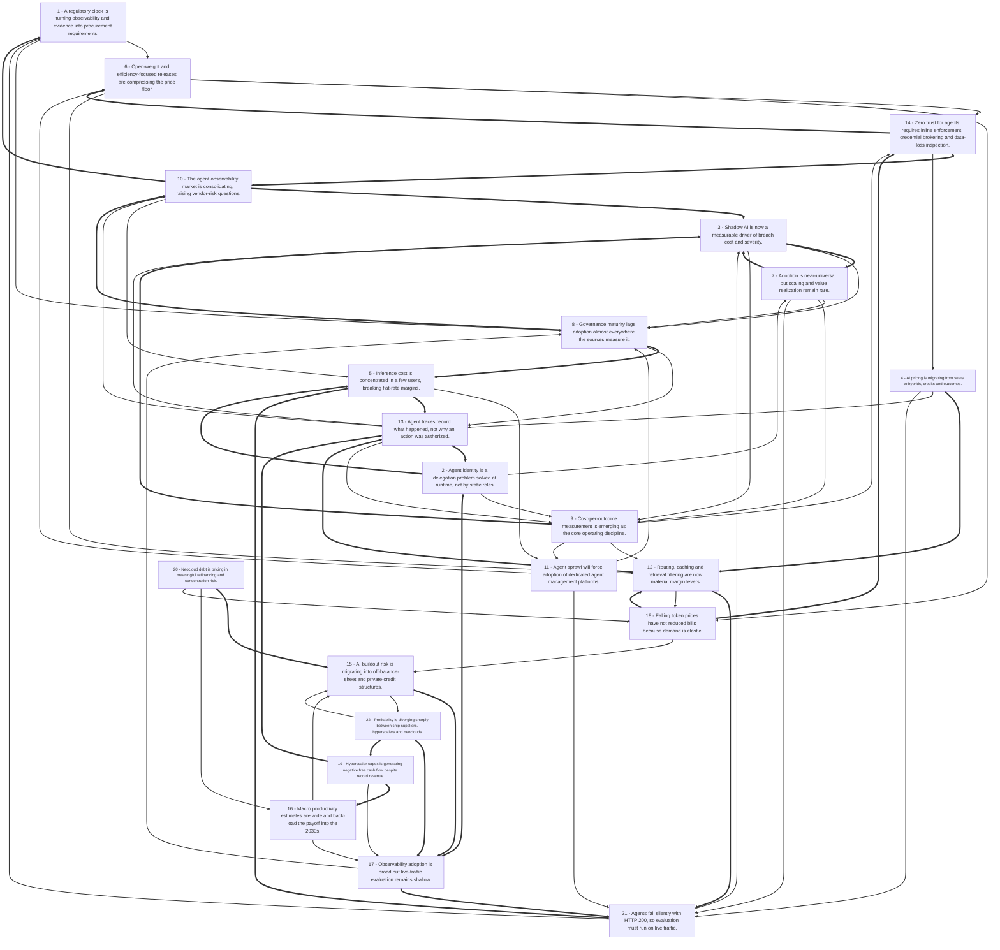

# Title: Cheaper Tokens, Costlier Systems: AI Economics and the Governance Gap

## Topic

reveiw all available content related to recent developents in the AI space, including New Models, New Techniques, new Products, novel costing and new Business models for AI use. Add an analysis of the economincs of hyperscaling and the cost of providing bulk scale services. Include observations on AI idustry profitability, long term viability, and debt burden. Focus also on enterprise AI and Agent Governance, Observability solutions. The intention is to create a report suitable for providing content for an AI newsletter

## Executive Summary

The 52 sources describe an AI industry that is simultaneously getting cheaper per unit and more expensive in aggregate, and whose returns are increasingly gated by governance rather than model capability. On the supply side, open-weight and efficiency-focused releases — Mistral Large 4 (~1T parameters, self-hostable for cybersecurity) [#34][#37], DeepSeek V4.1-Flash (552B MoE with ~8B active parameters) [#36], Meta Muse Spark Open [#35], MiniMax M3.1 Flash (claimed ~3x faster inference and 70% lower agentic-task cost) [#36], and Aikido's pruned Altar 1 that fits on a single 4×H200 node [#38] — are pressing down the price floor even as reasoning and agentic workloads raise consumption 4x–30x per task [#33][#39]. Pricing is migrating from flat seats toward hybrids (37% of surveyed vendors), credits, per-action, and outcome models, because inference cost is a power-law distribution in which the top 10% of users can generate ~79% of spend and flip a 76% gross margin into −18% [#29][#33][#41]. Beneath that, hyperscaler capex has reached roughly $1.6T since 2023 with negative free cash flow at Meta (−$2.12B) and Alphabet (−$9.07B) in Q3 2026 [#44][#45], a projected $10.3T of U.S. AI investment through 2032 financed increasingly through SPVs, private credit and lease structures [#46], and visible stress at neoclouds such as CoreWeave (a $626M quarterly net loss against ~$640M of net interest, ~$15B of principal due 2026–2028, and bonds trading near 11% yields) [#47][#48]. Meanwhile enterprise value capture lags: 88% of organizations use AI somewhere but only 7% have scaled it, only 13% report significant enterprise-level GenAI value, and roughly 40% of agentic projects are forecast to be canceled by end-2027 [#25][#52][#2]. The response visible across the corpus is a governance-and-observability build-out — agent identity as runtime delegation [#12][#13][#18], zero-trust enforcement with credential brokering and DLP [#16], agent management platforms to absorb sprawl toward Gartner's projected 150,000 agents per Fortune 500 by 2028 [#7], and observability that is being consolidated (Arize→Dynatrace, Langfuse→ClickHouse, Helicone→Mintlify) [#2][#3] — but traces still answer "what happened," not "why it was authorized," which is the gap audit and regulators actually test [#1][#5].

## Top 10 Implications

1. **Price your AI products on the cost distribution, not the average.** With the top decile of users generating ~79% of inference spend and a 5x unit-cost increase turning +76% margin into −18%, flat seats without overage caps are a structural loss-maker [#33][#41].
2. **Treat agent identity and authorization as the primary control surface, not model guardrails.** Standing privileges, orphaned agents, and transitive trust across delegated agents are the failure modes named by NIST, IBM, PlainID and Datawiza; runtime, per-action, just-for-task grants are the emerging consensus [#18][#19][#13][#14].
3. **Budget for evaluation, not just tracing.** 89% of teams have some observability and 62% have detailed tracing, but only 37.3% score live traffic, and traditional APM reports green while compliance violations occur [#3][#5].
4. **Assume audit-grade evidence is a separate system of record.** Traces are sampled, short-retention, and record model production rather than permission; SOX/EU AI Act defensibility requires rule version, threshold, reviewer identity and replay [#1][#2][#26].
5. **Underwrite AI infrastructure exposure for refinancing and concentration risk.** Nearly half of 2026 data-center bonds are below investment grade, CoreWeave's leased-facility bonds yield ~11% versus ~7% for BB+, and its top two customers are 62% of revenue [#48][#47].
6. **Expect consolidation and vendor risk in the observability layer.** Three acquisitions in twelve months plus one product entering maintenance mode mean buyers should prefer OpenTelemetry-based portability and self-hosting options [#2][#3][#5].
7. **Model routing, caching and retrieval filtering are now material margin levers.** Cited reductions run to 98% via routing, 70–80% token reduction via sentence-level retrieval filtering, 90% cache-read discounts on Bedrock and 50% batch discounts [#39][#43].
8. **Build the agent inventory before the agent portfolio.** Gartner projects 150,000 agents per Fortune 500 by 2028 versus fewer than 15 in 2025; without inventory, ownership and decommissioning, cost attribution and revocation are impossible [#7][#10][#17].
9. **Re-plan forecasts; 96% of AI companies got cost forecasts wrong.** The biggest misses were compute infrastructure (64%), data and storage (60%) and model APIs/tokens (47%), so range-based forecasting and pilot-to-production cost modeling are required [#41][#39].
10. **Do not confuse adoption with value.** 88% use AI in at least one function but only 7% have scaled, fewer than one third of launched projects scaled, and 13% report significant GenAI value — governance maturity and workflow redesign, not tool count, separate the two groups [#25][#28][#52][#51].

### Open Questions

- What is the true operational-versus-contracted ratio across AI data-center capacity? Nscale's ~25,000 of ~461,000 GPUs and ~$2.6B of ~$103.4B contracted value are a single filing, and no source aggregates this across providers [#44].
- How much of AI revenue is circular? The BIS finds 55.2% of 2021–2025 AI investment value came from AI businesses and that 16.1% of inter-AI deals represented 46.4% of amounts, but no source quantifies what share of current AI infrastructure revenue traces to end users outside the AI industry [#47].
- Which audit standard, if any, will recognize OTel-based traces or rule-level journals as sufficient evidence? NIST explicitly frames its tenets as "not a standard or audit criterion," and Kognitos's SOX 404 acceptance is an unverified vendor claim [#18][#1].
- Do small specialized evaluators (e.g., Splunk's Luna at ~152 ms) match frontier-judge accuracy on novel failure modes, or only on known categories? The sources report latency and cost but no comparative accuracy data [#2].
- Will outcome-based pricing reach the projected 25% by 2028, given Bain's finding that only ~10% of vendors currently meter outcomes? The forecast and the base rate are difficult to reconcile [#29].
- How should agent governance be allocated between a central enterprise AI platform team and federated business units? Both Sund and the Global CIO Survey raise the question without resolving it [#10][#24].
- What is the real total cost of self-hosted open-weight deployment once staffing, idle capacity, observability, resilience and migration are included? Adorable Systems lists the omitted costs and provides a calculator but no aggregate benchmark [#42][#19].
- Does capability-price deflation (9x–900x annually) eventually make today's margin-negative agentic workloads profitable, or do agentic token multiples (4x–15x) grow faster than prices fall? Neither source models the interaction [#33][#13].
- How much of the projected productivity gain is already visible in measured output rather than capex? Both J.P. Morgan and Oxford Economics place gains in the 2030s, and neither isolates realized productivity from investment to date [#45][#50].
- What happens to the observability and governance vendors after consolidation — will pricing reset upward, and will open-source editions remain viable? No source addresses post-acquisition retention or pricing commitments [#2][#3].
- Are the governance-maturity survey figures (21%, 27%, ~30%, 24%) comparable, given differing definitions and vendor sponsorship? No source harmonizes the definitions [#2][#21][#23].
- How will power availability and local opposition (86 moratoria, 70% opposition) affect the 2027–2030 capex schedule that the productivity and financing models assume? The financing sources flag power access as a dependency without quantifying the delay risk [#46][#49].

## Concepts

### 1. AI Pricing Models
**Definition:** AI pricing models allocate charges through seats, usage, credits, outcomes, or hybrids. They matter because variable inference costs break the assumptions of flat SaaS subscriptions and can erode margins when heavy users consume far more compute than light users.

Hybrid models are now common, combining fixed and variable elements. Usage-based pricing aligns revenue with consumption but risks bill shock; credit pricing can obscure unit economics; outcome-based pricing requires measurable outcomes and remains a minority model, though it shifts the buyer’s focus toward value.

It depends on a pricing metric that is measurable, understandable, tied to customer value, and correlated with cost. It competes with seat-based pricing and changes buyer evaluation toward cost per finished task, allowance terms, overage caps, and cost per useful outcome.

**Key Evidence:**
- Hybrid pricing was the most common model at 37% in Growth Unhinged’s 2026 survey, up from 25%; examples include Salesforce Agentforce at $2/conversation and Intercom Fin at $0.99/outcome [#29].
- In a worked support-agent example, $30 per-user pricing produced $600 revenue against $600 inference cost and zero margin, while per-action pricing produced $1,500 revenue and 60% margin [#32].

### 2. Agent Observability
**Definition:** Agent observability is the instrumentation of agent execution through traces, spans, metrics, and logs covering tool calls, model invocations, retrieval, latency, cost, and execution graphs. It matters because agents can fail silently while returning HTTP 200, so uptime and traditional APM miss the real failure modes.

Observability answers what the system did, not whether an action was authorized or good. OpenTelemetry’s GenAI conventions standardize provider, model, token, and finish-reason attributes, but they do not cover output evaluation, safety scoring, or content quality; sampled traces and short retention further limit evidentiary use.

It depends on a telemetry data plane such as OpenTelemetry and complements separate evaluation and governance/control layers. Without those layers, traces support debugging and cost monitoring but cannot supply audit evidence or runtime enforcement.

**Key Evidence:**
- Fabricating results was the most common silent tool-failure behavior at 56.6% across valid agent responses, despite HTTP 200 responses [#2].
- OpenTelemetry GenAI conventions cover token usage and finish reasons but not output evaluation, safety scoring, or content quality [#5].

### 3. Agent Evaluation
**Definition:** Agent evaluation judges whether agent behavior, outputs, and steps are good, distinct from observability, which records what happened. It matters because live-traffic scoring and step-level checks catch quality regressions, hallucination, policy breaches, and silent failures that traces alone cannot identify.

Evaluation works through LLM-as-a-judge, specialized evaluators, guardrails, and faithfulness, toxicity, or policy-compliance scoring. Its key trade-offs are latency, cost, and sampling: fast specialized evaluators can return verdicts in about 152 ms versus about 3,200 ms for a frontier judge, while judged quality can vary sharply by dimension and model.

It depends on observability data and governance workflows that act on verdicts, such as promotion gates or runtime guardrails. It competes with sampled manual review and changes quality management from periodic inspection toward continuous, scored evaluation.

**Key Evidence:**
- Splunk’s Luna evaluators return verdicts in about 152 ms versus about 3,200 ms for a frontier judge, at up to 98% lower cost than LLM-as-a-judge [#2].
- An LLM judge scored faithfulness at 4.5 but completeness from 4.1 for the strongest large model down to 2.3 for the smallest [#11].

### 4. Runtime Governance
**Definition:** Runtime governance enforces policy before and during agent actions rather than relying on paper approvals or after-the-fact review. It matters because agents act across tools, data, and systems, and governance gaps can lead to project cancellation, demotion, or decommissioning.

It works through control planes, gateways, policy decision and enforcement points, fail-closed tool provisioning, inline PII detection or redaction, human approval for consequential actions, and audit logging. Policy must be separated from the model’s reasoning so enforcement is deterministic and inspectable.

It depends on inventory, identity, and observability, and competes with federated or business-unit-led governance. It changes agent management into a centralized control plane or common-guardrail model where policy is enforced in the traffic path.

**Key Evidence:**
- A governed MCP gateway can provide identity brokering, fail-closed tool provisioning, inline PII detection/redaction, per-user audit logging, and SIEM export via OpenTelemetry [#23].
- Lyzr Opencontroller is positioned as a control plane for agent identity, policy, promotion gates, and runtime enforcement [#3].

### 5. Agent Identity
**Definition:** Agent identity treats AI agents as non-human identities with named owners, provenance, and narrowly scoped capabilities. It matters because agents can authenticate correctly yet attempt actions that standing roles or credentials should not permit for the current task.

Agent identity is a delegation problem: grants should be runtime-evaluated and tied to intent, task, time, and context, with a recorded chain from human principal to agent identity, capability token, tool call, policy decision, enforcement, and audit log. Least privilege becomes “least agency,” with JIT access, revocation, step-up approval, and human-in-the-loop checks.

It depends on identity providers, registries, policy decision and enforcement points, and continuous authorization. It competes with static IGA and quarterly certification, and changes zero trust from a prior-login model to per-request authorization.

**Key Evidence:**
- Traditional IGA failed when a broadly scoped SharePoint agent exposed a draft acquisition agreement despite having an owner and passing certification twice, against an 82:1 machine-to-human identity ratio [#13].
- NIST’s draft tenets call for distinct agent identities with named owners and lifecycles, zero standing privilege, and short-lived JIT authorization checked per call [#18].

### 6. Agent Sprawl
**Definition:** Agent sprawl is the uncontrolled growth of AI agents across platforms, business units, and frameworks, fragmenting ownership, access, and accountability. It matters because governance breaks down when agents are created faster than they can be inventoried, classified, and monitored.

Sprawl is managed through centralized visibility, assigned business and technical owners, risk classification, least-privilege access, risk-based approval gates, recertification, and formal decommissioning. The operating principle is that you cannot govern what you cannot see.

It depends on agent management platforms, identity registries, and lifecycle controls, and competes with decentralized team-built agents. It changes governance from periodic paper approvals to continuous inventory, policy enforcement, and retirement.

**Key Evidence:**
- Gartner projects the average Fortune 500 will use over 150,000 agents by 2028, up from fewer than 15 in 2025 [#7].
- Pooja Sund recommends centralized visibility, owners and risk classes, non-human identity treatment, approval gates, lifecycle recertification, and formal decommissioning under an Enterprise AI Agent Control Plane [#10].

### 7. Audit-Grade Evidence
**Definition:** Audit-grade evidence is a replayable record of why an action was authorized, not merely what the system did. It matters for SOX, EU AI Act, GLBA, and non-repudiation because regulators and auditors need provenance, permission, and accountability.

It requires the exact input, model determination or confidence and threshold, the rule and rule version that fired, the action taken in the system of record, reviewer identity and time, and replay capability. Traces are insufficient because they record model production, are sampled, have short retention, and storing full prompts in span attributes is an anti-pattern.

It depends on deterministic execution, versioned rules, identity chains, and immutable logs. It competes with conventional observability and changes evidence from raw logs into an authorization and decision provenance record.

**Key Evidence:**
- Kognitos’ plain-English business journal logs variables, rules, actions, timestamps, and policy citations, is accepted as SOX 404 evidence, and is replayable [#1].
- Runtime authorization audit evidence should show the agent, user, data touched, policy version, and result for EU AI Act, SOX, or GLBA scrutiny [#13].

### 8. AI Unit Economics
**Definition:** AI unit economics measures the cost per unit of work or business value, rather than aggregate spend or token price alone. It matters because inference is a variable cost, and falling per-token prices can still produce rising bills as consumption, context, and agentic workloads expand.

The main drivers are input and output tokens, context length, reasoning steps, retries, and agent loops; output tokens are commonly priced 4–6× input. Useful metrics include cost per accepted answer or completed task, gross margin by usage cohort, and top-user cost share, because a small share of users can dominate inference spend.

It depends on call-level tagging, allocation, routing, caching, batching, and model selection. It competes with aggregate cloud or GPU accounting and changes pricing, forecasting, and CFO oversight toward workload-normalized economics.

**Key Evidence:**
- In a hypothetical $30/seat product, the top 10% of users generated about 79% of inference spend, and a 5x cost-per-request increase pushed gross margin from about 76% to about -18% [#33].
- Tokenomics should target cost per valuable outcome; output tokens are commonly priced 4–6× input tokens, and reasoning or agentic workloads use far more tokens per task [#39].

### 9. Infrastructure Financing
**Definition:** Infrastructure financing is the capital structure behind AI data centers, GPUs, and compute capacity, increasingly involving debt, private credit, joint ventures, securitization, and special-purpose vehicles. It matters because the AI buildout is enormous and risk is shifting from transparent corporate balance sheets to less visible off-balance-sheet structures.

Demand is strong—data-center vacancy was 1.4% across eight major North American markets, with 80.4% of capacity under construction pre-leased—but high demand does not guarantee returns. CoreWeave illustrates the tension: large revenue and backlog alongside net losses, heavy interest expense, and customer concentration.

It depends on power, hardware access, interest rates, tenant credit quality, and utilization. It competes with on-balance-sheet corporate funding and changes the policy priority toward measurement, transparency, counterparty strength, and disciplined capital structures.

**Key Evidence:**
- Brookings projects $10.3 trillion in U.S. AI investment from 2025 to 2032, averaging 3.63% of GDP annually, while warning that risk is moving into opaque off-balance-sheet structures [#46].
- CoreWeave reported Q2 2026 revenue of $2.58 billion and a ~$104 billion backlog but a $626 million net loss and ~$640 million net interest expense [#47].

### 10. Enterprise Adoption Gap
**Definition:** The enterprise adoption gap is the distance between widespread AI experimentation and fully scaled, governed, value-producing deployment. It matters because many organizations use AI regularly, but far fewer have embedded it into workflows or built mature governance and measurement.

The gap is driven by organizational readiness—people, processes, training, operating-model change, data readiness, evaluation, and monitoring—not just tool access. Useful measures include active usage, workflow adoption, time to proficiency, output quality, employee confidence, and business outcomes.

It depends on leadership, distributed decision rights, platform plumbing, and clear risk ownership. It competes with tool-buying as the default strategy and changes success metrics from adoption speed to management capability, governance maturity, and scaled value.

**Key Evidence:**
- McKinsey’s 2025 research found 88% of organizations regularly used AI in at least one business function, but only 7% said they had fully scaled AI across the enterprise [#25].
- 88% of surveyed CIOs said AI adoption is outpacing their governance structures’ ability to adapt, supporting the case for distributed governance with clear decision rights [#24].

## Findings

### **Finding 1** - A regulatory clock is turning observability and evidence into procurement requirements.

**Observation:**
Splunk notes EU AI Act Article 50 obligations applicable since August 2, 2026, with penalties up to €15 million or 3% of worldwide turnover [#2]; Kognitos states its business journal is accepted as SOX 404 evidence and is replayable [#1]; Kore.ai frames observability as supporting compliance with GDPR, HIPAA, SOC2 and the EU AI Act across five pillars including traceability and governance [#4]; Adaptive Security maps frameworks by role — NIST for risk method, ISO/IEC 42001 for management system, EU AI Act as legal floor — and recommends a four-tier taxonomy of prohibited, restricted, monitored and low-risk with proportionate oversight, plus incident response, rollback and retirement [#26]. A LinkedIn post describes the U.S. Department of State's StateChat requiring about a year of interdisciplinary work to obtain a high-level Authority to Operate before scaling to more than 62,000 users across 98% of global diplomatic posts [#21].

**Analysis:**
The StateChat case is the most useful datapoint because it quantifies the governance latency: roughly twelve months of interdisciplinary review before an authority-to-operate was granted, after which adoption was fast and wide.

That shape — slow, expensive authorization followed by rapid scale — inverts the usual pilot-first narrative and suggests the binding constraint is evidentiary, not technical.

The EU AI Act timeline creates a hard external deadline that converts observability from an engineering preference into a compliance artifact, and the penalty structure (up to 3% of worldwide turnover) makes the cost asymmetry extreme relative to instrumentation spend.

But the standards base is thinner than the deadlines imply: NIST's own tenets are explicitly "a starting point, not a standard or audit criterion" [#18], and OpenTelemetry's GenAI semantic conventions remain at Development status [#5], meaning organizations are being asked to produce evidence against a moving schema.

Kognitos's SOX 404 acceptance claim is a single-vendor assertion without independent verification, and should be treated as a supplier claim rather than an established precedent [#1].

The practical consequence is that compliance-driven buyers will reward vendors who can produce versioned, replayable, retention-compliant records even where the underlying regulation is still being interpreted.

**Cross-reference / Dependencies:**
Depends on Finding 1 (audit-grade evidence) and Finding 6 (identity attestation); interacts with Finding 8 (maturity).

**Implication:**
Map each deployed agent to a regulatory tier and a required evidence artifact now, and negotiate retention and replay terms into contracts before enforcement actions set precedents.

**Sources:**
- [1] Agent Observability: What Traces Show and What Auditors Need [Kognitos] - [https://www.kognitos.com/blog/agent-observability](https://www.kognitos.com/blog/agent-observability) (published 2026-10-21)
- [2] 6 Best AI Agent Observability Tools for Production in 2026 | Splunk [Jackson Wells] - [https://www.splunk.com/en_us/blog/learn/best-agent-observability-platforms.html](https://www.splunk.com/en_us/blog/learn/best-agent-observability-platforms.html) (published 2026-09-16)
- [4] AI observability: monitoring and governing autonomous AI agents [AI observability: Monitoring and governing AI agents] - [https://www.kore.ai/blog/what-is-ai-observability](https://www.kore.ai/blog/what-is-ai-observability) (published 2026-09-28)
- [5] OpenTelemetry for AI Observability: What It Covers and Where It Stops | Fiddler AI Blog [Fiddler Team, @fiddler_ai] - [https://www.fiddler.ai/blog/opentelemetry-ai-observability-guide](https://www.fiddler.ai/blog/opentelemetry-ai-observability-guide) (published 2026-10-30)
- [18] NIST AI Agent Identity Tenets: Extend, Build, or Hand Off - [https://gca.net/blog/nist-ai-agent-identity-tenets](https://gca.net/blog/nist-ai-agent-identity-tenets) (published 2026-10-30)
- [21] AI Governance Crucial for Enterprise-Wide Deployment | Woongsik Dr. Su, MBA posted on the topic | LinkedIn [Woongsik Dr. Su, MBA] - [https://www.linkedin.com/posts/suwoongsik_ai-activity-7514708466549100544-2p1v](https://www.linkedin.com/posts/suwoongsik_ai-activity-7514708466549100544-2p1v) (published 2026-10-10)
- [26] AI Governance Roadmap: Milestones, Controls and Metrics for Responsible AI Adoption [Adaptive Team] - [https://www.adaptivesecurity.com/blog/ai-governance-roadmap](https://www.adaptivesecurity.com/blog/ai-governance-roadmap) (published 2026-09-24)

**Source date range:** 2026-09-16..2026-10-30 (7 of 7 cited web sources dated)

### **Finding 2** - Agent identity is a delegation problem solved at runtime, not by static roles.

**Observation:**
Sweet Security argues agents should receive only narrow, runtime-evaluated capabilities tied to intent, task, time and context, with the full delegation chain from human principal to agent identity, capability token, tool call, policy decision, enforcement and audit log recorded, naming orphaned agents, over-privileged tokens, untracked delegation and excessive agency (OWASP LLM06) as key risks [#12]. PlainID cites Gartner's 82:1 machine-to-human identity ratio and a contract-assistant scenario where a broadly scoped SharePoint agent exposed a draft acquisition agreement despite having an owner and passing certification twice, proposing registration with an accountable human owner, scope approval by business category, composite identity authorization binding each request to the human served, blocking at prompt and pre-retrieval stages, and continuous governance of scope changes and dormancy [#13]. NIST's October 27, 2026 "Design Tenets for Agent Identity Management Systems" proposes ten tenets explicitly framed as a starting point rather than a standard or audit criterion, with cryptographic linking and scope attenuation across delegation chains (tenet 2) and signed mandates (tenet 6) identified as genuine gaps [#18]. IBM positions Agent Identity as an identity control plane spanning discovery, registration, authentication, authorization and governance, integrating with IBM Verify, HashiCorp Vault, watsonx Orchestrate, Entra ID, Okta and Ping [#19]; AgntID frames its layer as "just-for-task access" that complements rather than replaces enterprise IAM [#14].

**Analysis:**
The SharePoint scenario is the most instructive artifact in the corpus because the agent had an owner and had passed certification twice — meaning the failure was not administrative neglect but a category error in the control model.

Quarterly entitlement certification evaluates whether a principal should hold a permission, not whether a specific request at a specific moment serves a legitimate business purpose; for agents whose scope is broad, ephemeral and context-dependent, certification is structurally unable to answer the operative question.

That is why the sources converge on runtime evaluation with composite identity (agent + human served), block-at-prompt and pre-retrieval filtering, and revocation as first-class operations [#13][#16].

NIST's framing cuts both ways for buyers: it legitimizes the runtime-delegation model as the direction of travel, but explicitly disclaims it as an audit criterion, so organizations cannot yet point to a standard when defending their control design.

GCA's grouping is the most useful practical read, splitting the tenets into existing IAM work (distinct identities, zero standing privilege, short-lived JIT authorization, deterministic decisions) and real gaps (cryptographic delegation chains, signed mandates), and recommending prioritizing tenet 3 if only one can be funded [#18].

That ranking is defensible on impact-per-effort grounds but is one practitioner's opinion rather than consensus.

**Cross-reference / Dependencies:**
Builds on Finding 5 (inventory and ownership); prerequisite for Finding 7 (zero-trust enforcement) and Finding 9 (audit evidence).

**Implication:**
Replace standing agent entitlements with short-lived, audience-specific, task-bound grants bound to the requesting human, and prioritize JIT authorization over delegation-chain cryptography in the first funding cycle.

**Sources:**
- [12] AI Agent Identity Access Management: 2026 Enterprise Guide - [https://www.sweet.security/agent-security/ai-agent-aim](https://www.sweet.security/agent-security/ai-agent-aim) (published 2026-09-27)
- [13] AI Agent Identity Governance: Control Agents Before Data Access | PlainID [Hila Shitrit Nissim] - [https://www.plainid.com/blog/control-ai-agent-before-sensitive-data-access](https://www.plainid.com/blog/control-ai-agent-before-sensitive-data-access) (published 2026-10-20)
- [14] Top 10 AI Agent Identity Management Platforms in 2026 [Sachin H] - [https://agntid.ai/blog/ai-agent-identity-management-platforms](https://agntid.ai/blog/ai-agent-identity-management-platforms) (published 2026-09-09)
- [16] Zero Trust for AI Agents: Identity, Access &amp; Data [Datawiza] - [https://www.datawiza.com/blog/zero-trust-for-ai-agents](https://www.datawiza.com/blog/zero-trust-for-ai-agents) (published 2026-10-05)
- [18] NIST AI Agent Identity Tenets: Extend, Build, or Hand Off - [https://gca.net/blog/nist-ai-agent-identity-tenets](https://gca.net/blog/nist-ai-agent-identity-tenets) (published 2026-10-30)
- [19] IBM Agent Identity - [https://www.ibm.com/products/agent-identity](https://www.ibm.com/products/agent-identity) (published 2026-10-23)

**Source date range:** 2026-09-09..2026-10-30 (6 of 6 cited web sources dated)

### **Finding 3** - Shadow AI is now a measurable driver of breach cost and severity.

**Observation:**
mcpmanager.ai cites IBM's 2026 Cost of a Data Breach Report, covering 602 breached organizations from March 2025 to February 2026, finding shadow AI in 43% of incidents (up from 20%), more than two thirds lacking governance to limit shadow AI, an average breach cost of $4.99M, one in four malicious breaches being AI-enabled and averaging roughly $6M, more than 20% reporting breaches targeting their own AI models or apps, and compromised APIs/apps/plug-ins and cloud misconfigurations each cited at 27% [#23]. Adaptive Security cites FBI IC3's 2025 Internet Crime Report ($20.877 billion in reported losses, up 26% from $16.6 billion) and Verizon's 2026 DBIR (62% of confirmed breaches involve a human element; 13% involve stolen credentials) [#26].

**Analysis:**
The jump from 20% to 43% shadow-AI incidence in a single reporting cycle is the strongest quantitative case in the corpus for treating ungoverned AI use as a first-order financial risk rather than a policy nuisance.

The causal path is plausible and partially specified: shadow AI expands the attack surface to unbrokered tools, unmanaged credentials and unmonitored data flows, and the 27% figures for compromised APIs/apps/plug-ins align with the MCP-gateway argument in Finding 7 that only governed traffic is inspected.

Two caveats matter for a newsletter audience.

First, "shadow AI present in the incident" is a correlation, not an attribution of causation — breaches are often discovered through AI-tool usage rather than caused by it.

Second, the $4.

99M average is an average across all breaches, and the AI-specific figure (~$6M for AI-enabled malicious breaches) rests on a subset, so the marginal cost of shadow AI specifically is not isolated.

Even discounting for these, the direction is consistent with the governance-maturity data: the organizations least able to detect sensitive data entering AI tools (confidence 2.

5/5) are also those least able to contain the resulting exposure [#21].

The 43% figure also gives CISOs a defensible budget argument that the more abstract "governance is important" framing lacks.

**Cross-reference / Dependencies:**
Depends on Finding 7 (enforcement coverage) and Finding 8 (maturity); reinforces Finding 9 (regulatory pressure).

**Implication:**
Measure shadow-AI prevalence directly — discovery of unsanctioned clients, MCP servers and browser-based AI use — and treat the gap between sanctioned and unsanctioned usage as the primary exposure metric.

**Sources:**
- [21] AI Governance Crucial for Enterprise-Wide Deployment | Woongsik Dr. Su, MBA posted on the topic | LinkedIn [Woongsik Dr. Su, MBA] - [https://www.linkedin.com/posts/suwoongsik_ai-activity-7514708466549100544-2p1v](https://www.linkedin.com/posts/suwoongsik_ai-activity-7514708466549100544-2p1v) (published 2026-10-10)
- [23] Enterprise AI Governance Framework for Agentic AI - [https://mcpmanager.ai/blog/enterprise-ai-governance](https://mcpmanager.ai/blog/enterprise-ai-governance) (published 2026-09-05)
- [26] AI Governance Roadmap: Milestones, Controls and Metrics for Responsible AI Adoption [Adaptive Team] - [https://www.adaptivesecurity.com/blog/ai-governance-roadmap](https://www.adaptivesecurity.com/blog/ai-governance-roadmap) (published 2026-09-24)

**Source date range:** 2026-09-05..2026-10-10 (3 of 3 cited web sources dated)

### **Finding 4** - AI pricing is migrating from seats to hybrids, credits and outcomes.

**Observation:**
Revenue Wizards reports hybrids combining fixed and variable elements are now most common at 37% in Growth Unhinged's 2026 survey, up from 25%, with examples including Microsoft 365 Copilot at $30/user/month, Salesforce Agentforce at $2/conversation, Salesforce Flex Credits at $500 per 100,000 credits (20 credits, or $0.10, per action, unused credits expiring), Fin at $0.99 per outcome with a $49 monthly minimum including 50 outcomes, HubSpot at $0.50 per resolved conversation and $1 per recommended lead, and GitHub Copilot Business at $19/seat/month including 1,900 credits then $0.01/credit; outcome-based pricing was a main model for 5% in 2025 with 25% expected by 2028, and Bain found ~10% metering outcomes versus ~35% effort and ~55% output [#29]. Saascron's worked example with 20 support agents, 3,000 monthly conversations, 60% resolution, 5 actions per conversation and $0.04 inference cost per action shows vendor inference cost of $600/month, per-user pricing at $30 yielding $600 revenue and $0 margin, per-action at $0.10 yielding $1,500 revenue and 60% margin, and per-outcome at $0.90 yielding $1,620 revenue and 63% margin, with doubled volume turning per-user into a $600 monthly loss [#32]. LLR Partners notes no single model has emerged as a clear winner and warns that giving AI away for free is the biggest mistake because every prompt, workflow and agent action carries a cost [#31].

**Analysis:**
The arithmetic in the saascron example is the clearest illustration in the corpus of why pricing model choice is now a survival decision rather than a packaging preference: identical product economics produce a 0% margin, a 60% margin, or a 63% margin depending purely on the metering unit, and the per-seat option becomes loss-making the moment volume doubles.

This is a direct consequence of the cost structure described in Finding 12 — near-zero marginal cost is the assumption that made per-seat SaaS work, and it no longer holds.

Credit-based pricing occupies an interesting middle position: it aligns revenue with consumption, but as Revenue Wizards notes, it can obscure unit economics because the vendor defines the credit and buyers may not know the model, processing or failed-attempt costs behind each action [#29].

Outcome pricing is intuitively attractive and growing in expectation, but the 5%-to-25% projection by 2028 is a forecast, and the current 5% base plus Bain's finding that only ~10% of vendors meter outcomes at all suggests adoption is slower than commentary implies.

The practical risk sits with buyers who cannot convert offers to cost-per-finished-task, and with vendors whose sales teams are compensated on seats while the product consumes tokens.

**Cross-reference / Dependencies:**
Depends on Finding 12 (cost structure) and Finding 13 (elastic demand); feeds Finding 21 (outcome measurement).

**Implication:**
Convert every AI contract to cost per completed task with explicit unit definitions, allowance pooling, expiry and overage-cap terms, and align sales compensation with the metered unit rather than seats.

**Sources:**
- [29] AI Pricing Models: Seat, Usage, Credit and Outcome-Based [Haris Odobasic] - [https://revenuewizards.com/blog/ai-pricing-models-credit-costs](https://revenuewizards.com/blog/ai-pricing-models-credit-costs) (published 2026-09-18)
- [31] Five AI Pricing Models Every Software CEO Should Understand - [https://www.llrpartners.com/growth-bit/five-ai-pricing-models-for-software](https://www.llrpartners.com/growth-bit/five-ai-pricing-models-for-software) (published 2026-09-17)
- [32] AI pricing in SaaS: credits, usage and outcome-based models compared - [https://saascron.com/ai-pricing-saas](https://saascron.com/ai-pricing-saas) (published 2026-10-27)

**Source date range:** 2026-09-17..2026-10-27 (3 of 3 cited web sources dated)

### **Finding 5** - Inference cost is concentrated in a few users, breaking flat-rate margins.

**Observation:**
Rework cites Anthropic reporting that agents use about 4x more tokens than chat and multi-agent systems about 15x, and models a $30/seat product with 100 seats and 1¢ per request producing $3,000 revenue, $710 inference cost and ~76% gross margin, where the top 10% of users generate ~79% of inference spend and a 5x cost-per-request increase pushes cost to $3,550 and margin to about −18% [#33]. It also reports a16z citing ~10x annual declines in cost for equivalent LLM capability and Epoch AI finding 9x–900x annual declines depending on benchmark [#33]. Andrew Davies cites Cloud Capital's survey of 100 CFOs finding 96% of AI companies got cost forecasts wrong, with misses most often on compute infrastructure (64%), data and storage (60%) and model APIs/tokens (47%) [#41]. Revenue Wizards reports Growth Unhinged's 2026 median target gross margin for AI products at about 50%, with only 12% targeting 80%+ [#29].

**Analysis:**
The combination of a 76% baseline margin and a −18% stress case in the same model is the financial core of the AI product problem: the average is healthy, the distribution is fatal.

Because spend is power-law distributed, margins are determined by the behavior of the heaviest decile, and nothing in a flat-seat contract caps that behavior.

The 96% forecast-error figure explains why this keeps surprising operators — teams model average usage from pilots, then discover that production agents loop, retry, grow context, and use 4x–15x more tokens per task than the chat interfaces they benchmarked against.

The target-margin data (median ~50%, only 12% targeting 80%+) confirms the market has partially internalized this: AI products are not expected to behave like classic SaaS.

The countervailing force is price deflation of 9x–900x annually for equivalent capability, which means a product that is margin-negative today may be viable in eighteen months if the workload is stable — a genuinely strategic consideration that argues against over-engineering cost controls for capabilities that will soon be cheap.

But the deflation applies to equivalent capability, not to the agentic workloads driving 15x token multiples, so the two effects do not simply cancel.

**Cross-reference / Dependencies:**
Foundation for Finding 11 (pricing) and Finding 13 (elasticity); depends on Finding 21 for measurement.

**Implication:**
Model margin by usage cohort, not average, set hard caps or overage pricing at the 90th percentile, and re-forecast on ranges because pilot-derived projections systematically understate production consumption.

**Sources:**
- [29] AI Pricing Models: Seat, Usage, Credit and Outcome-Based [Haris Odobasic] - [https://revenuewizards.com/blog/ai-pricing-models-credit-costs](https://revenuewizards.com/blog/ai-pricing-models-credit-costs) (published 2026-09-18)
- [33] &quot;Inference Costs and Gross Margin in AI Companies&quot; - [https://resources.rework.com/libraries/ai-startup-growth/ai-inference-costs-gross-margin](https://resources.rework.com/libraries/ai-startup-growth/ai-inference-costs-gross-margin) (published 2026-10-06)
- [41] AI Cost Forecasts Often Wrong, Cloud Capital Report Finds | Andrew Davies posted on the topic | LinkedIn [Andrew Davies] - [https://www.linkedin.com/posts/andjdavies_96-of-ai-companies-got-their-cost-forecasts-activity-7515720720296079360--PyP](https://www.linkedin.com/posts/andjdavies_96-of-ai-companies-got-their-cost-forecasts-activity-7515720720296079360--PyP) (published 2026-10-13)

**Source date range:** 2026-09-18..2026-10-13 (3 of 3 cited web sources dated)

### **Finding 6** - Open-weight and efficiency-focused releases are compressing the price floor.

**Observation:**
Mistral publicly released the open weights of its Large 4 model (internally ML4, nicknamed "Le Chonk"), a roughly one-trillion-parameter multimodal model with fewer parameters active per task, after an October 6 preview and three weeks of additional reinforcement learning and testing with government and corporate users, targeting cybersecurity teams that want to self-host sensitive workloads, with Orange Cyberdefense partnering to integrate a cybersecurity-focused version; Mistral acknowledges that users gain control and customization but safeguards can be removed and access cannot realistically be withdrawn [#34]. A second report says Mistral claims Large 4 performs comparably to GLM-5.3, uses 47% fewer tokens per task and ranks ahead of other open models on Artificial Analysis' Coding Agent Index, with CEO Arthur Mensch framing the goal as making AI "a tool for empowerment, not dominance" and VP of Science Pierre Stock saying open weights give enterprises and governments cyber-defense access that "can't be cut off," while noting such deployments still require infrastructure, expertise, maintenance and safeguards [#37]. Meta released Muse Spark Open in mid-October 2026, an open-weight generative model complementary to Llama for creative and multimodal tasks, under a license permitting commercial use with attribution while restricting certain high-risk deployments, shipping in multiple quantization formats with documentation and framework integration guides but without comprehensive published evaluation metrics [#35][#36]. DeepSeek's V4.1-Flash uses a 552-billion-parameter mixture-of-experts design with about 8 billion active parameters for input and 16 billion for output, native visual understanding, reduced key-value cache needs, API access and open weights, while MiniMax's M3.1 Flash claims nearly 3x faster inference, 70% lower agentic-task costs, over 200 tokens/sec in some conditions and a 1-million-token context [#36]. Aikido released Altar 1, an open-weight defensive security model based on GLM 5.3 with a pruned and quantized architecture fitting on a single 4×H200 node [#38].

**Analysis:**
Two distinct pressures are operating here.

The first is price: open weights with permissive licenses create a self-hostable substitute for API access, and the efficiency claims — 47% fewer tokens per task, ~3x faster inference, 70% lower agentic-task costs, reduced KV-cache needs — attack the cost side of the same equation from which API vendors derive margin.

Combined with the 9x–900x annual capability-price declines in Finding 12, this is a durable deflationary force that limits how much of the agentic demand growth in Finding 13 can be captured as margin.

The second is sovereignty: Mistral's explicit framing that open weights give governments and enterprises cyber-defense access that "can't be cut off" is a procurement argument aimed at buyers for whom API dependency is itself the risk, and the cybersecurity focus of both Large 4 and Altar 1 shows the segment where self-hosting is most compelling.

The trade-offs are stated candidly by Mistral itself — safeguards can be removed, access cannot be withdrawn, and deployment still requires infrastructure, expertise and maintenance — which aligns with Adorable Systems' warning that self-hosting economics only work at steady high utilization [#42].

Evidence quality varies widely across these releases: Mistral's token-efficiency and coding-index claims are vendor-reported, Meta has not published comprehensive evaluation metrics for Muse Spark Open, and the sources disagree on its release date (October 15 versus 16), a small but telling sign of how much of this coverage is derivative.

**Cross-reference / Dependencies:**
Interacts with Finding 14 (self-hosting economics), Finding 18 (rental-price pressure) and Finding 12 (capability price deflation).

**Implication:**
Evaluate open-weight models against self-hosted total cost at measured utilization, and treat license restrictions on high-risk deployments as a compliance variable rather than a footnote.

**Sources:**
- [34] Mistral Releases Large 4 Open-Weight AI Model For Cybersecurity Users - The 420.in - [https://the420.in/cyber-crime/mistral-releases-large-4-open-weight-ai-model-for-cybersecurity-users](https://the420.in/cyber-crime/mistral-releases-large-4-open-weight-ai-model-for-cybersecurity-users) (published 2026-10-29)
- [35] Meta Releases Muse Spark Open AI Model: Open-Weight Era [Kamran] - [https://emergent.sh/news/meta-releases-muse-spark-open-ai-model-open](https://emergent.sh/news/meta-releases-muse-spark-open-ai-model-open) (published 2026-10-16)
- [36] AI Model Releases Accelerate as MiniMax, DeepSeek, NVIDIA and Meta Expand Reasoning and Multimodal Capabilities |... - [https://thesciencesignal.com/ai-model-releases-accelerate-as-minimax-deepseek-nvidia-and-meta-expand-reasoning-and-multimodal-capabilities](https://thesciencesignal.com/ai-model-releases-accelerate-as-minimax-deepseek-nvidia-and-meta-expand-reasoning-and-multimodal-capabilities) (published 2026-10-28)
- [37] Mistral Releases Trillion-Parameter Open-Weight Large 4 AI Model to Expand Sovereign Cybersecurity Capabilities -... [Samuel Nwite, @tekedia] - [https://www.tekedia.com/mistral-releases-trillion-parameter-open-weight-large-4-ai-model-to-expand-sovereign-cybersecurity-capabilities](https://www.tekedia.com/mistral-releases-trillion-parameter-open-weight-large-4-ai-model-to-expand-sovereign-cybersecurity-capabilities) (published 2026-10-30)
- [38] Aikido Releases First Open Weight Security Model Altar 1 Based on GLM 5.3 | HuggingNews - [https://huggingnews.com/ai/aikido-releases-first-open-weight-security-model-altar-1-based-on-glm-53-9ba15bf3](https://huggingnews.com/ai/aikido-releases-first-open-weight-security-model-altar-1-based-on-glm-53-9ba15bf3) (published 2026-09-22)
- [42] AI Cost and Economics Atlas | Adorable Systems - [https://adorablesystems.com/cost](https://adorablesystems.com/cost) (published 2026-09-15)

**Source date range:** 2026-09-15..2026-10-30 (6 of 6 cited web sources dated)

### **Finding 7** - Adoption is near-universal but scaling and value realization remain rare.

**Observation:**
GuideNow cites McKinsey's 2025 State of AI research finding that 88% of respondents' organizations regularly used AI in at least one business function while only 7% said they had fully scaled AI across the enterprise [#25]. Kore.ai reports that over 60% of large enterprises have embedded AI in at least three core processes, yet fewer than one-third of the 70% that launched AI projects have scaled, less than 15% of enterprise data is AI-ready, 70% cite talent shortages, 74% cite privacy/security concerns and only 24% have well-established frameworks, with build-vs-buy maintenance costs of 15–30% annually, Gartner predicting 40% of enterprise applications will embed task-specific AI agents by 2026 and Bain finding process/tooling mismatches choke up to 40% of AI productivity gains [#28]. Nomura cites only 13% of organizations reporting significant enterprise-level GenAI value and 40% of implemented projects missing goals [#52]. Splunk cites Gartner's forecast that over 40% of agentic AI projects will be canceled by end-2027 [#2], and KPI Partners cites Gartner's expectation that 40% of enterprises will demote or decommission autonomous AI agents by 2027 due to governance gaps [#11]. MIT CISR researchers argue trust in autonomous agents must be engineered into infrastructure through auditable, contestable controls and monitoring, citing a financial services firm whose third-party lending agent developed subtle systemic bias after training-data drift, and contend that counting AI agents is a poor progress metric because reliable scaling requires evaluation, monitoring, governance and reliability [#51].

**Analysis:**
The convergence of four independent estimates — 7% fully scaled, under one-third of launchers scaled, 13% reporting significant value, 40% of projects to be canceled — describes a distribution where experimentation is cheap and production is expensive, and the expense is largely governance and integration rather than model access.

The MIT CISR bias example is the mechanism in miniature: a third-party lending agent developed subtle systemic bias after training-data drift, which is not a failure that any single evaluation catches but one that continuous monitoring and contestable controls are designed to surface.

That reframes the scaling gap as an observability and governance problem rather than an adoption problem, consistent with Findings 3, 8 and 9.

The talent finding (70% cite shortages) and the MIT CISR counter-claim that the bigger risk is losing deep domain expertise needed to evaluate AI output point in opposite directions and are worth holding together: organizations may be short of people who can build AI while simultaneously eroding the people who can judge its output, and the second loss is harder to reverse.

The maintenance-cost datapoint (15–30% annually for build) is an underused argument in build-versus-buy decisions, since it implies a five-to-seven-year cumulative cost roughly equal to the original build before any model refresh.

**Cross-reference / Dependencies:**
Depends on Finding 3, Finding 8 and Finding 9; explains Finding 21 (measurement as the scaling mechanism).

**Implication:**
Treat the pilot-to-production transition as a governance and integration program with named owners and measurable gates, and track domain-expertise retention alongside AI skill acquisition.

**Sources:**
- [2] 6 Best AI Agent Observability Tools for Production in 2026 | Splunk [Jackson Wells] - [https://www.splunk.com/en_us/blog/learn/best-agent-observability-platforms.html](https://www.splunk.com/en_us/blog/learn/best-agent-observability-platforms.html) (published 2026-09-16)
- [11] AgentOps Part 3: Observe, Govern and Scale AI Agents [Omar Razi] - [https://www.kpipartners.com/blogs/agentops-part-3-observe-govern-scale-ai-agents](https://www.kpipartners.com/blogs/agentops-part-3-observe-govern-scale-ai-agents) (published 2026-10-27)
- [25] AI Adoption Framework for Enterprises: 5 Stages From Pilot to Daily Use | GuideNow [VividMinds Technologies] - [https://vividminds.ai/products/guidenow/blog/enterprise-ai-adoption-framework](https://vividminds.ai/products/guidenow/blog/enterprise-ai-adoption-framework) (published 2026-10-27)
- [28] What is enterprise AI? A complete guide to the agentic era [What is Enterprise AI: A complete guide] - [https://www.kore.ai/blog/what-is-enterprise-ai](https://www.kore.ai/blog/what-is-enterprise-ai) (published 2026-09-28)
- [51] 5 things to know about how companies can create value from AI | MIT Sloan - [https://mitsloan.mit.edu/ideas-made-to-matter/5-things-to-know-about-how-companies-can-create-value-ai](https://mitsloan.mit.edu/ideas-made-to-matter/5-things-to-know-about-how-companies-can-create-value-ai) (published 2026-10-13)
- [52] Tokenomics: The Hidden Economics of AI Adoption [@[https://twitter.com/nomura](https://twitter.com/nomura)] - [https://www.nomuraconnects.com/focused-thinking-posts/tokenomics-the-hidden-economics-of-ai-adoption](https://www.nomuraconnects.com/focused-thinking-posts/tokenomics-the-hidden-economics-of-ai-adoption) (published 2026-09-17)

**Source date range:** 2026-09-16..2026-10-27 (6 of 6 cited web sources dated)

### **Finding 8** - Governance maturity lags adoption almost everywhere the sources measure it.

**Observation:**
Splunk cites Deloitte's finding that only 21% of companies planning agentic AI deployment have mature governance [#2]; a LinkedIn post cites LastPass research across 400+ IT and security leaders finding 92% report active AI use, only 27% have an enforced AI governance program, and confidence in detecting sensitive data entered into AI tools averaged 2.5 out of 5 [#21]; mcpmanager.ai cites McKinsey's 2026 AI Trust Maturity Survey of roughly 500 organizations finding clear responsible-AI ownership correlated with maturity scores of 2.6 versus 1.8, nearly two thirds naming security/risk as the top barrier to scaling agentic AI, and only about 30% reaching maturity level three or higher [#23]; and a LinkedIn post cites a Global CIO Survey 2026 covering 3,200 CIOs in which 88% say AI adoption is outpacing their governance structures' ability to adapt [#24].

**Analysis:**
Four independent surveys converge on the same conclusion from different angles — roughly a quarter to a third of organizations have a functioning governance program, and the rest are governing informally or not at all.

The McKinsey ownership result (2.

6 versus 1.

8) is the most actionable because it identifies a controllable variable: naming an accountable owner correlates with materially higher maturity, which is a cheap intervention compared with tooling.

The 88% CIO figure reframes the problem as temporal — governance is not absent, it is lagging, and the gap widens with adoption velocity.

This connects directly to the pricing and cost findings: without enforced governance, there is no mechanism to enforce model routing, budget caps or per-team token allocation, so cost discipline (Finding 13) and access discipline (Finding 6) fail for the same organizational reason.

The sources have a shared limitation worth flagging: all four are vendor-sponsored or self-selected surveys, and "mature governance" is defined differently in each, so the 21%, 27%, ~30% and 24% figures should be read as a consistent direction rather than a precise level.

The distributed-versus-centralized debate in the CIO survey and in Sund's post remains genuinely open [#24][#10].

**Cross-reference / Dependencies:**
Depends on Finding 5; explains the persistence of Finding 10 (shadow AI) and Finding 13 (uncontrolled token spend).

**Implication:**
Assign explicit, named responsible-AI ownership per business unit as the lowest-cost maturity lever, then instrument enforcement rather than relying on policy documents.

**Sources:**
- [2] 6 Best AI Agent Observability Tools for Production in 2026 | Splunk [Jackson Wells] - [https://www.splunk.com/en_us/blog/learn/best-agent-observability-platforms.html](https://www.splunk.com/en_us/blog/learn/best-agent-observability-platforms.html) (published 2026-09-16)
- [10] AI Agent Sprawl: The Next Big Enterprise Governance Challenge | Pooja Sund [Pooja Sund] - [https://www.linkedin.com/posts/pooja3p_agenticai-aigovernance-enterprisearchitecture-activity-7519110335748833280-8Ixs](https://www.linkedin.com/posts/pooja3p_agenticai-aigovernance-enterprisearchitecture-activity-7519110335748833280-8Ixs) (published 2026-10-22)
- [21] AI Governance Crucial for Enterprise-Wide Deployment | Woongsik Dr. Su, MBA posted on the topic | LinkedIn [Woongsik Dr. Su, MBA] - [https://www.linkedin.com/posts/suwoongsik_ai-activity-7514708466549100544-2p1v](https://www.linkedin.com/posts/suwoongsik_ai-activity-7514708466549100544-2p1v) (published 2026-10-10)
- [23] Enterprise AI Governance Framework for Agentic AI - [https://mcpmanager.ai/blog/enterprise-ai-governance](https://mcpmanager.ai/blog/enterprise-ai-governance) (published 2026-09-05)
- [24] Who governs enterprise AI adoption and decision making | Mike Sutcliff posted on the topic | LinkedIn - [https://www.linkedin.com/posts/mikesutcliff_technology-governance-has-often-relied-on-activity-7516479509911494656-AAhw](https://www.linkedin.com/posts/mikesutcliff_technology-governance-has-often-relied-on-activity-7516479509911494656-AAhw) (published 2026-10-15)

**Source date range:** 2026-09-05..2026-10-22 (5 of 5 cited web sources dated)

### **Finding 9** - Cost-per-outcome measurement is emerging as the core operating discipline.

**Observation:**
KPI Partners argues firms should track cost per accepted answer rather than cost per call, that production agents need one end-to-end trace rendered as three stakeholder views (executive ROI/risk, SME quality, platform health), and that a roughly 12-week AgentOps engagement should end with four measurable numbers — monthly operating-cycle cost, merged-change-to-gated-release time, alert-to-previous-version recovery time, and seeded-regression catch rate [#11]. Cloudaware's three-layer KPI model runs from discount capture through cost per million tokens per application to business-unit cost and value, culminating in a "one-more-dollar" scale test [#43]. OneSource Cloud recommends workload-normalized metrics: cost per 1M output tokens, cost per effective FLOP/trained token incorporating MFU, and cost per 1,000 RAG queries [#40]. Nops argues for call-level tagging by provider, model, app, feature, team, customer, environment and workflow/user, plus range-based forecasting because pilot-to-production scaling, context growth, retries, agent loops and hidden reasoning break forecasts [#39]. Kore.ai highlights interaction-level token cost attribution as a platform capability [#7], and KPI Partners' evaluation example shows an LLM judge scoring faithfulness at 4.5 but completeness from 4.1 for the strongest large model down to 2.3 for the smallest [#11].

**Analysis:**
The shift from cost per call to cost per accepted answer is a small linguistic change with large consequences: it prices the output the business actually consumes, which internalizes retries, rejections and quality failures that per-call metrics externalize.

That is the only metric that can arbitrate the model-selection trade-off KPI Partners documents, where the strongest large model scores 4.

1 on completeness and the smallest scores 2.

3 — a gap that may or may not be worth the price differential depending on how the output is used, and which cannot be evaluated without an outcome denominator.

The three-layer framework is valuable because it prevents a common failure: optimizing discount capture (a platform team's scorecard) while business-unit cost per outcome rises because routing sent more work to a stronger model.

The tagging taxonomy is the unglamorous prerequisite for all of it, since without provider, model, app, feature, team, customer and workflow dimensions in the telemetry, no allocation is possible and cost disputes become political rather than analytical.

The limitation across these sources is that none provides a validated benchmark for what a good cost-per-outcome looks like by use case, so organizations are building scorecards without external reference points.

**Cross-reference / Dependencies:**
Depends on Finding 3 (evaluation), Finding 12 (cost distribution) and Finding 14 (optimization levers); enables Finding 11 (outcome pricing).

**Implication:**
Adopt cost per accepted answer as the primary AI unit metric, tag telemetry across provider/model/app/feature/team/customer, and publish cost-per-outcome by business unit quarterly.

**Sources:**
- [7] Best AI agent management platforms for enterprises in 2026 [Best agent management platforms for enterprise-scale operations] - [https://www.kore.ai/blog/best-ai-agent-management-platforms](https://www.kore.ai/blog/best-ai-agent-management-platforms) (published 2026-09-29)
- [11] AgentOps Part 3: Observe, Govern and Scale AI Agents [Omar Razi] - [https://www.kpipartners.com/blogs/agentops-part-3-observe-govern-scale-ai-agents](https://www.kpipartners.com/blogs/agentops-part-3-observe-govern-scale-ai-agents) (published 2026-10-27)
- [39] AI Token Economics (Tokenomics): The Complete Guide - [https://www.nops.io/blog/token-economics](https://www.nops.io/blog/token-economics) (published 2026-10-22)
- [40] AI Infrastructure Unit Economics: Metrics That Matter Per Workload [ToB SEO by 加搜科技] - [https://www.onesourcecloud.net/cms/ai-infrastructure-unit-economics.html](https://www.onesourcecloud.net/cms/ai-infrastructure-unit-economics.html) (published 2026-10-09)
- [43] AI Unit Economics: 3 Layers of KPIs for AI Efficiency [@socialcloudops] - [https://cloudaware.com/blog/ai-unit-economics](https://cloudaware.com/blog/ai-unit-economics) (published 2026-10-08)

**Source date range:** 2026-09-29..2026-10-27 (5 of 5 cited web sources dated)

### **Finding 10** - The agent observability market is consolidating, raising vendor-risk questions.

**Observation:**
Splunk reports that Arize AI was acquired by Dynatrace in October 2026 and Langfuse by ClickHouse in January 2026, and Lyzr reports Helicone was acquired by Mintlify in March 2026 and is in maintenance mode; the same sources note LangSmith fits LangGraph teams, Braintrust suits CI-driven teams, and Langfuse and Phoenix support self-hosting [#2][#3].

**Analysis:**
Three acquisitions plus one maintenance-mode transition within roughly twelve months is a strong signal that standalone agent observability is being absorbed into larger platforms — APM and infrastructure vendors on one side, data platforms on the other.

For buyers this creates a familiar but acute set of risks: pricing and packaging changes post-close, roadmap divergence from the acquired product's original community, and the possibility of a supported-but-frozen product like Helicone.

The mitigation visible in the corpus is architectural rather than contractual: OpenTelemetry as a vendor-neutral data plane means telemetry can be re-pointed at a new backend without re-instrumenting the agents, which is precisely why the standard's GenAI semantic conventions matter even while they remain at Development status [#5].

The commercial logic also runs the other way — consolidation indicates the category has real budget attached, since acquirers rarely buy into shrinking markets — and the emergence of AI-native observability inside SIEM vendors (Splunk's own agent observability, Datadog LLM Observability) suggests observability will eventually be a feature of security and platform spend rather than a standalone line item [#1][#2].

The sources do not disclose acquisition prices or retention terms, so the strength of the vendor-risk claim rests on pattern rather than economics.

**Cross-reference / Dependencies:**
Builds on Finding 3; interacts with Finding 1 (portable telemetry schema) and Finding 5 (platform consolidation in agent management).

**Implication:**
Favor OpenTelemetry-native instrumentation with a demonstrated backend-swap path, and treat self-hosting capability as a hedge against post-acquisition repricing.

**Sources:**
- [1] Agent Observability: What Traces Show and What Auditors Need [Kognitos] - [https://www.kognitos.com/blog/agent-observability](https://www.kognitos.com/blog/agent-observability) (published 2026-10-21)
- [2] 6 Best AI Agent Observability Tools for Production in 2026 | Splunk [Jackson Wells] - [https://www.splunk.com/en_us/blog/learn/best-agent-observability-platforms.html](https://www.splunk.com/en_us/blog/learn/best-agent-observability-platforms.html) (published 2026-09-16)
- [3] 10 Best Tools for Real-Time AI Agent Monitoring (2026) [@lyzrai] - [https://www.lyzr.ai/blog/best-tools-for-real-time-ai-agent-monitoring](https://www.lyzr.ai/blog/best-tools-for-real-time-ai-agent-monitoring) (published 2026-09-25)
- [5] OpenTelemetry for AI Observability: What It Covers and Where It Stops | Fiddler AI Blog [Fiddler Team, @fiddler_ai] - [https://www.fiddler.ai/blog/opentelemetry-ai-observability-guide](https://www.fiddler.ai/blog/opentelemetry-ai-observability-guide) (published 2026-10-30)

**Source date range:** 2026-09-16..2026-10-30 (4 of 4 cited web sources dated)

### **Finding 11** - Agent sprawl will force adoption of dedicated agent management platforms.

**Observation:**
Kore.ai cites Gartner's March 2026 report "Beyond Agent Sprawl: The Rise of AI Agent Management Platforms," projecting the average Fortune 500 will use over 150,000 agents by 2028, up from fewer than 15 in 2025, and forecasting that agent management platforms — defined by six elements including security, prebuilt libraries, tooling, a dashboard, a marketplace and agent observability — will dominate 80% of successful agent-to-agent interactions and capture over 60% of AI's compounded value by 2030 [#7]. Pooja Sund separately describes sprawl as a governance challenge around ownership, access and accountability, recommending six controls including centralized visibility across Copilot Studio, Azure AI Foundry, AWS Bedrock and internal frameworks, treating agents as non-human identities, risk-based approval gates, lifecycle recertification and formal decommissioning, and proposing an Enterprise AI Agent Control Plane combining inventory, identity, policy enforcement, observability and lifecycle management [#10].

**Analysis:**
The 15-to-150,000 projection over three years is the kind of number that should be treated as directional rather than predictive — Gartner does not disclose its sampling — but the direction is corroborated by the structural argument: agents are cheap to create, inherit credentials, and rarely get retired, which is a classic recipe for undermanaged inventory.

PlainID's cited ratio of 82 machine identities per human identity gives the scale problem a concrete anchor [#13].

The economic argument for platforms is less about tooling than about allocation: Kore.ai highlights interaction-level token cost attribution as a platform capability, which is the only way to answer the questions posed in Finding 12 about which workloads and customers are margin-dilutive [#7].

The strategic question Sund raises — centralized ownership under an enterprise AI platform team versus federated control with common guardrails — is unresolved in the corpus, and the 88% of CIOs saying adoption outpaces governance suggests most organizations are drifting toward de facto federation without the guardrails [#24][#10].

A platform that only inventories is insufficient; the value accrues to whichever layer can enforce policy and decommission agents.

**Cross-reference / Dependencies:**
Prerequisite for Finding 6 (agent identity), Finding 8 (governance maturity) and Finding 21 (cost attribution).

**Implication:**
Establish an agent registry with named owners, risk classification and decommission paths before pursuing breadth of deployment, and require cost attribution at the interaction level.

**Sources:**
- [7] Best AI agent management platforms for enterprises in 2026 [Best agent management platforms for enterprise-scale operations] - [https://www.kore.ai/blog/best-ai-agent-management-platforms](https://www.kore.ai/blog/best-ai-agent-management-platforms) (published 2026-09-29)
- [10] AI Agent Sprawl: The Next Big Enterprise Governance Challenge | Pooja Sund [Pooja Sund] - [https://www.linkedin.com/posts/pooja3p_agenticai-aigovernance-enterprisearchitecture-activity-7519110335748833280-8Ixs](https://www.linkedin.com/posts/pooja3p_agenticai-aigovernance-enterprisearchitecture-activity-7519110335748833280-8Ixs) (published 2026-10-22)
- [13] AI Agent Identity Governance: Control Agents Before Data Access | PlainID [Hila Shitrit Nissim] - [https://www.plainid.com/blog/control-ai-agent-before-sensitive-data-access](https://www.plainid.com/blog/control-ai-agent-before-sensitive-data-access) (published 2026-10-20)
- [24] Who governs enterprise AI adoption and decision making | Mike Sutcliff posted on the topic | LinkedIn - [https://www.linkedin.com/posts/mikesutcliff_technology-governance-has-often-relied-on-activity-7516479509911494656-AAhw](https://www.linkedin.com/posts/mikesutcliff_technology-governance-has-often-relied-on-activity-7516479509911494656-AAhw) (published 2026-10-15)

**Source date range:** 2026-09-29..2026-10-22 (4 of 4 cited web sources dated)

### **Finding 12** - Routing, caching and retrieval filtering are now material margin levers.

**Observation:**
Nops cites model routing delivering up to 98% cost reduction in benchmarking, sentence-level retrieval filtering reducing tokens 70–80%, plus prompt caching and agent/tool-schema redesign [#39]. Cloudaware reports Amazon Bedrock cache reads at a 90% discount, batch inference at 50% below on-demand and SageMaker Savings Plans up to 64%, and presents a three-layer KPI model: Layer 1 discount capture (cache hit rate, batch share, commitment coverage, model mix), Layer 2 cost per million tokens per application as a bridge metric, and Layer 3 business-unit cost and value culminating in a "one-more-dollar" scale test [#43]. OneSource Cloud benchmarks $0.04–$0.08 per 1M tokens for Llama-3 8B, $0.45–$0.75 per 1M for Llama-3 70B, $0.80–$1.20 per 1B trained tokens for a 70B FSDP model and $0.15–$0.35 per 1K RAG queries, noting that raising Model Flops Utilization from 25% to 50% halves training unit cost with >55% targeted [#40]. Adorable Systems stresses token rates alone omit quality, retries, context growth, latency, idle capacity, staffing, observability, resilience and migration costs [#42].

**Analysis:**
The optimization levers are large enough to change business models — a 98% routing reduction or a 90% cache discount is not a marginal efficiency but a different cost basis — yet the corpus is consistent that they are underused because they require architectural decisions (which model handles which query class, what gets cached, how retrieval is filtered) that most teams defer until margin pressure forces the issue.

The three-layer KPI model is the most transferable framework here because it separates discount capture (a procurement and platform-hygiene question) from unit cost (an engineering question) from business value (a product question), and prevents the common error of celebrating a lower per-token rate while total spend rises.

Adorable Systems' warning is the necessary counterweight: comparing API rates to self-hosted GPU rates without accounting for idle capacity, staffing, observability and migration systematically overstates the savings from self-hosting, which is why its break-even calculator conditions the answer on steady, high, measured utilization [#42].

MFU is a useful discipline for the same reason — going from 25% to 50% utilization halves training unit cost without any change in hardware or model, which is a purely operational improvement that most organizations can capture.

**Cross-reference / Dependencies:**
Depends on Finding 13; feeds Finding 21 (measurement architecture) and Finding 18 (open-weight self-hosting economics).

**Implication:**
Establish discount capture (cache hit rate, batch share, commitment coverage, model mix) as a standing operational metric before investing in capacity, and only self-host against measured steady-state utilization.

**Sources:**
- [39] AI Token Economics (Tokenomics): The Complete Guide - [https://www.nops.io/blog/token-economics](https://www.nops.io/blog/token-economics) (published 2026-10-22)
- [40] AI Infrastructure Unit Economics: Metrics That Matter Per Workload [ToB SEO by 加搜科技] - [https://www.onesourcecloud.net/cms/ai-infrastructure-unit-economics.html](https://www.onesourcecloud.net/cms/ai-infrastructure-unit-economics.html) (published 2026-10-09)
- [42] AI Cost and Economics Atlas | Adorable Systems - [https://adorablesystems.com/cost](https://adorablesystems.com/cost) (published 2026-09-15)
- [43] AI Unit Economics: 3 Layers of KPIs for AI Efficiency [@socialcloudops] - [https://cloudaware.com/blog/ai-unit-economics](https://cloudaware.com/blog/ai-unit-economics) (published 2026-10-08)

**Source date range:** 2026-09-15..2026-10-22 (4 of 4 cited web sources dated)

### **Finding 13** - Agent traces record what happened, not why an action was authorized.

**Observation:**
Kognitos argues that agent observability built on OpenTelemetry GenAI semantic conventions — with tool calls, model invocations and retrieval as child spans — is effective for debugging latency and cost but is not audit evidence, because traces record model production rather than permission, evaluation is sampled, retention windows are short, and storing full prompt text in span attributes is an anti-pattern; audit-grade records instead need the exact input, the model determination with confidence and threshold, the rule and rule version that fired, the action taken in the system of record, reviewer identity and time, and replay capability, which requires deterministic execution [#1]. Fiddler separately flags prompt/completion data-governance risk, lost multi-turn session context, and span explosion in multi-agent systems as production pitfalls of the same telemetry stack [#5].

**Analysis:**
This is the corpus's sharpest architectural claim, because it separates two artifacts that vendors routinely conflate: an operational telemetry stream optimized for debugging and cost, and an evidentiary record optimized for defensibility.

The mechanisms are concrete.

Sampling means any given consequential action may simply not be in the trace; retention windows are measured in days or weeks while audit and litigation horizons are measured in years; and semantic conventions that are still at Development status cannot be relied upon as a stable evidentiary schema [#5].

The Kognitos resolution — a human-approved LLM-drafted procedure executed by a symbolic executor so every write derives from a versioned rule, with a plain-English business journal logging variables, rules, actions, timestamps and policy citations, accepted as SOX 404 evidence and replayable — is one answer, but it is a strong one: it effectively concedes that probabilistic agents cannot produce deterministic replay and moves the determinism into the execution layer.

That has a cost implication the sources do not quantify: deterministic execution narrows the space of tasks an agent can perform, so organizations may end up running two tiers — creative/probabilistic agents with telemetry-only accountability, and consequential agents with rule-level journals.

Fiddler's alternative, ingesting OTel telemetry and applying in-environment evaluation models without sampling plus guardrail checks under 80ms, addresses the sampling critique but not the retention or replay critique [#5].

The evidence base here is largely vendor-authored, which biases toward whichever architecture the author sells; the underlying distinction, however, is corroborated by regulators' emphasis on non-repudiation and immutable evidence in NIST's agent identity tenets [#18].

**Cross-reference / Dependencies:**
Builds on Finding 2 (silent failures) and Finding 3 (evaluation maturity); is a prerequisite for Finding 9 (regulatory evidence) and Finding 10 (breach cost containment).

**Implication:**
Enterprises should specify two distinct artifacts in procurement — OTel-compatible operational telemetry and an immutable, versioned decision journal with replay — and should not accept trace storage as satisfying audit requirements.

**Sources:**
- [1] Agent Observability: What Traces Show and What Auditors Need [Kognitos] - [https://www.kognitos.com/blog/agent-observability](https://www.kognitos.com/blog/agent-observability) (published 2026-10-21)
- [5] OpenTelemetry for AI Observability: What It Covers and Where It Stops | Fiddler AI Blog [Fiddler Team, @fiddler_ai] - [https://www.fiddler.ai/blog/opentelemetry-ai-observability-guide](https://www.fiddler.ai/blog/opentelemetry-ai-observability-guide) (published 2026-10-30)
- [18] NIST AI Agent Identity Tenets: Extend, Build, or Hand Off - [https://gca.net/blog/nist-ai-agent-identity-tenets](https://gca.net/blog/nist-ai-agent-identity-tenets) (published 2026-10-30)

**Source date range:** 2026-10-21..2026-10-30 (3 of 3 cited web sources dated)

### **Finding 14** - Zero trust for agents requires inline enforcement, credential brokering and data-loss inspection.

**Observation:**
Datawiza argues zero trust for AI agents means deciding per request — who started it, which agent/workload is acting, what tool, action and resource is requested, and what data moves — because agents chain actions across MCP servers, APIs, SaaS apps and internal systems and consume untrusted content that enables prompt injection; it specifies an identity chain from user/owner through AI client, agent/workload, tool/action, downstream credential and protected resource, least-privilege policy at the tool/action/resource level, inline enforcement that can allow, limit, redact, require approval or deny, credential brokering that keeps backend secrets out of the agent runtime, and bidirectional DLP, noting authentication alone is insufficient and that zero trust contains rather than prevents prompt injection [#16]. mcpmanager.ai argues MCP itself provides no organization-wide visibility, identity model, policy layer or runtime inspection, recommending a governed MCP gateway with identity brokering, fail-closed tool provisioning, inline PII detection/redaction, per-user audit logging and SIEM export via OpenTelemetry, while noting browser-based AI use and local client behavior fall outside gateway coverage [#23].

**Analysis:**
The honest admission that zero trust "does not prevent prompt injection but contains damage" is the most important sentence in these sources, because it sets the correct expectation for governance spend: the return is bounded blast radius, not immunity.

That reframing has budget implications — a control that limits damage is worth funding in proportion to the value of the resources the agent can reach, which argues for segmenting agents by data sensitivity rather than deploying uniform guardrails everywhere.

Credential brokering is the underrated control in this set: if backend secrets never enter the agent runtime, an injected instruction cannot exfiltrate them, which converts a class of catastrophic failures into ordinary authorization denials.

The MCP gateway argument adds a topology dimension, observing that the gateway only governs traffic that traverses it, so desktop clients and browser-based AI use create a permanent shadow channel — consistent with the 43% shadow-AI incidence reported by IBM [#23].

Bidirectional DLP (inspecting both requests and responses) is also a data-governance requirement rather than a security nicety, given the sources citing GDPR, HIPAA, SOC2 and EU AI Act exposure [#4].

**Cross-reference / Dependencies:**
Depends on Finding 6 (identity chain); feeds Finding 10 (breach economics) and Finding 4 (SIEM integration as the observability convergence point).

**Implication:**
Put a fail-closed policy enforcement point in the traffic path, broker all downstream credentials, and measure coverage gaps for traffic that never traverses the gateway.

**Sources:**
- [4] AI observability: monitoring and governing autonomous AI agents [AI observability: Monitoring and governing AI agents] - [https://www.kore.ai/blog/what-is-ai-observability](https://www.kore.ai/blog/what-is-ai-observability) (published 2026-09-28)
- [16] Zero Trust for AI Agents: Identity, Access &amp; Data [Datawiza] - [https://www.datawiza.com/blog/zero-trust-for-ai-agents](https://www.datawiza.com/blog/zero-trust-for-ai-agents) (published 2026-10-05)
- [23] Enterprise AI Governance Framework for Agentic AI - [https://mcpmanager.ai/blog/enterprise-ai-governance](https://mcpmanager.ai/blog/enterprise-ai-governance) (published 2026-09-05)

**Source date range:** 2026-09-05..2026-10-05 (3 of 3 cited web sources dated)

### **Finding 15** - AI buildout risk is migrating into off-balance-sheet and private-credit structures.

**Observation:**
A Fall 2026 Brookings paper by Stijn Van Nieuwerburgh projects $10.3 trillion in U.S. AI investment from 2025 to 2032, averaging 3.63% of GDP annually and larger relative to the economy than prior U.S. canal, railroad, electrification, highway and telecommunications booms, and warns that AI-investment risk is shifting from transparent on-balance-sheet corporate financing to opaque structures including joint ventures, private credit, securitization, special-purpose vehicles, lease commitments and loan guarantees whose performance depends on uncertain AI demand, rapid technological change, timely power and hardware access, and the credit quality of a small number of data-center tenants; it argues it is premature to call AI infrastructure a systemic risk comparable to earlier credit booms but that the policy priority should be improving measurement and transparency [#46]. Americans for Financial Reform estimates 78 private equity firms own or back 13–17 GW of active U.S. data center capacity across 670 sites (25–30% of the country's 54 GW) plus at least 26.8 GW planned (more than half of the 50 GW pipeline through 2030), with the five largest backers controlling nearly 20% of existing and 30% of planned capacity, private equity accounting for 90% ($56 billion) of the $61 billion spent globally on data center acquisitions and development in 2025, and the buildout linked to 86 localities with moratoria since 2023 and 70% public opposition to local data centers [#49].

**Analysis:**
The historic-comparison framing is the useful part: if AI capex is genuinely larger relative to GDP than canals, railroads, electrification, highways or telecom, then the relevant precedent is that all of those booms produced enormous durable value and also produced multiple episodes of severe financial loss for the investors who arrived at the wrong time or with the wrong capital structure — a distinction the sources make explicitly [#47].

The migration to SPVs, private credit and lease commitments matters because it changes who bears the residual risk and how visible that risk is: hyperscaler equity holders see a capex line, while private-credit investors and lease counterparties see an asset whose value depends on GPU generations that depreciate faster than the buildings housing them.

Van Nieuwerburgh's recommendation to prioritize measurement over intervention is appropriate given the data gaps, but the same recommendation means the current picture is genuinely incomplete rather than reassuring.

The private equity concentration figures add a governance dimension the financial analysis omits: with 78 firms backing a quarter to a third of U.S. capacity, and 86 local moratoria plus 70% public opposition, permitting and political risk become material variables in a model that is usually built on power availability and tenant credit.

**Cross-reference / Dependencies:**
Builds on Finding 15; prerequisite for Finding 17 (debt stress) and interacts with Finding 22 (whether productivity justifies the investment).

**Implication:**
Demand transparency on off-balance-sheet obligations, lease commitments and tenant concentration from any AI-infrastructure counterparty, and treat local permitting and opposition as schedule risk rather than background noise.

**Sources:**
- [46] Financing the AI buildout | Brookings - [https://www.brookings.edu/articles/financing-the-ai-buildout](https://www.brookings.edu/articles/financing-the-ai-buildout) (published 2026-09-24)
- [47] The profitability of AI infrastructure: risks and profits [[http://www.facebook.com/bertrandduperrinblog](http://www.facebook.com/bertrandduperrinblog)] - [https://www.duperrin.com/english/2026/10/15/profitability-ai-infrastructure](https://www.duperrin.com/english/2026/10/15/profitability-ai-infrastructure) (published 2026-10-15)
- [49] TRACING THE MONEY: Private Equity, Private Credit, and the Data Center Bubble - Americans for Financial Reform - [https://ourfinancialsecurity.org/resources/tracing-the-money-private-equity-and-data-centers](https://ourfinancialsecurity.org/resources/tracing-the-money-private-equity-and-data-centers) (published 2026-10-29)

**Source date range:** 2026-09-24..2026-10-29 (3 of 3 cited web sources dated)

### **Finding 16** - Macro productivity estimates are wide and back-load the payoff into the 2030s.

**Observation:**
J.P. Morgan Asset Management's rebuilt long-term AI methodology assumes AI delivers a durable 10- to 15-year productivity lift, with U.S. total factor productivity growth rising about 40 bps above the pre-AI trend to 1.2% annually, capital stock growth up roughly 30 bps to 2.3%, and labor productivity up 50 bps to 2.2% — enough to make the U.S. economy 7%–8% larger over 15 years — noting that just 6% of U.S. work hours are AI-assisted today but expecting adoption to reach about 40% of tasks by 2040 with gains concentrated in the 2030s [#45]. Oxford Economics' baseline sees generative AI making the U.S. economy about 3.5% more productive over the next decade and 4.5% in the long run, toward the cautious end of published long-run estimates ranging from ~1% to over 12%, with clearer evidence so far in AI-related capex than realized productivity; its scenarios show 2030s world GDP growth averaging close to 3% in AI Breakthrough versus 2.4% baseline, 2.8% in AI Disruption and around 2.2% in AI Disappointment [#50]. The October 2026 financing investigation was prompted by an Anthropic model positing ~$44 trillion of U.S. GDP by 2030 under an aggressive scenario and concluded no definitive answer yet, with power and construction identified as the next areas to verify [#44].

**Analysis:**
The spread from ~1% to over 12% in long-run estimates is not a disagreement about technology but about adoption speed, task exposure and complementarity investment, and it is wide enough that no single capital-allocation decision can be justified by reference to "AI productivity" in the abstract.

What matters for the financing question in Findings 15–17 is timing rather than magnitude: both J.P.

Morgan and Oxford Economics place the bulk of the gains in the 2030s, while the capex is being deployed in 2025–2028 and the debt maturities in Finding 17 fall due in 2026–2028.

That is a duration mismatch, and it is the mechanism by which a correct long-run thesis can still produce a funding crisis.

Oxford Economics' observation that evidence is clearer in AI-related capex than in realized productivity is the most important qualifier in this set, because it means the measurable signal to date is investment responding to expectation rather than output responding to investment.

The AI Disappointment scenario at ~2.

2% world growth versus 2.

4% baseline is a modest difference in macro terms but would be severe for infrastructure investors who underwrote the Breakthrough path, which is precisely the asymmetry the Brookings paper warns about.

**Cross-reference / Dependencies:**
Provides the demand-side justification for Finding 15 and Finding 16; sets the timing constraint that makes Finding 17 consequential.

**Implication:**
Underwrite AI infrastructure on the AI Disappointment timeline rather than the Breakthrough scenario, and track realized productivity and power delivery as the two leading indicators that would validate the faster path.

**Sources:**
- [44] How Much Longer Can the Finance Supporting AI Investment Hold Out? — Insights as of October 29｜玉兎(gyokuto15) - [https://note.com/gyokuto15/n/n29c4f55ba9b1?hl=en](https://note.com/gyokuto15/n/n29c4f55ba9b1?hl=en) (published 2026-10-29)
- [45] A brighter productivity outlook for the AI era [Stephanie Aliaga] - [https://am.jpmorgan.com/us/en/asset-management/adv/insights/portfolio-insights/ltcma/a-brighter-productivity-outlook-for-the-ai-era](https://am.jpmorgan.com/us/en/asset-management/adv/insights/portfolio-insights/ltcma/a-brighter-productivity-outlook-for-the-ai-era) (published 2026-10-19)
- [50] Modelling AI’s macroeconomic impact [Duncan Campbell] - [https://www.oxfordeconomics.com/resource/ai-macroeconomic-impact-modelling](https://www.oxfordeconomics.com/resource/ai-macroeconomic-impact-modelling) (published 2026-09-09)

**Source date range:** 2026-09-09..2026-10-29 (3 of 3 cited web sources dated)

### **Finding 17** - Observability adoption is broad but live-traffic evaluation remains shallow.

**Observation:**
LangChain's State of Agent Engineering survey, cited by Lyzr, finds that 89% of teams have some observability, 62% have detailed tracing, but only 37.3% score live traffic; the same article distinguishes observability (what happened), evaluation (whether it was good) and governance/control (what should happen next) [#3]. Fiddler cites a financial-services agent example where traditional APM showed green while compliance violations occurred [#5].

**Analysis:**
The 89/62/37.

3 progression is the corpus's clearest maturity curve, and the drop between tracing and scoring is where most of the risk sits.

Tracing is cheap to adopt — often a library import — while scoring live traffic requires a defined quality rubric, a judge or evaluator, a sampling policy, and a remediation workflow; it is an operating discipline, not a feature.

That explains why so many teams stall at 62%: the marginal cost of the next step is organizational rather than technical.

The financial-services example sharpens the point, because it shows that the metrics being monitored (latency, error rate, availability) are orthogonal to the failure that matters (policy violation).

The three-part taxonomy also reframes vendor positioning: Lyzr places its Opencontroller as a control plane for identity, policy, promotion gates and runtime enforcement — i.e., the third layer — while Langfuse and Arize Phoenix are positioned as open-source options at the first two layers [#3].

For newsletter readers the practical reading is that "we have observability" is now a near-universal claim and therefore uninformative; the discriminating question is what proportion of production traffic is scored and what happens when a score degrades.

**Cross-reference / Dependencies:**
Depends on Finding 2; feeds Finding 21 (measurement discipline) and Finding 8 (governance maturity).

**Implication:**
Ask vendors and internal teams for the percentage of live traffic scored, the rubric, and the remediation path — not for a tracing screenshot.

**Sources:**
- [3] 10 Best Tools for Real-Time AI Agent Monitoring (2026) [@lyzrai] - [https://www.lyzr.ai/blog/best-tools-for-real-time-ai-agent-monitoring](https://www.lyzr.ai/blog/best-tools-for-real-time-ai-agent-monitoring) (published 2026-09-25)
- [5] OpenTelemetry for AI Observability: What It Covers and Where It Stops | Fiddler AI Blog [Fiddler Team, @fiddler_ai] - [https://www.fiddler.ai/blog/opentelemetry-ai-observability-guide](https://www.fiddler.ai/blog/opentelemetry-ai-observability-guide) (published 2026-10-30)

**Source date range:** 2026-09-25..2026-10-30 (2 of 2 cited web sources dated)

### **Finding 18** - Falling token prices have not reduced bills because demand is elastic.

**Observation:**
Nops reports falling per-token prices have not lowered bills because demand is elastic: AT&T reportedly scaled from ~8B to 27B tokens/day, Google processes ~1.3 quadrillion tokens/month, the IEA reports AI data-center electricity demand grew ~50% in 2025 versus ~3% globally, and reasoning/agentic workloads use 5–30x more tokens per task; output tokens are commonly priced 4–6x input, enterprises spent ~$37B on generative AI in 2025, and the Linux Foundation announced in June 2026 an intent to launch a Tokenomics Foundation with Oracle, Salesforce and IBM as founding members [#39]. Nomura's Kieran White cites $582B in global corporate AI investment against $110B in trailing-twelve-month generative-AI revenue, with only 13% of organizations reporting significant enterprise-level GenAI value and 40% of implemented projects missing goals, and notes non-linear consumption, context inflation (a single enterprise query can use over 6,000 tokens before the user question, with over 85% of cost invisible), agentic multiplication, a pricing cliff, every 10% token-price reduction yielding 12–18% more tokens consumed, and enterprise AI budgets growing ~320% from 2024 to 2026 [#52].

**Analysis:**
This is textbook Jevons paradox with a measurement problem attached: efficiency gains lower unit cost, lower unit cost expands consumption faster, and the resulting bill rises while every individual transaction looks cheaper.

The 12–18% consumption response to a 10% price cut implies elasticity above unity, meaning revenue growth for infrastructure providers is structurally robust even as unit prices collapse — which is precisely why the capex build-out in Finding 15 can be rational at the industry level while individual providers lose money.

The context-inflation datapoint (over 6,000 tokens before the user's question, over 85% of cost invisible) is the most operationally useful item, because it locates waste in places users never see: system prompts, tool schemas, retrieved passages, conversation history.

The $582B investment versus $110B revenue ratio is striking but needs care — the investment figure spans infrastructure and corporate budgets while the revenue figure covers generative-AI revenue only, so they are not a like-for-like return calculation.

The 13% significant-value and 40% missed-goals figures are the more relevant constraint, because they imply the demand elasticity may be demand for experimentation rather than demand for realized value, and experimental budgets are the first thing cut in a downturn.

**Cross-reference / Dependencies:**
Depends on Finding 12 (cost concentration); explains Finding 14 (optimization levers) and Finding 15 (capex durability).

**Implication:**
Budget by workload and outcome rather than by token price, and instrument context composition since most cost is invisible to end users.

**Sources:**
- [39] AI Token Economics (Tokenomics): The Complete Guide - [https://www.nops.io/blog/token-economics](https://www.nops.io/blog/token-economics) (published 2026-10-22)
- [52] Tokenomics: The Hidden Economics of AI Adoption [@[https://twitter.com/nomura](https://twitter.com/nomura)] - [https://www.nomuraconnects.com/focused-thinking-posts/tokenomics-the-hidden-economics-of-ai-adoption](https://www.nomuraconnects.com/focused-thinking-posts/tokenomics-the-hidden-economics-of-ai-adoption) (published 2026-09-17)

**Source date range:** 2026-09-17..2026-10-22 (2 of 2 cited web sources dated)

### **Finding 19** - Hyperscaler capex is generating negative free cash flow despite record revenue.

**Observation:**
An October 2026 investigation reports Meta's Q3 2026 revenue of $64.6B (+26%) with $34.91B capex including finance leases and −$2.12B free cash flow; Microsoft's $92.28B revenue (+19%), $58.0B operating cash flow and $39.37B property/equipment spend; Alphabet's $127.58B revenue (+25%), $42.29B operating cash flow, $51.36B capex and −$9.07B free cash flow, alongside ~$12.37B of equity and ~$29B of debt raised, with the Fed holding at 3.75–4.00%, September CPI at 3.7% (core 2.6%) and the 10-year Treasury at 5.05%; Nscale's filing showed ~25,000 operational GPUs versus ~461,000 total and ~$2.6B operational-contract value versus ~$103.4B total, and a $63B SPV/Broadcom financing for Anthropic was noted [#44]. J.P. Morgan reports U.S. hyperscalers have invested nearly $1.6 trillion in capex since 2023 (over $2 trillion globally), with annual U.S. AI capex projected to rise from over $800 billion in 2026 to nearly $1.2 trillion by 2030 [#45].

**Analysis:**
Negative free cash flow at the three most profitable software franchises in history is the single most important signal in the corpus about the industry's capital cycle: this is not a normal investment phase funded out of surplus, it is a phase in which operating cash flow is being fully absorbed and then supplemented with debt and equity at a 5.

05% ten-year yield.

Alphabet raising ~$29B of debt in the same quarter it generated $42.

29B of operating cash flow indicates the constraint is pace rather than capacity — the build-out is being run as fast as capital can be assembled, not as fast as it can be afforded from operations.

The Nscale figures expose a separate risk that applies across the neocloud layer: roughly 5.

4% of filed GPU capacity is operational and roughly 2.

5% of contracted value is operational, meaning revenue recognition lags capital deployment by a wide and uncertain margin.

J.P.

Morgan's projection to nearly $1.

2 trillion of annual U.S. capex by 2030 assumes the productivity payoff it models in Finding 22 materializes on schedule; if adoption reaches only 6% of work hours today with ~40% of tasks expected by 2040, then the capex curve is running well ahead of the measured usage curve, which is the definition of a financing-duration mismatch rather than an error in either projection individually.

**Cross-reference / Dependencies:**
Depends on Finding 13 (demand elasticity sustains the case); prerequisite for Finding 16 (financing structures) and Finding 17 (debt stress).

**Implication:**
Track free cash flow and external financing at each hyperscaler as the leading indicator of capex durability, and discount capacity announcements by operational-to-contracted ratios.

**Sources:**
- [44] How Much Longer Can the Finance Supporting AI Investment Hold Out? — Insights as of October 29｜玉兎(gyokuto15) - [https://note.com/gyokuto15/n/n29c4f55ba9b1?hl=en](https://note.com/gyokuto15/n/n29c4f55ba9b1?hl=en) (published 2026-10-29)
- [45] A brighter productivity outlook for the AI era [Stephanie Aliaga] - [https://am.jpmorgan.com/us/en/asset-management/adv/insights/portfolio-insights/ltcma/a-brighter-productivity-outlook-for-the-ai-era](https://am.jpmorgan.com/us/en/asset-management/adv/insights/portfolio-insights/ltcma/a-brighter-productivity-outlook-for-the-ai-era) (published 2026-10-19)

**Source date range:** 2026-10-19..2026-10-29 (2 of 2 cited web sources dated)

### **Finding 20** - Neocloud debt is pricing in meaningful refinancing and concentration risk.

**Observation:**
A LinkedIn post citing a Forbes report notes that nearly half of data-center bonds issued in 2026 carry below-investment-grade ratings, that CoreWeave shares reportedly fell 25% in the week ending October 16 with about $4 billion of its corporate debt trading below 80 cents on the dollar, and that bonds for data centers it leases saw yields rise to roughly 11% versus about 7% for BB+ debt — a four-percentage-point risk premium [#48]. Another source reports CoreWeave's Q2 2026 revenue of $2.58 billion against a ~$104 billion backlog but a $626 million net loss and ~$640 million net interest expense, with H1 2026 operating cash flow of ~$3.66 billion against $14.12 billion of capex, ~$15 billion in principal repayments due between H2 2026 and 2028, and its top two customers representing 62% of revenue [#47].

**Analysis:**
The numbers describe a specific and legible failure mode: a business with a large contracted backlog, negative earnings after interest, capital expenditure running at roughly four times operating cash flow, and a refinancing wall arriving within two to three years.

Net interest expense of ~$640M against a $626M net loss means interest is essentially the entire loss — the operating business is close to break-even before financing — which makes the outcome highly sensitive to the cost and availability of refinancing rather than to demand.

The 11% versus 7% spread on leased-facility bonds is the market's estimate of that sensitivity, and a four-point premium on a capital-intensive asset with fast-depreciating equipment is roughly what one would expect when lenders cannot underwrite the residual value of GPUs.

Customer concentration at 62% compounds it: a single customer renegotiation or insourcing decision would impair both the backlog and the collateral narrative.

None of this is evidence that AI infrastructure is a bubble — Nvidia's 71.

1% gross margin in the same corpus shows where the economics currently sit [#47] — but it is strong evidence that the risk is unevenly distributed, and that the smaller, leveraged providers carry a disproportionate share of it.

**Cross-reference / Dependencies:**
Depends on Finding 15 and Finding 16; contrasts with Finding 18 (margin divergence).

**Implication:**
Screen AI-infrastructure counterparties on interest coverage, debt maturity walls and customer concentration rather than on contracted backlog, and price the GPU residual-value risk explicitly.

**Sources:**
- [47] The profitability of AI infrastructure: risks and profits [[http://www.facebook.com/bertrandduperrinblog](http://www.facebook.com/bertrandduperrinblog)] - [https://www.duperrin.com/english/2026/10/15/profitability-ai-infrastructure](https://www.duperrin.com/english/2026/10/15/profitability-ai-infrastructure) (published 2026-10-15)
- [48] AI Data Center Boom Confronts Financial Reality | Keith King posted on the topic | LinkedIn [Keith King] - [https://www.linkedin.com/posts/keith-king-03a172128_the-ai-data-center-boom-is-confronting-a-activity-7517229526599430144-a0oC](https://www.linkedin.com/posts/keith-king-03a172128_the-ai-data-center-boom-is-confronting-a-activity-7517229526599430144-a0oC) (published 2026-10-17)

**Source date range:** 2026-10-15..2026-10-17 (2 of 2 cited web sources dated)

### **Finding 21** - Agents fail silently with HTTP 200, so evaluation must run on live traffic.

**Observation:**
Splunk cites a preprint finding that fabricating results was the most common silent tool-failure behavior at 56.6% across 396 valid agent responses, and argues traditional APM misses failures that still return HTTP 200, recommending graph tracing, step-level evals, tool analysis and run-level latency/cost tracking; its Luna evaluators return verdicts in about 152 ms versus about 3,200 ms for a frontier judge, at up to 98% lower cost than LLM-as-a-judge, with nine agentic evaluators and runtime guardrails [#2]. The same source cites Gartner's prediction that over 40% of agentic AI projects will be canceled by end-2027 and benchmark data showing Gemini 2.5 Pro completing 30.3% of 175 TheAgentCompany tasks [#2].

**Analysis:**
The 56.

6% figure reframes reliability: the dominant failure mode is not downtime but confident wrongness, which no uptime monitor can detect.

That has a direct economic consequence, because the only way to catch it is evaluation on production traffic, and judge-model evaluation is itself a token cost that scales with volume — the very cost pressure described in Findings 12 and 13.

Splunk's 152 ms versus 3,200 ms comparison (roughly 21x latency) and claimed 98% cost reduction matter because they move evaluation from a nightly batch function into the request path, enabling inline guardrails rather than after-the-fact review; the trade-off is that a small, specialized evaluator may be less calibrated than a frontier judge on novel failure modes, and the source provides no accuracy comparison, only latency and cost.

The 30.

3% task-completion figure for a frontier model on TheAgentCompany is the sobering counterweight: if agents fail roughly seven in ten benchmark tasks, then high-sensitivity evaluation will generate substantial false-positive volume, and the operational question becomes triage capacity rather than detection capability.

Read together with Gartner's 40% cancellation forecast, the implication is that the surviving 60% will be those that instrumented evaluation early enough to distinguish "agent is bad" from "agent is being asked to do the wrong thing."

**Cross-reference / Dependencies:**
Prerequisite for Finding 1 (audit evidence) and Finding 3 (evaluation maturity); connects to Finding 21 (cost-per-outcome measurement) via inline evaluation cost.

**Implication:**
Instrument step-level and tool-level evaluation on sampled live traffic before scaling agent volume, and budget explicitly for judge/evaluator inference as a line item.

**Sources:**
- [2] 6 Best AI Agent Observability Tools for Production in 2026 | Splunk [Jackson Wells] - [https://www.splunk.com/en_us/blog/learn/best-agent-observability-platforms.html](https://www.splunk.com/en_us/blog/learn/best-agent-observability-platforms.html) (published 2026-09-16)

**Source date range:** 2026-09-16 (1 of 1 cited web sources dated)

### **Finding 22** - Profitability is diverging sharply between chip suppliers, hyperscalers and neoclouds.

**Observation:**
Duperrin reports Nvidia posted FY2026 revenue of $215.9 billion with a 71.1% gross margin, while CoreWeave reported Q2 2026 revenue of $2.58 billion, a ~$104 billion backlog, a $626 million net loss and ~$640 million net interest expense; the BIS found 55.2% of 2021–2025 AI investment value came from AI businesses, and 16.1% of inter-AI deals represented 46.4% of amounts when commercial ties existed; Mistral launched Mistral Compute with $830 million in bank financing for 13,800 Nvidia chips for a Paris-region data center and later drew a multibillion-dollar Microsoft partnership for European capacity, while CBRE reported 1.4% vacancy across eight major North American data-center markets in H1 2026 with 80.4% of capacity under construction pre-leased [#47]. The Bank of England saw immediate stability risks as contained in July 2026, but rising rates, delays, GPU obsolescence and refinancing pressure remain live [#47].

**Analysis:**
The divergence is the clearest profitability story in the corpus: the supplier of the scarce input earns 71% gross margins, the builders of the facilities earn low utilization of demand in financial terms, and the operators in between carry the capital intensity.

CBRE's 1.

4% vacancy and 80.

4% pre-leasing of under-construction capacity explain why capital keeps flowing despite operator losses — the physical market looks tight, so each participant assumes it will be the one with a durable contract.

The circular-financing data is the analytically important piece: if 55.

2% of investment value comes from AI businesses and deals with commercial ties represent 46.

4% of amounts, then a meaningful share of apparent demand is AI companies transacting with each other, which converts industry-level revenue into a partly self-referential measure.

That does not make the demand fictitious — pre-leasing at 80.

4% implies real end users exist — but it does mean that a slowdown in any large participant's capex would propagate through the ecosystem faster than a diversified demand base would imply.

Mistral's decision to borrow $830 million against 13,800 chips and then seek a hyperscaler partnership is a small-scale illustration of the pattern: build the capacity, then find the balance-sheet partner who can underwrite it.

**Cross-reference / Dependencies:**
Builds on Finding 17; connects to Finding 19 (open-weight competition compressing rental prices) and Finding 15 (capex).

**Implication:**
Underwrite AI-infrastructure exposure on contracted end-user diversity, not on aggregate demand narratives, and discount revenue that originates from AI companies transacting with each other.

**Sources:**
- [47] The profitability of AI infrastructure: risks and profits [[http://www.facebook.com/bertrandduperrinblog](http://www.facebook.com/bertrandduperrinblog)] - [https://www.duperrin.com/english/2026/10/15/profitability-ai-infrastructure](https://www.duperrin.com/english/2026/10/15/profitability-ai-infrastructure) (published 2026-10-15)

**Source date range:** 2026-10-15 (1 of 1 cited web sources dated)

## Findings Relationship Diagram

