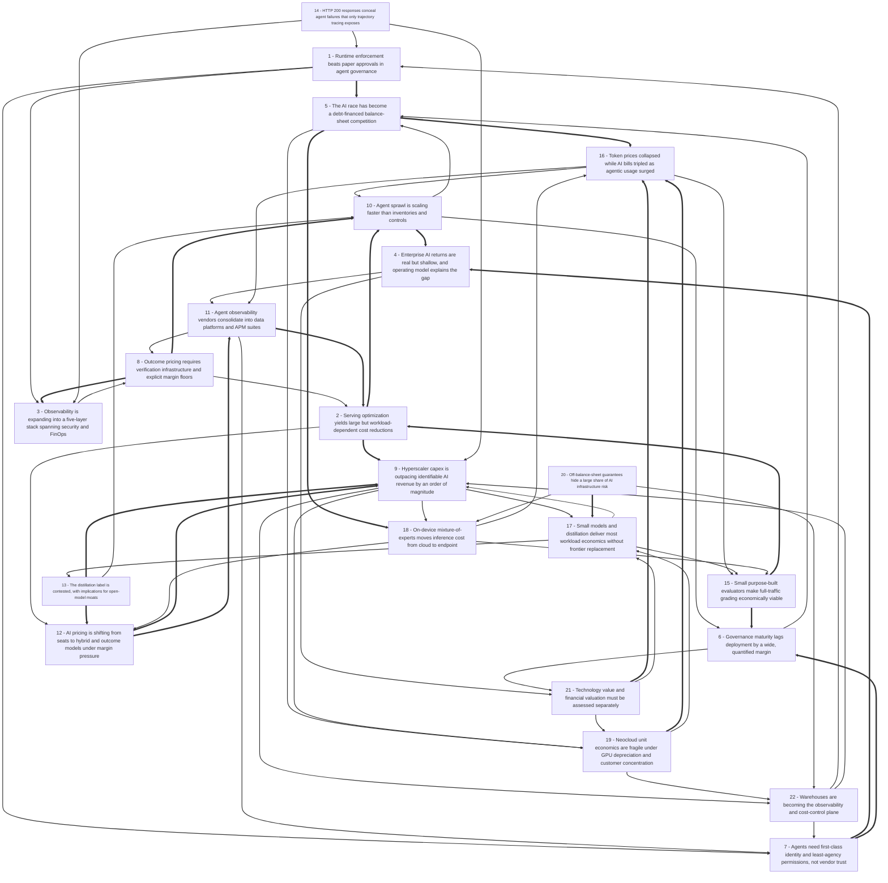

# Title: AI’s Scale Economics, Debt Risk, and Agent Governance Gap

## Topic

reveiw all available content related to recent developents in the AI space, including New Models, New Techniques, new Products, novel costing and new Business models for AI use. Add an analysis of the economincs of hyperscaling and the cost of providing bulk scale services. Include observations on AI idustry profitability, long term viability, and debt burden. Focus also on enterprise AI and Agent Governance, Observability solutions. The intention is to create a report suitable for providing content for an AI newsletter

## Executive Summary

The 61 captured sources describe an AI industry in late 2026 that is simultaneously maturing and straining: model capability keeps improving (Gemma 4’s 31B dense model scores 89.2% on AIME 2026 versus 20.8% for its predecessor, Qualcomm demonstrated a 30B mixture-of-experts model on a handset, and computer-task accuracy rose from 12% to 66.3% in 2025, six points below the human baseline), while the economics of delivering that capability at scale are deteriorating in specific, measurable ways [#18][#19][#17]. Token list prices have fallen roughly 98% while enterprise AI bills have tripled, because reasoning and agentic workloads consume 5–30x more tokens per task and agentic sessions can span 15,000 to over one million tokens versus 200–2,000 for chat [#29][#40]. Infrastructure is being financed increasingly with debt and guarantees rather than operating cash flow — Alphabet raised €6bn against a $195–205bn 2026 capex program, Oracle issued $10bn against $125.3bn of existing debt and $288bn of lease commitments, Big Tech has extended up to $300bn in off-balance-sheet residual value guarantees, and CoreWeave carries $51.9bn of debt plus leases at 14.8–15.4% yields with 62% of revenue from two customers [#47][#49][#48][#51]. Enterprise returns remain uneven: 80% of leaders report positive AI returns but only 28% report strongly positive returns, only 7% both prove value and transform workflows, and Gartner expects over 40% of agentic AI projects to be cancelled by end-2027 [#53][#16]. The control layer — agent governance, observability, identity, and runtime enforcement — is emerging as the binding constraint and the fastest-growing commercial opportunity, with the AI governance market projected to grow from $419m in 2026 to $5.88bn by 2035 at a 34.27% CAGR, even as only 21% of companies planning agentic deployment have mature governance and 92% of breached organizations lacked proper AI access controls [#58][#1][#44].

## Top 10 Implications

1. **Instrument trajectories and cost per outcome before scaling agents.** A 200 OK is not evidence of correctness, and token bills rise even as token prices fall, so the metrics must be behavioural and economic, not infrastructural [#4][#40].
2. **Make governance artefacts a release gate.** Inventory, named owner, scoped identity, approval gates, and audit trail should be required before any agent touches production systems or money [#14][#7].
3. **Redesign pricing away from flat seats.** Negative per-user margins on heavy accounts (Copilot’s $10 price against $20+ cost) are the predictable outcome of flat pricing over variable inference COGS [#29].
4. **Adopt hybrid value-unit pricing with margin floors.** Target 60–80% gross margin, set allowances and overage before launch, and micro-meter internally while pricing externally on outcomes [#30][#31].
5. **Build a routing layer as core infrastructure.** A 5–20x cost differential between small and large models makes task routing a bigger margin lever than most product features [#18].
6. **Verify OTel portability in every observability contract.** With Langfuse and Arize absorbed into ClickHouse and Dynatrace, vendor continuity is no longer a safe assumption [#3][#1].
7. **Underwrite counterparties, not just capacity.** CoreWeave’s 14.8–15.4% debt yields and 62% revenue concentration are a warning for any multi-year compute commitment [#48][#51].
8. **Adjust AI credits for guarantees and purchase commitments.** Off-balance-sheet exposure of $1–3.1trn means reported leverage understates risk by a material margin [#49][#50].
9. **Fund operating-model change alongside tooling.** The 58% vs 8% CAIO gradient and 50% vs 9% platform-standardization gradient suggest organizational design drives returns more than model choice [#53].
10. **Keep technology and financing theses separate in planning.** Productivity gains modelled for the 2030s cannot service debt incurred in 2026, so scenario planning must cover both normalisation and systemic crisis [#61][#60].

### Open Questions

- How much of the reported 41%–86.7% multi-agent failure rate reflects genuinely unreliable systems versus benchmark tasks deliberately chosen to be hard, and how does failure rate scale with agent autonomy level?
- Are Splunk’s Luna claims (152 ms, 98% cheaper, 10–20 concurrent evals on L4 GPUs) independently reproducible, and how does evaluator accuracy degrade on domain-specific tasks outside the nine shipped agentic evaluators?
- What proportion of the $300bn in residual value guarantees and the $3.1trn of off-balance-sheet commitments is double-counted across Morgan Stanley, RBA, and journalistic estimates, and what are the actual residual-value assumptions?
- Do reported AI gross margins (25%, 45%, 53%) reflect genuine unit economics or subsidized growth pricing, and how do they behave for cohort customers after 18 months of agentic usage?
- How much of the 5–20x small-versus-large model cost differential survives once routing errors, retries, escalation, and quality-assurance overhead are included?
- Is the reported quality parity of open models such as Kimi K3 and DeepSeek V4 robust to contamination controls and independent evaluation, and what happens to closed-model API pricing if it is?
- What is the verified payback period for enterprise agent deployments — the £25,900 versus £40,000 service-desk example does not repay on labour alone in year one, so what non-labour benefits close the gap?
- How will the deferred EU AI Act high-risk obligations (December 2027 and August 2028) interact with the already-applicable Article 50 transparency duties and US state rules in California, New York, and Colorado?
- Which entity bears liability when a third-party agent with delegated authority causes harm, and do current insurance and contract structures allocate that risk coherently?
- Will warehouse-native observability plus hyperscaler bundling commoditize standalone agent-observability vendors faster than the 34.27% market CAGR implies?
- Does the on-device MoE approach scale to genuinely useful agentic workloads given thermal and memory-bandwidth limits, or does it remain a complement to cloud inference?
- How would a sectoral correction in AI infrastructure transmit to enterprise AI budgets, given that 61% of IT leaders have already cut projects due to unplanned SaaS cost increases?

## Concepts

### 1. Human Oversight

**Definition:** Human oversight is the deliberate calibration of agent autonomy, with human approval or intervention reserved for high-impact actions and low-risk work left to runtime controls. It matters because autonomous agents can spend money, change production systems, delete data, or act outside scope before a person notices.

It works through approval gates, escalation rules, stop authority, and defined accountability, not blanket review of every step. The key nuance is risk calibration: too little oversight permits harm, while per-step approval erodes the speed and capacity gains that justify agents; maturity therefore shifts oversight toward exceptions and drift signals.

Oversight depends on clear ownership, agent identity, audit trails, and observability that surfaces the right exceptions. It competes with fully autonomous optimization and is increasingly required by regulated-sector and EU AI Act high-risk expectations, while adoption data shows most organizations still limit unsupervised action.

**Key Evidence:**
- A governance checklist recommends human approval for spending money, changing production systems, deleting data, or acting outside scope [#14].
- Wharton/GBK found 67% use agents in some form, but only 17% let agents act without per-step approval [#53].

### 2. AI Infrastructure Financing

**Definition:** AI infrastructure financing is the debt, equity, private credit, leases, and off-balance-sheet guarantees used to fund data centers, chips, and compute capacity. It matters because the AI race is increasingly a balance-sheet competition, where leverage and debt-servicing capacity can transmit compute-market stress into broader credit markets.

It works through bond issuance, vendor financing, special-purpose vehicles, residual-value guarantees, and lease commitments that may not appear as reported debt until payment is probable. The key distinction is between demand for AI and the profitability of debt-financed operators: revenue backlog and EBITDA can coexist with operating losses, heavy interest expense, and customer concentration.

Financing depends on power availability, GPU depreciation, utilization, hyperscaler demand, and interest rates, and it competes with internally funded capex. It is changing as neocloud impairment warnings, distressed yields, and guarantees draw rating-agency and investor scrutiny, even while long-run productivity forecasts remain optimistic.

**Key Evidence:**
- Alphabet raised €6 billion across seven tranches, while Oracle issued $10 billion as half of a $20 billion debt-and-equity program [#47].
- Big Tech provided up to $300 billion in off-balance-sheet residual value guarantees; Morgan Stanley estimates over $3.1 trillion in commitments and credit support across seven companies [#49].

### 3. Adoption & ROI Readiness

**Definition:** Adoption and ROI readiness is the organizational capacity—people, processes, training, operating models, and workflow redesign—to turn AI deployment into measurable business value. It matters because tool access alone rarely produces returns; leaders report far more positive than strongly positive outcomes.

It works by scoping one high-friction workflow, defining success and payback before build, measuring time saved, cycle time, and capacity, and staging investment by risk appetite. The key distinction is between efficiency-only metrics and growth or workflow-transformation outcomes, which are more strongly associated with high ROI.

Readiness depends on ownership such as a Chief AI Officer, standardized platforms, governance, and independent validation. It competes with broad automation and tool-first adoption, and it is changing as agent lifecycle management and human oversight become part of the ROI calculation rather than post-deployment overhead.

**Key Evidence:**
- Wharton/GBK found 80% of leaders report positive AI returns but only 28% strongly positive; strong ROI was 58% with a Chief AI Officer versus 8% where no role exists or is planned [#53].
- EY’s Rick Ross says success depends on readiness—people, processes, training, operating models, and workflow redesign—not just buying tools [#57].

### 4. Regulatory Risk Oversight

**Definition:** Regulatory risk oversight is the board- and enterprise-level process for aligning AI agents with evolving laws, standards, and risk frameworks while enabling proportionate adoption. It matters because penalties, audits, and reputational exposure can arrive before governance programs mature.

It works through risk tiering, inventories, policy approval, human oversight for high-impact decisions, audit evidence, and mapping to frameworks such as the EU AI Act, NIST AI RMF, ISO/IEC 42001, SOC 2, and sector rules. The key distinction is between static compliance documentation and evidence that runtime behavior matched approved intent.

Oversight depends on legal, security, compliance, and business accountability, and it competes with fragmented IT-only ownership. It is changing as high-risk obligations phase in, as boards face AI-related shareholder proposals, and as regulators scrutinize agentic autonomy and third-party AI use.

**Key Evidence:**
- EU AI Act Article 50 obligations have applied since Aug. 2, 2026, with penalties up to €15 million or 3% of worldwide turnover [#1]; high-risk penalties reach €35 million or 7% of global revenue [#13].
- Enterprise guidance maps NIST AI RMF 1.0, ISO/IEC 42001:2023, and the EU AI Act timeline into governance controls [#16].

### 5. Agent Observability

**Definition:** AI agent observability is the practice of capturing, connecting, and evaluating every production step—LLM calls, tool calls, retrievals, and handoffs—so teams can judge whether an agent was correct, safe, and efficient rather than merely running. It matters because multi-step agents can return successful HTTP responses while silently fabricating results or violating policy.

It works through sessions, traces, and spans that preserve nested causality across long, non-deterministic runs, plus evaluations, token-cost attribution, and guardrail decisions. The key distinction is trajectory-aware grading: sampling outcomes alone misses tool-choice and reasoning failures, especially across long or cross-invocation workflows.

Observability depends on instrumentation standards such as OpenTelemetry, storage for high-cardinality traces, and evaluators affordable enough to grade more than a sample of traffic. It competes with conventional APM and single-call LLM tracing, and increasingly feeds governance, security, and FinOps controls rather than standing alone.

**Key Evidence:**
- Splunk reports fabricating results was 56.6% of silent tool failures across 396 valid agent responses, so HTTP 200 can hide failure [#1].
- Snowflake Observe traces prompts, completions, retrievals, tool calls, token usage, and session IDs, linking behavior to cost and quality [#2].

### 6. Runtime Agent Governance

**Definition:** Runtime agent governance is the set of controls that constrain what autonomous agents may do while they act—identity, permissions, tool scope, approvals, execution limits, and audit evidence—rather than relying on static policy documents. It matters because agents can transfer funds, edit documents, call APIs, and interact at machine speed, making after-the-fact review too slow.

It works by tying each agent to a verified owner and purpose, granting least-privilege and least-agency access, enforcing policy at gateways or control planes, and recording tool calls, blocked actions, exceptions, and policy changes. The key distinction is live enforcement: inventory and model-risk reviews describe intent, but runtime controls determine whether an action was authorized and can be reconstructed.

Runtime governance depends on agent inventories, identity systems, gateways, observability, and approval workflows; it overlaps with security and compliance but must coordinate them. It is changing as frameworks align to NIST AI RMF, ISO/IEC 42001, SOC 2, and the EU AI Act, and as vendors consolidate enforcement and evidence into agent control planes.

**Key Evidence:**
- IBM says govern third-party agents by autonomy, access, authority, and impact, with least privilege, least agency, a verified owner, and runtime policy enforcement [#7].
- A 10-step checklist includes an agent owner, approval gates, scoped short-lived identities, execution limits, and immutable audit evidence [#14].

### 7. Agent Sprawl & Shadow AI

**Definition:** Agent sprawl and shadow AI describe the uncontrolled proliferation of autonomous agents and AI tools outside centralized visibility, ownership, or policy. It matters because unmanaged agents create data leakage, duplicated integrations, untracked inference costs, and compliance gaps that scale faster than review processes.

The problem is less the number of agents than missing metadata: who owns each agent, what data and systems it accesses, its autonomy level, and which business or risk officer is accountable. Inventory, permission inheritance, and write-action approvals are first controls; without them, governance cannot distinguish sanctioned from unauthorized behavior.

Sprawl is driven by easy agent creation, bring-your-own-tool adoption, and fragmented clouds and model providers. It competes with platform consolidation and enablement—shared gateways, MCP connections, and enterprise AI platforms—and raises the cost of governance, security, and FinOps unless visibility precedes scaling.

**Key Evidence:**
- Gartner predicts the average Fortune 500 enterprise will use over 150,000 agents by 2028, up from fewer than 15 in 2025, while only 13% believe they have adequate agent governance [#16].
- An IBM study found 70% say business teams deploy AI faster than IT can track it, and two-thirds are accountable for systems they do not fully control [#23].

### 8. Token Economics

**Definition:** Token economics is the measurement, allocation, optimization, and governance of token consumption and its value, with the goal of cost per valuable outcome rather than lowest price per token. It matters because falling unit prices have not prevented rising bills as reasoning and agentic workloads consume far more tokens per task.

It works by metering input, output, reasoning, cached, and multimodal tokens; attributing usage by model, application, team, customer, and workflow; and applying routing, caching, batching, retrieval filtering, and loop controls. The key distinction is that list price is a poor predictor: cost per task and cost per useful response include retries, tools, verification, and quality.

Token economics depends on provider pricing, tokenizer differences, observability, and FinOps tooling, and it competes with simplistic token markups. It is changing as standards efforts emerge and as enterprises shift from API dashboards to cross-surface cost management spanning infrastructure, API/token, and SaaS-embedded AI.

**Key Evidence:**
- Artificial Analysis cost per task ranges from $0.07 for GPT 6 Luna to $7.63 for Claude Fable 5.1, showing list price poorly predicts cost per task [#37].
- The planned Tokenomics Foundation and AT&T’s rise from about 8B to 27B tokens/day illustrate standardization pressure as unit prices fall but bills rise [#40].

### 9. AI Pricing Models

**Definition:** AI pricing models are the commercial structures used to charge for AI products—seat, usage, credit, outcome, and hybrid models—chosen to cover variable inference costs while matching customer value. They matter because traditional per-seat SaaS pricing can collapse when heavy usage drives cost above revenue.

It works by selecting a value metric such as resolved tickets, verified pull requests, documents, or completed tasks, then layering allowances, overage rates, credits, or success fees. The key distinction is between billing tokens and billing outcomes: token pass-through is transparent but exposes margin to price deflation and invoice anxiety, while outcomes require verification and clear baselines.

Pricing depends on cost per action, usage distribution, margin floors, and customer acceptance, and it competes with flat subscriptions and pure consumption billing. It is changing toward hybrids and outcome units as AI companies blend multiple models and as buyers demand predictable bills and value-linked charges.

**Key Evidence:**
- GitHub Copilot charged $10/month but reportedly lost over $20 per user monthly, added request caps in 2025, and moved to usage-based billing on June 1, 2026 [#29].
- Cursor’s June 2025 switch from 500 fast requests to $20 of usage caused surprise bills, an apology, and refunds [#29][#31].

### 10. Efficient Model Serving

**Definition:** Efficient model serving is the use of smaller, distilled, quantized, pruned, or sparse models plus serving techniques to reduce inference cost and latency while preserving task quality. It matters because agentic and high-volume workloads make inference a dominant operating expense and a constraint on deployment scale.

It works through knowledge distillation, quantization, pruning, Mixture-of-Experts routing, batching, caching, and hardware-aware kernels; small models can beat larger predecessors on benchmarks and run on edge devices. The key nuance is that distillation is not mere API copying: true distillation uses teacher outputs, reasoning traces, and probability distributions, and gains depend on workload and hardware.

Efficient serving depends on teacher quality, training data, evaluation, and memory hierarchy, and it competes with simply calling ever-larger frontier models. It is changing through model cascading and task routing, where cheap models handle common tasks and frontier models are reserved for hard cases rather than universally replaced.

**Key Evidence:**
- Gemma 4’s 31B dense model scores 89.2% on AIME 2026 versus 20.8% for Gemma 3’s 27B model [#18].
- Cross-lab API “distillation” is behavior parroting of finished outputs, while true distillation requires full teacher internals and probability distributions [#20].

## Findings

### **Finding 1** - Runtime enforcement beats paper approvals in agent governance

**Observation:**
Kong argues that agentic governance often relies on manual reviews and “paper approvals,” leaving firewalls and gateways without context, and that “you can’t govern what you can’t see,” while Sweet Security frames governance as a runtime control problem requiring records of tool calls, identity use, data access, approvals, exceptions, blocked actions, policy changes, and enforcement decisions [#6][#10]; Kore.ai likewise insists governance be enforced at runtime and measured by behaviour [#13].

**Analysis:**
The compliance-to-network gap is the central operational failure mode described across these sources: a policy document can approve an agent while the gateway that actually routes its traffic has no idea the approval exists, and the agent’s permissions are whatever the underlying service account happened to grant [#6].

Runtime enforcement closes the gap by moving controls into the request path — model gateways, MCP tool-call authentication, sandboxes, and guardrails — so that blocking, approval, and audit happen at the moment of action rather than in a quarterly review [#9][#6].

The maturity of the vendor landscape is uneven: prompt-layer and AI-SPM tools often cover only part of the agent governance problem, which is why buyer checklists emphasize runtime blocking, approval workflows, least-privilege tool scoping, identity-linked audit evidence, and integrations with agent frameworks, model gateways, cloud APIs, and IAM, aligned to NIST AI RMF, ISO/IEC 42001, SOC 2, and the EU AI Act [#10].

Kore.ai’s claim that the tenth agent deploys 3–5x faster by inheriting proven infrastructure is the strongest economic argument for runtime controls: governance as a reusable platform rather than per-project paperwork [#13].

**Cross-reference / Dependencies:**
Depends on Finding 5 (identity) and Finding 3 (evaluators as guardrails); supports Finding 7 (stack expansion).

**Implication:**
Implement policy enforcement at the gateway and tool-call layer where traffic actually flows, and generate audit evidence automatically from enforcement decisions.

**Sources:**
- [6] AI Governance Tools and Platforms: Enterprise Guide [Kong, @kong] - [https://konghq.com/blog/enterprise/ai-governance-tools-and-platforms-guide](https://konghq.com/blog/enterprise/ai-governance-tools-and-platforms-guide) (published 2026-09-23)
- [9] Governed Context, Security and Spend Controls for AI Agents | Snowflake [Nick El-Rayess, Carlos Nai, Radhika Janardanan, Danielle Kucera, Tehzeeb Versey-Patel] - [https://www.snowflake.com/en/blog/ai-agents-governance-ai-security-cost-control](https://www.snowflake.com/en/blog/ai-agents-governance-ai-security-cost-control) (published 2026-11-03)
- [10] AI Agent Governance Platforms: Top 7 Compared - [https://www.sweet.security/agent-security/agent-governance-platforms](https://www.sweet.security/agent-security/agent-governance-platforms) (published 2026-09-24)
- [13] AI agent governance: a practical guide to risk, trust, and compliance [AI agent governance: A practical guide to risk, trust, and compliance] - [https://www.kore.ai/blog/ai-agent-governance-a-practical-guide](https://www.kore.ai/blog/ai-agent-governance-a-practical-guide) (published 2026-09-29)

**Source date range:** 2026-09-23..2026-11-03 (4 of 4 cited web sources dated)

### **Finding 2** - Serving optimization yields large but workload-dependent cost reductions

**Observation:**
Reported results include quantization shrinking models by 75–80% with usually under 2% accuracy loss, pruning removing 30–50% of parameters, distillation students reaching 90–95% of teacher performance, and combined pruning-plus-quantization yielding models 4–5x smaller and 2–3x faster, while practitioner guidance stresses that quantization is not automatically faster and aggressive batching can worsen tail latency, requiring monitoring of TTFT, ITL, TPOT, p95/p99 latency, and cost per request [#25][#27][#24].

**Analysis:**
Optimization is the most reliable near-term margin lever available to AI product teams, but the literature is explicit that gains are workload- and hardware-dependent: batching improves accelerator utilization while increasing queueing, larger KV caches consume the GPU memory that concurrency needs, and lower precision can degrade exactly the reasoning quality agentic workloads depend on [#24][#27].

The recommended discipline — representative workloads, a baseline, one variable at a time, quality validation — is unglamorous but is the difference between a measured 73% inference-time reduction at a bank and a regression discovered in production [#25][#27].

The crucial economic caveat is that optimization does not automatically reduce spend: if a 4x cheaper token induces 10x more usage, the bill rises, which is the same elasticity mechanism documented in Finding 9.

Teams therefore need both a unit-cost metric and a total-spend metric, and Cerebras’s framing of “cost per useful response” — total input/output costs plus tool, infrastructure, retry, and verification costs divided by successful useful responses — is the right denominator [#38].

**Cross-reference / Dependencies:**
Depends on Finding 9 (usage growth); supports Finding 10 (margin recovery) and Finding 12 (small models).

**Implication:**
Establish per-workload baselines and gate optimization changes on quality plus p95/p99 latency, not throughput alone.

**Sources:**
- [24] AI Inference Tuning for Dependable AI Apps - Techgenyz [@techgenyz] - [https://techgenyz.com/ai-inference-optimization-speed-costs](https://techgenyz.com/ai-inference-optimization-speed-costs) (published 2026-11-03)
- [25] AI Model Optimization Techniques for Enhanced Performance in 2025 [Kacper Rafalski] - [https://netguru.com/blog/ai-model-optimization](https://netguru.com/blog/ai-model-optimization) (published 2026-10-29)
- [27] How Does LLM Inference Optimization Work? [Cloudester Blogger, @cloudester] - [https://cloudester.com/llm-inference-optimization](https://cloudester.com/llm-inference-optimization) (published 2026-10-16)
- [38] AI Cost per Token and Price-Performance Explained - [https://www.cerebras.ai/glossary/cost-per-token-and-ai-price-performance](https://www.cerebras.ai/glossary/cost-per-token-and-ai-price-performance) (published 2026-09-11)

**Source date range:** 2026-09-11..2026-11-03 (4 of 4 cited web sources dated)

### **Finding 3** - Observability is expanding into a five-layer stack spanning security and FinOps

**Observation:**
A practitioner framework describes enterprise AI observability as five layers — traditional observability; AI observability (prompt/response tracing, token usage, RAG quality, hallucinations, agent/tool calls, evaluations, model drift, cost); AI governance and runtime control; AI runtime security (prompt injection, data leakage, malicious tool calls, MCP security); and AI production management (AI SRE, AgentOps, AI FinOps, agent identity, AI service catalog) — while the AI governance market is projected to grow from $419.45m in 2026 to $5,883.90m by 2035 at a 34.27% CAGR [#8][#58].

**Analysis:**
The stack framing explains why point tools keep getting absorbed: each layer’s data is the next layer’s input, so a trace that reveals a hallucination is also the evidence a runtime guardrail needs and the cost record FinOps requires [#8].

The market-size numbers cut both ways.

A 34.

27% CAGR is fast, but $419m in 2026 is small against the $2.

59 trillion in total AI spending Kong cites for the same year — roughly 0.

016% — which suggests governance and observability are still being bought as add-ons rather than as a proportionally funded control plane [#58][#6].

Precedence segments the market as 66% software, 53% on-premises, 70% large enterprises, and BFSI-led, with North America at 31% share and Asia-Pacific growing fastest, which implies near-term revenue concentrates in regulated, self-hosted buyers while the long-run growth is cloud-first and Asian [#58].

The principal limitation is that market forecasts of this kind extrapolate from a small base and rarely survive contact with platform bundling, since hyperscalers and data platforms can include equivalent capability at marginal cost.

**Cross-reference / Dependencies:**
Builds on Findings 1, 3, and 6; contextualizes Finding 8.

**Implication:**
Expect the standalone observability/governance category to be squeezed by bundling; differentiate on cross-vendor coverage and enforcement, not dashboards.

**Sources:**
- [6] AI Governance Tools and Platforms: Enterprise Guide [Kong, @kong] - [https://konghq.com/blog/enterprise/ai-governance-tools-and-platforms-guide](https://konghq.com/blog/enterprise/ai-governance-tools-and-platforms-guide) (published 2026-09-23)
- [8] Enterprise AI Observability for Scalable and Secure AI Systems | Vikas Pai posted on the topic | LinkedIn [Vikas Pai] - [https://www.linkedin.com/posts/vikas-pai-83b3119_enterpriseai-aiobservability-generativeai-activity-7504791520235991040-jvlH](https://www.linkedin.com/posts/vikas-pai-83b3119_enterpriseai-aiobservability-generativeai-activity-7504791520235991040-jvlH) (published 2026-09-13)
- [58] AI Governance Market Companies, Size &amp; Trends 2026-2035 [Shivani Zoting] - [https://www.precedenceresearch.com/ai-governance-market](https://www.precedenceresearch.com/ai-governance-market) (published 2026-10-22)

**Source date range:** 2026-09-13..2026-10-22 (3 of 3 cited web sources dated)

### **Finding 4** - Enterprise AI returns are real but shallow, and operating model explains the gap

**Observation:**
The Wharton Human-AI Research and GBK Collective study of 1,416 US enterprise leaders found 80% report positive AI returns but only 28% report strongly positive returns; strong ROI correlated with measuring growth outcomes (35% vs 13%), a designated Chief AI Officer (58% vs 24% where oversight was added to an existing executive vs 8% where no role exists), standardizing on one approved platform (50% vs 9%), and clearing workflow-transformation measures (67% vs 28%), while only about one in five meets all three workflow measures and only 7% prove value, transform workflows, and align the organization [#53].

**Analysis:**
The 80%/28% split reframes the enterprise AI debate from “does it work?” to “why does it work for a minority?” and the correlates point at organizational design rather than model choice.

The CAIO gradient — 58% versus 24% versus 8% — is the steepest in the dataset and implies that accountability concentration matters more than the specific technology deployed, while the platform-standardization gradient of 50% versus 9% suggests sprawl is a direct drag on returns [#53].

Two cautions apply: these are self-reported returns from a survey, not audited financial outcomes, and correlation with a CAIO may reflect that better-run companies both appoint CAIOs and achieve returns rather than that the appointment causes the returns.

Supporting evidence comes from the readiness literature, where EY’s Rick Ross argues that pilots often reveal conventional ROI and NPV models fit poorly and that leaders should narrow initial focus and govern agent lifecycles, and from adoption economics showing a service desk removing ~£25,900/year of labour against a £40,000 build and £1,200/month run cost that does not pay back on labour alone in year one [#57][#55].

**Cross-reference / Dependencies:**
Builds on Finding 4 (governance) and Finding 11 (pricing); connects to Finding 21 (sprawl).

**Implication:**
Fund the operating-model changes — ownership, platform standardization, workflow redesign — alongside the technology, since tooling alone correlates with weak returns.

**Sources:**
- [53] Enterprise AI Adoption and ROI Study Finds 80% of Leaders Report Positive Returns | Spyridon (Spyros) Georgiadis... [Spyridon (Spyros) Georgiadis] - [https://www.linkedin.com/posts/spirosg_80-says-ai-is-paying-off-but-only-28-that-activity-7518333920245911552-8u1s](https://www.linkedin.com/posts/spirosg_80-says-ai-is-paying-off-but-only-28-that-activity-7518333920245911552-8u1s) (published 2026-10-20)
- [55] Best AI Agent for Business Efficiency and Workflow ROI [[https://www.facebook.com/deployflow](https://www.facebook.com/deployflow)] - [https://deployflow.co/blog/best-ai-agent-business-efficiency-guide-roi](https://deployflow.co/blog/best-ai-agent-business-efficiency-guide-roi) (published 2026-09-07)
- [57] Enterprise AI Adoption: Readiness, Value and Governance - [https://techstrong.tv/videos/ai-leadership-insights/enterprise-ai-success-depends-on-readiness-not-just-tools](https://techstrong.tv/videos/ai-leadership-insights/enterprise-ai-success-depends-on-readiness-not-just-tools) (published 2026-10-01)

**Source date range:** 2026-09-07..2026-10-20 (3 of 3 cited web sources dated)

### **Finding 5** - The AI race has become a debt-financed balance-sheet competition

**Observation:**
On 2 November 2026 Alphabet raised €6bn across seven tranches with over €17bn of orders (~2.8x oversubscribed) to support a $195–205bn 2026 capex program, while Oracle issued $10bn across six tranches as half of a $20bn debt-and-equity program against $125.3bn of existing debt and $288bn of lease commitments; 2031 bond spreads reportedly ranged from 41bp for Alphabet to 227bp for Oracle and 970bp for CoreWeave [#47][#52].

**Analysis:**
The spread dispersion is the analytically interesting fact: the market is not treating “AI infrastructure” as a single credit, it is pricing execution and leverage risk company by company, which means the financing environment still discriminates rather than uniformly tightening.

Alphabet’s 2.

8x oversubscription and 41bp spread reflect a fortress balance sheet funding capex from a position of strength, whereas Oracle’s 227bp spread on $125.

3bn of debt plus $288bn of leases reflects a company that has converted an operating business into a leveraged infrastructure landlord for AI workloads [#47][#52].

The shift in investor attention from revenue growth to leverage, free-cash-flow conversion, debt-servicing capacity, and long-term ROIC is the regime change that matters for how AI companies will be valued through 2027 [#47].

The evidence is limited to a small number of issuers and a single week’s pricing, so it should be read as an illustration of differentiation rather than a complete credit map of the sector.

**Cross-reference / Dependencies:**
Builds on Finding 16 (capex gap); prerequisite for Finding 18 (neocloud stress) and Finding 19 (guarantees).

**Implication:**
Treat credit spreads and issuance terms for AI-linked issuers as a real-time read on the sector’s cost of capital and refinancing risk.

**Sources:**
- [47] Alphabet &amp; Oracle Bond Issuance – AI Infrastructure Financing, Debt Expansion &amp; Balance-Sheet Risks |... [Faisal Amjad] - [https://www.linkedin.com/pulse/alphabet-oracle-bond-issuance-ai-infrastructure-financing-amjad-fubdf](https://www.linkedin.com/pulse/alphabet-oracle-bond-issuance-ai-infrastructure-financing-amjad-fubdf) (published 2026-11-02)
- [52] Can the Finance Supporting AI Investment Hold Out Until 2030?｜玉兎(gyokuto15) - [https://note.com/gyokuto15/n/n0e7baf91d0c8?hl=en](https://note.com/gyokuto15/n/n0e7baf91d0c8?hl=en) (published 2026-10-19)

**Source date range:** 2026-10-19..2026-11-02 (2 of 2 cited web sources dated)

### **Finding 6** - Governance maturity lags deployment by a wide, quantified margin

**Observation:**
Deloitte found only 21% of companies planning agentic AI deployment have mature governance, IBM found 63% of 600 organizations lacked AI governance policies, IBM’s 2026 breach research found 92% of organizations suffering an AI-related breach lacked proper AI access controls, only 13% believe they have adequate agent governance, and Gartner predicts over 40% of agentic AI projects will be cancelled by end-2027 [#1][#16][#44].

**Analysis:**
These figures describe a consistent pattern: capability adoption is outpacing control adoption, and the cancellation forecast is the market’s correction mechanism.

The stated reasons for cancellation — costs, unclear value, and inadequate risk controls — are governance failures as much as technology failures, because an agent without an owner, an inventory entry, and an audit trail cannot demonstrate value or survive an audit [#16].

The regulatory clock is tightening in parallel: EU AI Act Article 50 transparency obligations applied from 2 August 2026 with penalties up to €15m or 3% of worldwide turnover, while high-risk obligations were deferred to December 2027 and August 2028, and separate analyses cite the €35m/7% penalty tier for prohibited practices plus emerging US state rules in California, New York, and Colorado [#1][#13][#17].

The evidence has a self-interest problem — governance vendors citing governance gaps — but the convergence of independent surveys (Deloitte, IBM, Gartner) with hard regulatory dates makes the direction credible even if the magnitudes are approximate.

**Cross-reference / Dependencies:**
Prerequisite for Finding 5 (identity), Finding 6 (runtime enforcement), and Finding 21 (agent sprawl).

**Implication:**
Treat governance artefacts — inventory, ownership, audit trail, approval gates — as release criteria for agent deployment rather than post-launch cleanup.

**Sources:**
- [1] 6 Best AI Agent Observability Tools for Production in 2026 | Splunk [Jackson Wells] - [https://www.splunk.com/en_us/blog/learn/best-agent-observability-platforms.html](https://www.splunk.com/en_us/blog/learn/best-agent-observability-platforms.html) (published 2026-09-16)
- [13] AI agent governance: a practical guide to risk, trust, and compliance [AI agent governance: A practical guide to risk, trust, and compliance] - [https://www.kore.ai/blog/ai-agent-governance-a-practical-guide](https://www.kore.ai/blog/ai-agent-governance-a-practical-guide) (published 2026-09-29)
- [16] Enterprise AI Governance: Stop Agent Sprawl [Dhruv Kapadia] - [https://coworker.ai/blog/enterprise-ai-governance](https://coworker.ai/blog/enterprise-ai-governance) (published 2026-10-20)
- [17] Shaping global governance of AI agents | Brookings - [https://www.brookings.edu/articles/shaping-global-governance-of-ai-agents](https://www.brookings.edu/articles/shaping-global-governance-of-ai-agents) (published 2026-10-12)
- [44] AI Governance, Security, and Risk for Regulated Industries [HITRUST] - [https://hitrustalliance.net/blog/ai-governance-security-and-risk-for-regulated-industries](https://hitrustalliance.net/blog/ai-governance-security-and-risk-for-regulated-industries) (published 2026-09-10)

**Source date range:** 2026-09-10..2026-10-20 (5 of 5 cited web sources dated)

### **Finding 7** - Agents need first-class identity and least-agency permissions, not vendor trust

**Observation:**
IBM argues enterprises should govern third-party agents by autonomy, access, authority, and potential impact rather than vendor trust, applying “least privilege” and “least agency” so each agent has a verified owner, purpose-limited permissions, runtime policy enforcement, and an evidence trail, illustrated by Riyadh Air’s build spanning 59 workstreams, 60+ partners, 75+ systems, and 1,800+ integrations coordinated through watsonx Orchestrate [#7]; LATAM guidance prescribes individual identities via Entra Agent ID and Sentinel audit logs within 90 days [#11].

**Analysis:**
The identity framing matters because it converts an unbounded AI risk problem into a bounded access-control problem that existing security tooling can partly handle.

If an agent is an identity, it can be provisioned, scoped, rotated, monitored, and revoked using Zero Trust primitives — least privilege, continuous verification, and monitoring — which is precisely the argument that the security perimeter is shifting to the agent as agent-to-agent interactions occur at machine speed, potentially hundreds or thousands of times before a human notices [#5].

The Riyadh Air example shows the scale at which this becomes unavoidable: 1,800+ integrations across 75+ systems means the blast radius of an over-permissioned orchestrator is effectively the entire enterprise estate [#7].

The “least agency” concept adds a dimension traditional IAM lacks — limiting not just what an agent can reach but how many autonomous steps it may take before human approval — and the practical checklist version scopes short-lived identities, constrains tool and API endpoints, defines execution limits, and embeds human-in-the-loop rules for spending money, changing production systems, or deleting data [#14].

The weakness in this evidence is that vendor guidance and consultancy roadmaps dominate; there is little independent measurement of how much least-agency design actually reduces incident severity.

**Cross-reference / Dependencies:**
Builds on Finding 4 (governance maturity); prerequisite for Finding 6 (runtime enforcement).

**Implication:**
Issue every agent a distinct, short-lived, narrowly scoped identity with a named human owner, and cap the number of autonomous steps before escalation.

**Sources:**
- [5] Governing Agentic AI: Visibility, Observability, and Enterprise Trust [Gaby Moulis, @ISLENetworks] - [https://islandnetworks.com/blog-ai-agent-governance-autonomous-agents-enterprise](https://islandnetworks.com/blog-ai-agent-governance-autonomous-agents-enterprise) (published 2026-09-09)
- [7] How to effectively govern third-party AI agents across the enterprise | IBM [Jala  Taylor-Pickett] - [https://www.ibm.com/think/perspectives/how-to-effectively-govern-third-party-ai-agents-across-the-enterprise](https://www.ibm.com/think/perspectives/how-to-effectively-govern-third-party-ai-agents-across-the-enterprise) (published 2026-09-22)
- [11] Technical and Regulatory Framework for AI Agent Governance in LATAM Enterprises - [https://kcpdynamics.com/en/ai-agent-governance-enterprises](https://kcpdynamics.com/en/ai-agent-governance-enterprises) (published 2026-10-28)
- [14] AI Agent Governance Checklist: How to Govern Runtime - [https://www.sweet.security/agent-security/agent-governance-checklist](https://www.sweet.security/agent-security/agent-governance-checklist) (published 2026-09-24)

**Source date range:** 2026-09-09..2026-10-28 (4 of 4 cited web sources dated)

### **Finding 8** - Outcome pricing requires verification infrastructure and explicit margin floors

**Observation:**
Examples include Fin at $0.99 per outcome and Zendesk at $1.50 per committed automated resolution or $2.00 pay-as-you-go, a proposed $500/month for 250 completed tasks plus $2.00 overage, and a warning that an edge case costing $8.50 against a $2.00 charge destroys the model, alongside a target of 60–80% software gross margin, six-decimal micro-metering, complexity caps, and dynamic rate cards [#29][#30][#31].

**Analysis:**
Outcome pricing solves the customer’s “invoice anxiety” problem but transfers cost risk to the vendor unless completion is verified before billing, which is why the reference architecture routes tasks between cheap and frontier models, verifies task completion, and meters tokens internally as a cost guardrail rather than an external price [#30].

Verification is the hidden cost centre: a resolved ticket, a merged pull request, or a reconciled freight invoice each require an objective definition of “done,” and where the definition is ambiguous — precisely the high-value, judgment-heavy tasks — disputes and non-billable work accumulate.

The distribution matters as much as the average: a $30 flat unlimited plan at 33% margin versus a hybrid at 68% margin shows how a small tail of expensive interactions determines whether the business is viable, which is why CRV advises pricing the median customer to target margin while ensuring the heaviest account covers its own cost and setting margin floors and allowances before overage rates [#31][#29].

Agentic supply-chain deployments add a further requirement, because autonomous action makes governance, audit trails, and human escalation part of deployment cost rather than overhead [#35].

**Cross-reference / Dependencies:**
Builds on Finding 10; depends on Finding 3 and Finding 2 for the verification and evaluation substrate.

**Implication:**
Instrument a verifiable completion event before launching outcome pricing, and cap the worst-case cost per outcome explicitly.

**Sources:**
- [29] CRV | AI Pricing Models: How to Price an AI Product [CRV] - [https://www.crv.com/content/ai-pricing-models](https://www.crv.com/content/ai-pricing-models) (published 2026-09-07)
- [30] Stop Billing by the Token: How to Price Your AI Product for Value, Not Compute [Mehdi Allahyari] - [https://mlnotes.substack.com/p/stop-billing-by-the-token-how-to](https://mlnotes.substack.com/p/stop-billing-by-the-token-how-to) (published 2026-10-25)
- [31] AI Pricing Models: How to Price an AI Product (2026 Guide) [Robert Coorey] - [https://www.subscriptionplaybook.com/pricing/ai](https://www.subscriptionplaybook.com/pricing/ai) (published 2026-10-27)
- [35] Agentic AI Business Models and What They Mean for Supply Chain [Trax Technologies] - [https://www.traxtech.com/ai-in-supply-chain/agentic-ai-monetization-models-supply-chain-impact](https://www.traxtech.com/ai-in-supply-chain/agentic-ai-monetization-models-supply-chain-impact) (published 2026-10-16)

**Source date range:** 2026-09-07..2026-10-27 (4 of 4 cited web sources dated)

### **Finding 9** - Hyperscaler capex is outpacing identifiable AI revenue by an order of magnitude

**Observation:**
Amazon, Alphabet, Meta, and Microsoft’s 2025 capex totalled about $381bn, expected to approach $700bn in 2026, against only about $60bn in 2025 AI revenue; J.P. Morgan cites nearly $1.6trn in cumulative US hyperscaler capex since 2023 (over $2trn globally) and projects US AI capex rising from over $800bn in 2026 to nearly $1.2trn by 2030, while the RBA notes AI capital outlays could reach US$7.7trn by 2030 [#49][#61][#50].

**Analysis:**
The gap between roughly $700bn of annual capex and roughly $60bn of AI revenue is the single most important number in the financing debate, because capex must be recovered through depreciation over a GPU generation that may be economically obsolete in three to five years.

Nvidia’s FY2026 revenue of $215.

9bn at a 71.

1% gross margin demonstrates where much of the current value is captured, but it explicitly does not prove downstream profitability for the operators who buy the chips [#51].

The bull case rests on demand tightness — CBRE reported 1.

4% vacancy and 80.

4% pre-leasing across eight major North American data-centre markets in H1 2026 — and on the productivity payoff J.P.

Morgan models at +40bps TFP, but the bear case notes that the IEA expects about 20% of planned data centres could face delays from grid constraints, with new transmission lines taking 4–8 years [#51][#61].

Both can be true simultaneously: the technology can be transformative while the capital structure used to build it is mispriced.

**Cross-reference / Dependencies:**
Prerequisite for Finding 17 (debt financing), Finding 18 (neoclouds), and Finding 19 (guarantees); contextualizes Finding 22 (macro payoff).

**Implication:**
Track capex-to-AI-revenue ratios, depreciation schedules, and utilization disclosures as leading indicators of margin compression.

**Sources:**
- [49] Big Tech&#x27;s $300 Billion &#x27;Hidden Guarantee&#x27; for AI Investment… Risk That Doesn&#x27;t Show Up as Debt... [BigGo Finance] - [https://finance.biggo.com/news/094a3a3e-0746-4e88-856f-5f251d647745](https://finance.biggo.com/news/094a3a3e-0746-4e88-856f-5f251d647745) (published 2026-09-21)
- [50] 1. The Global Macro-financial Environment | Financial Stability Review &ndash; October 2026 [scheme=AGLSTERMS.AglsAgent; corporateName=Reserve Bank of Australia] - [https://www.rba.gov.au/publications/fsr/2026/oct/the-global-macro-financial-environment.html](https://www.rba.gov.au/publications/fsr/2026/oct/the-global-macro-financial-environment.html) (published 2026-10-01)
- [51] The profitability of AI infrastructure: risks and profits [[http://www.facebook.com/bertrandduperrinblog](http://www.facebook.com/bertrandduperrinblog)] - [https://www.duperrin.com/english/2026/10/15/profitability-ai-infrastructure](https://www.duperrin.com/english/2026/10/15/profitability-ai-infrastructure) (published 2026-10-15)
- [61] A brighter productivity outlook for the AI era [Stephanie Aliaga] - [https://am.jpmorgan.com/us/en/asset-management/adv/insights/portfolio-insights/ltcma/a-brighter-productivity-outlook-for-the-ai-era](https://am.jpmorgan.com/us/en/asset-management/adv/insights/portfolio-insights/ltcma/a-brighter-productivity-outlook-for-the-ai-era) (published 2026-10-19)

**Source date range:** 2026-09-21..2026-10-19 (4 of 4 cited web sources dated)

### **Finding 10** - Agent sprawl is scaling faster than inventories and controls

**Observation:**
Gartner predicts the average Fortune 500 enterprise will use over 150,000 agents by 2028, up from fewer than 15 in 2025, with only 13% believing they have adequate agent governance; IBM’s Institute for Business Value found 70% of 2,000 tech executives say business teams deploy AI faster than IT can track it and two-thirds are accountable for systems they do not fully control, while 78% of AI users bring their own tools and shadow AI adds roughly $670,000 to average breach cost [#16][#23][#11].

**Analysis:**
The 15-to-150,000 trajectory is the strongest available argument that manual governance cannot work: no review board can process that volume, so governance must be automated, inventory-driven, and enforced at runtime [#16].

The “accountable but not in control” finding is the organizational corollary — two-thirds of executives own risk they cannot see — and it explains why the first recommendation in nearly every governance framework is a complete AI inventory with owners, scope, autonomy level, and lifecycle status [##23][#12].

The financial case for fixing this is one of the few quantified governance ROI figures available: shadow AI adds more than $670,000 to average breach cost, and medium-sized implementations are said to pay for themselves within the first year on an 8–16 week deployment using existing tools such as Purview, Entra Agent ID, and Sentinel [#11].

The evidence is vendor- and consultancy-sourced, so the payback claim should be treated as a planning assumption rather than a benchmark.

**Cross-reference / Dependencies:**
Depends on Finding 4 and Finding 5; supports Finding 6 (runtime enforcement).

**Implication:**
Build an automated agent registry with ownership and lifecycle state as the first governance deliverable, before policy authoring.

**Sources:**
- [11] Technical and Regulatory Framework for AI Agent Governance in LATAM Enterprises - [https://kcpdynamics.com/en/ai-agent-governance-enterprises](https://kcpdynamics.com/en/ai-agent-governance-enterprises) (published 2026-10-28)
- [12] AI Agent Governance: How to Manage Agents at Scale [n_beridze, @InDataLabs] - [https://indatalabs.com/blog/ai-agent-governance](https://indatalabs.com/blog/ai-agent-governance) (published 2026-10-15)
- [16] Enterprise AI Governance: Stop Agent Sprawl [Dhruv Kapadia] - [https://coworker.ai/blog/enterprise-ai-governance](https://coworker.ai/blog/enterprise-ai-governance) (published 2026-10-20)
- [23] Enterprise AI Platform: Architecture, Build vs. Buy [@ScandLtd] - [https://scand.com/company/blog/enterprise-ai-platform](https://scand.com/company/blog/enterprise-ai-platform) (published 2026-09-25)

**Source date range:** 2026-09-25..2026-10-28 (4 of 4 cited web sources dated)

### **Finding 11** - Agent observability vendors consolidate into data platforms and APM suites

**Observation:**
Langfuse was acquired by ClickHouse in January 2026 and Arize by Dynatrace in October 2026, while Splunk and Snowflake both shipped or announced their own agent observability offerings and a seven-way comparison catalogued Laminar, LangSmith, Braintrust, Arize Phoenix, Datadog, and Opik [#3][#1][#2].

**Analysis:**
Consolidation is the clearest signal that raw trace storage is becoming a feature of adjacent platforms rather than a durable standalone category.

The acquiring parties are a real-time analytics database (ClickHouse) and an APM incumbent (Dynatrace), which suggests telemetry gravity — traces belong next to the storage and monitoring systems that already hold production data — while Splunk and Snowflake extend from security analytics and warehouse respectively [#1][#2].

The licensing landscape is unusually fragmented for a young category: Laminar and Opik are Apache 2.

0, Langfuse is MIT except for its `ee/` directory, Arize Phoenix uses the Elastic License 2.

0, and LangSmith is closed-source with per-seat pricing, so a buyer’s exit cost is determined as much by licence choice as by feature fit [#3].

Datadog’s per-LLM-span billing with 40,000 free spans per month illustrates how metering choices can make a cheap-looking tool expensive at agent-scale volumes, where a single run can exceed 1,000 spans [#3].

The main limitation of this evidence is provenance: the comparison is vendor-authored (Laminar ranks itself first) and Splunk’s own post evaluates Splunk, so pricing and capability claims should be treated as directional rather than benchmarked [#3][#1].

**Cross-reference / Dependencies:**
Builds on Finding 2 (why trajectory tracing is needed) and Finding 8 (warehouse-native observability); is a prerequisite for Finding 7 (stack expansion).

**Implication:**
Enterprises should contract for OpenTelemetry export and raw trace portability before committing, so that consolidation among vendors does not become a data hostage situation.

**Sources:**
- [1] 6 Best AI Agent Observability Tools for Production in 2026 | Splunk [Jackson Wells] - [https://www.splunk.com/en_us/blog/learn/best-agent-observability-platforms.html](https://www.splunk.com/en_us/blog/learn/best-agent-observability-platforms.html) (published 2026-09-16)
- [2] AI Agent Observability coming to Observe by Snowflake - [https://www.snowflake.com/en/blog/ai-agent-observability-monitor-debug-optimize-llm-applications](https://www.snowflake.com/en/blog/ai-agent-observability-monitor-debug-optimize-llm-applications) (published 2026-09-22)
- [3] Best AI Agent Observability Tools in 2026: 7 Platforms Compared [Robert Kim] - [https://laminar.sh/article/top-6-agent-observability-platforms](https://laminar.sh/article/top-6-agent-observability-platforms) (published 2026-10-19)

**Source date range:** 2026-09-16..2026-10-19 (3 of 3 cited web sources dated)

### **Finding 12** - AI pricing is shifting from seats to hybrid and outcome models under margin pressure

**Observation:**
GitHub Copilot charged $10/month while reportedly losing over $20 per user monthly (heavy users up to $80) and moved to usage-based billing on 1 June 2026; roughly 65% of 30+ established vendors now layer AI meters onto seats; ICONIQ’s 2026 survey put average AI-product gross margin at 45% in 2025, projected at 53% in 2026, against Bessemer’s finding of about 25% for fast-growing AI companies, and AI companies now blend 1.7 pricing models on average with consumption rising from 35% to 42% and outcome pricing from 18% to 23% [#29][#31].

**Analysis:**
The Copilot example is the cleanest illustration of the structural problem: a flat seat price with variable, usage-driven COGS creates negative gross margin on exactly the most engaged customers, and the correction — request caps in 2025, then usage-based billing in 2026 — is the same pattern Cursor followed when it replaced 500 fast requests with $20 of usage on 16 June 2025, triggering surprise bills, a 4 July apology, and refunds [#29][#31].

The margin data explain why this is systemic rather than a single vendor’s mispricing: 25% to 53% gross margin is one to three tiers below the 75–80% software norm, because inference is a genuine variable cost that scales with customer success rather than a fixed hosting cost amortized across users [#31][#30].

The 45%→53% trajectory is the most important number in the set, because it suggests the industry is learning to price — through hybrid structures, routing, and allowances — rather than that the underlying economics are inherently poor.

The evidence base is survey-based and self-reported, and ICONIQ’s sample skews toward venture-backed companies, so the absolute levels should be read as directional while the direction of travel is corroborated by the Cursor and Copilot cases.

**Cross-reference / Dependencies:**
Depends on Finding 9 (token cost dynamics); prerequisite for Finding 11 (outcome pricing mechanics).

**Implication:**
Model per-customer inference cost before setting any flat price, and design the allowance so the heaviest account covers its own cost.

**Sources:**
- [29] CRV | AI Pricing Models: How to Price an AI Product [CRV] - [https://www.crv.com/content/ai-pricing-models](https://www.crv.com/content/ai-pricing-models) (published 2026-09-07)
- [30] Stop Billing by the Token: How to Price Your AI Product for Value, Not Compute [Mehdi Allahyari] - [https://mlnotes.substack.com/p/stop-billing-by-the-token-how-to](https://mlnotes.substack.com/p/stop-billing-by-the-token-how-to) (published 2026-10-25)
- [31] AI Pricing Models: How to Price an AI Product (2026 Guide) [Robert Coorey] - [https://www.subscriptionplaybook.com/pricing/ai](https://www.subscriptionplaybook.com/pricing/ai) (published 2026-10-27)

**Source date range:** 2026-09-07..2026-10-27 (3 of 3 cited web sources dated)

### **Finding 13** - The distillation label is contested, with implications for open-model moats

**Observation:**
One analysis argues true distillation requires a teacher’s full outputs, reasoning traces, and next-token probability distributions — feasible only within a lab distilling its own models — and that cross-lab “distillation” through APIs is behaviour parroting of finished outputs, especially since frontier models stopped returning reasoning logic; it adds that Kimi K3 matching frontier models cannot be explained by distillation because it launched weeks after Fable and seven days after GPT-5.6, too short a window to extract enough signal through restricted APIs [#20][#22].

**Analysis:**
The definitional dispute matters commercially because it determines whether closed-model labs retain a durable lead.

If open models are merely parroting outputs, the gap should widen as vendors restrict chain-of-thought exposure; if they are genuinely training on better data and architectures, the gap narrows and API gross margins compress [#20].

The seven-day gap between GPT-5.

6 and Kimi K3 is a suggestive but not decisive argument — it rules out large-scale API-based extraction for that release, but it does not rule out prior-model distillation, published-recipe replication, or independent post-training gains, and the source itself qualifies the conclusion by citing Gavin Baker’s view that a Chinese open-source “Sputnik moment” has not yet arrived [##20].

For enterprise buyers, the practical reading is that routing strategies should not assume a permanent quality premium for closed models, and procurement should retain the ability to swap model families per task without re-platforming [#22][#18].

**Cross-reference / Dependencies:**
Builds on Finding 12 (small-model economics); informs Finding 9 and Finding 10 by shaping long-run price competition.

**Implication:**
Design model-agnostic interfaces and re-benchmark open versus closed models quarterly rather than annually.

**Sources:**
- [18] Small AI Models Are Winning — Here&#x27;s Why - [https://getcoretech.net/articles/small-ai-models-distillation-new-standard](https://getcoretech.net/articles/small-ai-models-distillation-new-standard) (published 2026-09-13)
- [20] Distillation Explained: What It Is and Isn't in AI Models | Ashu Garg posted on the topic | LinkedIn [Ashu Garg] - [https://www.linkedin.com/posts/ashugargvc_everything-you-need-to-know-about-model-distillation-activity-7503830956986871808-2KtI](https://www.linkedin.com/posts/ashugargvc_everything-you-need-to-know-about-model-distillation-activity-7503830956986871808-2KtI) (published 2026-09-10)
- [22] What Is Model Distillation? | TrueFoundry [Ashish Dubey] - [https://www.truefoundry.com/pt/glossary/model-distillation](https://www.truefoundry.com/pt/glossary/model-distillation) (published 2026-10-31)

**Source date range:** 2026-09-10..2026-10-31 (3 of 3 cited web sources dated)

### **Finding 14** - HTTP 200 responses conceal agent failures that only trajectory tracing exposes

**Observation:**
Splunk cites a preprint finding that across 396 valid agent responses, fabricating results was the most common silent tool-failure behaviour at 56.6%, while MAST’s analysis of more than 1,600 traces found 41%–86.7% failure rates across seven open-source multi-agent systems and 14 distinct failure modes, and Claw-Eval found trajectory-blind evaluation missed 44% of safety violations [#1][#4].

**Analysis:**
The core argument in the observability literature is that a successful API call is not evidence of a correct outcome: an agent can call a tool, receive a well-formed response, and then misreport, omit, or hallucinate the result, which is exactly what the 56.

6% fabrication figure captures [#1].

This shifts the unit of analysis from the single LLM call to the session — spans, tool choices, retrievals, handoffs, and context — because multi-agent failures are frequently coordination failures rather than model failures, which is why MAST catalogues 14 failure modes across seven systems [#4].

The cost dimension compounds the correctness dimension: Anthropic estimates agents use roughly 4x chat tokens and multi-agent systems roughly 15x, so a failing agent is simultaneously wrong and expensive, and Gartner expects inference costs per agentic workflow to rise more than fivefold through 2028 [#4].

Trajectory-blind evaluation missing 44% of safety violations implies that the cheapest evaluation design is systematically the least safe one, a structural bias that only purpose-built evaluators can correct [#4].

**Cross-reference / Dependencies:**
Prerequisite for Finding 1 (vendor selection) and Finding 3 (evaluator economics); connected to Finding 9 (token consumption).

**Implication:**
Instrument spans and sessions from day one and evaluate on trajectories, not endpoints; a green dashboard is not evidence of correct behaviour.

**Sources:**
- [1] 6 Best AI Agent Observability Tools for Production in 2026 | Splunk [Jackson Wells] - [https://www.splunk.com/en_us/blog/learn/best-agent-observability-platforms.html](https://www.splunk.com/en_us/blog/learn/best-agent-observability-platforms.html) (published 2026-09-16)
- [4] What Is AI Agent Observability? A Practitioner Guide | Splunk [Jackson Wells] - [https://www.splunk.com/en_us/blog/learn/ai-agent-observability.html](https://www.splunk.com/en_us/blog/learn/ai-agent-observability.html) (published 2026-10-22)

**Source date range:** 2026-09-16..2026-10-22 (2 of 2 cited web sources dated)

### **Finding 15** - Small purpose-built evaluators make full-traffic grading economically viable

**Observation:**
Splunk claims its Luna evaluators return verdicts in about 152 ms versus about 3,200 ms for a frontier judge, cost up to 98% less than LLM-as-a-judge, run 10–20 evals simultaneously in under 200 ms on L4 GPUs, and include nine agentic evaluators — though Luna is Enterprise-tier only — while frontier-judge sampling typically grades just 1%–5% of traffic [#1][#4].

**Analysis:**
The economics of evaluation, not the quality of evaluation, explain why most production agents are effectively unmonitored: at frontier-judge prices and 3.

2-second latencies, grading every interaction is unaffordable and too slow for inline guardrails, so teams sample 1–5% and hope the sample is representative [#4].

A ~21x latency reduction and up to 98% cost reduction change the design space from periodic audit to continuous grading, which in turn allows the same evaluator to be promoted from offline analysis to a runtime guardrail — the workflow Splunk recommends when it advises starting with one agent, instrumenting spans, grouping by session, evaluating the highest-risk failures, and promoting trusted evals to guardrails [#1][#4].

Two caveats matter for a newsletter audience: the latency and cost figures are vendor claims without an independent benchmark, and cheap evaluators introduce their own failure modes — evaluator drift, reward hacking by the agent under test, and correlated blind spots when the evaluator shares a base model with the agent.

The 200 ms figure is also hardware-specific (L4 GPUs), so self-hosted economics differ from SaaS pricing.

**Cross-reference / Dependencies:**
Depends on Finding 2 (trajectory data must exist to be graded); enables Finding 6 (runtime enforcement).

**Implication:**
Budget for full-traffic evaluation using small evaluators, but validate evaluator agreement against a frontier-judge sample before trusting its verdicts as guardrails.

**Sources:**
- [1] 6 Best AI Agent Observability Tools for Production in 2026 | Splunk [Jackson Wells] - [https://www.splunk.com/en_us/blog/learn/best-agent-observability-platforms.html](https://www.splunk.com/en_us/blog/learn/best-agent-observability-platforms.html) (published 2026-09-16)
- [4] What Is AI Agent Observability? A Practitioner Guide | Splunk [Jackson Wells] - [https://www.splunk.com/en_us/blog/learn/ai-agent-observability.html](https://www.splunk.com/en_us/blog/learn/ai-agent-observability.html) (published 2026-10-22)

**Source date range:** 2026-09-16..2026-10-22 (2 of 2 cited web sources dated)

### **Finding 16** - Token prices collapsed while AI bills tripled as agentic usage surged

**Observation:**
CRV reports token prices fell about 98% while enterprise AI bills tripled, because agentic workflows can use 30x more tokens per task; nOps cites reasoning/agentic workloads using 5–30x more tokens and agentic tasks spanning ~15,000 to over 1M tokens versus 200–2,000 for chat, with AT&T scaling from ~8B to 27B tokens/day and Google reporting ~1.3 quadrillion tokens/month [#29][#40].

**Analysis:**
This is the defining economic paradox of the period: unit costs are collapsing and total costs are rising, so every procurement assumption built on “AI gets cheaper every year” is wrong at the budget level even though it is right at the token level.

The mechanism is elasticity plus workload redesign — cheaper tokens make agentic architectures affordable, agentic architectures consume 5–30x more tokens, and reasoning tokens are billed at output rates while remaining largely hidden from users, so the bill grows faster than the price falls [#40][#29].

The infrastructure tail is visible in the IEA finding that AI data-centre electricity demand grew ~50% in 2025 against ~3% globally, and in the Linux Foundation’s June 2026 intent to launch a Tokenomics Foundation with Oracle, Salesforce, and IBM among founding members — standardization efforts emerge precisely when unit-price declines stop translating into bill declines [#40].

Countermeasures are well documented but partial: model routing can cut costs up to 98% in published benchmarking, sentence-level RAG filtering removes 70–80% of tokens, and prompt caching and batching help, yet all of these are engineering disciplines most organizations have not staffed [#40].

**Cross-reference / Dependencies:**
Prerequisite for Finding 10 (pricing), Finding 11 (outcome pricing), and Finding 15 (optimization).

**Implication:**
Forecast AI spend on task volume and tokens-per-task, not on per-token price trends, and instrument cost per workflow from the first deployment.

**Sources:**
- [29] CRV | AI Pricing Models: How to Price an AI Product [CRV] - [https://www.crv.com/content/ai-pricing-models](https://www.crv.com/content/ai-pricing-models) (published 2026-09-07)
- [40] AI Token Economics (Tokenomics): The Complete Guide - [https://www.nops.io/blog/token-economics](https://www.nops.io/blog/token-economics) (published 2026-10-22)

**Source date range:** 2026-09-07..2026-10-22 (2 of 2 cited web sources dated)

### **Finding 17** - Small models and distillation deliver most workload economics without frontier replacement

**Observation:**
Google’s Gemma 4 31B dense model scores 89.2% on AIME 2026 versus 20.8% for Gemma 3’s 27B model, its 26B MoE variant scores 88.3% while activating only 3.8–4B parameters, Microsoft’s 3.8B Phi-4-mini scores 67.3% MMLU and 88.6% GSM8K in roughly 3GB of VRAM, small-model API access costs about $0.05–$1.50 per million tokens, and a private endpoint for 10,000 daily queries is estimated at $500–$2,000/month versus $5,000–$50,000 for an equivalent large-model API workload [#18].

**Analysis:**
The 5–20x cost gap is the operative number, and it points toward cascades and task routing rather than substitution: send classification, extraction, routing, and routine generation to small models and reserve frontier models for the tasks that measurably require them [#18].

Apple’s “Distillation Scaling Laws” research, training students up to 800M parameters and predicting student loss with about 1% error, adds the crucial caveat that distillation beats supervised training only when a suitable teacher already exists or when many students are produced from one teacher — otherwise training from scratch remains more compute-efficient, which means the small-model dividend is contingent on having a strong teacher and a repeatable distillation pipeline [##18][#22].

The benchmark numbers should be read sceptically: AIME 2026 comparisons across model generations conflate capability gains with possible benchmark contamination, and MMLU 5-shot scores are a weak proxy for agentic reliability.

The strategic implication is nonetheless robust — a routing layer is now a core infrastructure asset, because it converts model-price volatility into a margin buffer [#22].

**Cross-reference / Dependencies:**
Related to Finding 9 (cost pressure) and Finding 15 (optimization); contrasted with Finding 13 (open-model quality claims).

**Implication:**
Build an explicit routing layer with per-task quality thresholds rather than defaulting every request to a frontier model.

**Sources:**
- [18] Small AI Models Are Winning — Here&#x27;s Why - [https://getcoretech.net/articles/small-ai-models-distillation-new-standard](https://getcoretech.net/articles/small-ai-models-distillation-new-standard) (published 2026-09-13)
- [22] What Is Model Distillation? | TrueFoundry [Ashish Dubey] - [https://www.truefoundry.com/pt/glossary/model-distillation](https://www.truefoundry.com/pt/glossary/model-distillation) (published 2026-10-31)

**Source date range:** 2026-09-13..2026-10-31 (2 of 2 cited web sources dated)

### **Finding 18** - On-device mixture-of-experts moves inference cost from cloud to endpoint

**Observation:**
At Snapdragon Summit 2026 Qualcomm demonstrated a 30B mixture-of-experts model running on end-point devices, with VP of AI Vinesh Sukumar arguing that “30B capacity ≠ 30B compute” because a router activates only the relevant experts per token, combining sparse MoE with UFS 5.0 and Flash→DRAM→NPU expert management, while NVIDIA’s open Nemotron 3.5 family includes a 120B Super VL model with 12B active parameters [#19].

**Analysis:**
The architectural claim is economically important because it decouples model capacity from serving cost: if only 3.

8–12B parameters are active per token, the marginal compute and memory-bandwidth cost approaches that of a much smaller dense model while retaining a much larger knowledge store [#19][#18].

Treating flash storage as a new tier of the AI memory hierarchy — keeping a large expert pool persistent without every expert resident in DRAM — is the enabling trick, and it is the same principle that makes on-device agents plausible for reasoning, planning, tool use, and personalization without per-token cloud billing [#19].

The limitations are substantial: memory bandwidth, thermal envelopes, and battery constraints mean on-device throughput remains far below datacentre accelerators, and expert-management overhead introduces latency variance that matters for interactive agents.

The strategic consequence is nonetheless real for privacy-sensitive and latency-sensitive workloads, where the cheapest token is the one that never leaves the device.

**Cross-reference / Dependencies:**
Complements Finding 12 (small models) and Finding 15 (serving optimization); partially offsets Finding 16 (capex intensity) at the margin.

**Implication:**
Evaluate on-device MoE for latency-critical and privacy-sensitive agent functions before assuming cloud inference is always cheaper.

**Sources:**
- [18] Small AI Models Are Winning — Here&#x27;s Why - [https://getcoretech.net/articles/small-ai-models-distillation-new-standard](https://getcoretech.net/articles/small-ai-models-distillation-new-standard) (published 2026-09-13)
- [19] Qualcomm Edge AI Model Size Reduced with Mixture-of-Experts | Dr. Vinesh Sukumar posted on the topic | LinkedIn - [https://www.linkedin.com/posts/vineshsukumar_30%F0%9D%90%81-%F0%9D%90%8C%F0%9D%90%A8%F0%9D%90%84-%F0%9D%90%8E%F0%9D%90%A7-%F0%9D%90%83%F0%9D%90%9E%F0%9D%90%AF%F0%9D%90%A2%F0%9D%90%9C%F0%9D%90%9E-%F0%9D%90%93%F0%9D%90%A1%F0%9D%90%9E-%F0%9D%90%84%F0%9D%90%9D%F0%9D%90%A0%F0%9D%90%9E-activity-7508882035579633664-cEWC](https://www.linkedin.com/posts/vineshsukumar_30%F0%9D%90%81-%F0%9D%90%8C%F0%9D%90%A8%F0%9D%90%84-%F0%9D%90%8E%F0%9D%90%A7-%F0%9D%90%83%F0%9D%90%9E%F0%9D%90%AF%F0%9D%90%A2%F0%9D%90%9C%F0%9D%90%9E-%F0%9D%90%93%F0%9D%90%A1%F0%9D%90%9E-%F0%9D%90%84%F0%9D%90%9D%F0%9D%90%A0%F0%9D%90%9E-activity-7508882035579633664-cEWC) (published 2026-09-24)

**Source date range:** 2026-09-13..2026-09-24 (2 of 2 cited web sources dated)

### **Finding 19** - Neocloud unit economics are fragile under GPU depreciation and customer concentration

**Observation:**
Gartner warned that 80% of specialized neocloud AI cloud providers will cease independent operations, consolidate, or face substantial asset impairments by 2030; CoreWeave fell over 20% in a week (11.8% on Friday) with senior secured and equipment-backed debt at distressed yields of 14.8%–15.4%, carrying $35.6bn of debt plus $16.3bn of lease liabilities ($51.9bn total) against Q2 2026 revenue of $2.58bn, adjusted EBITDA of $1.51bn (59%), an operating loss of $49m, a net loss of $626m, ~$640m of net interest expense, H1 capex of $14.12bn versus $3.66bn operating cash flow, ~$15bn of principal due from H2 2026 through 2028, and 62% of revenue from two customers [#48][#51].

**Analysis:**
CoreWeave is the sector’s clearest natural experiment: 59% adjusted EBITDA alongside an operating loss and a $626m net loss shows that EBITDA is measuring the wrong thing when depreciation and interest are the dominant costs, and $14.

12bn of H1 capex against $3.

66bn of operating cash flow shows the funding gap is structural rather than seasonal [#51].

Customer concentration compounds the risk — 62% of revenue from two customers means a single contract renegotiation can impair the entire capital structure — while Gartner’s 80% impairment forecast adds a sector-level mechanism: GPU hyper-depreciation, power interconnection tariffs, and hyperscaler commoditization compress resale margins precisely as debt comes due [#48].

Circular financing is the least-understood amplifier: Nvidia’s $6.

3bn capacity-purchase agreement with CoreWeave through April 2032 plus an equity stake, and a BIS finding that 55.

2% of 2021–2025 AI investment value came from other AI businesses, mean reported demand is partly self-referential [#51].

The counter-evidence is real — a ~$104bn backlog and 1.

4% data-centre vacancy indicate genuine scarcity — but backlog is only as good as the counterparties’ ability to pay.

**Cross-reference / Dependencies:**
Builds on Finding 16 and Finding 17; interacts with Finding 19 (guarantees) and Finding 22 (macro scenarios).

**Implication:**
Assess neocloud counterparty risk explicitly in any multi-year AI capacity contract, including change-of-control and step-in rights.

**Sources:**
- [48] Gartner Neocloud Impairment &amp; CoreWeave Rout: AI Debt Factor Attribution [Parallax Research] - [https://parallax.chicago.global/blog/gartner-neocloud-impairment-coreweave-ai-debt-factor-attribution](https://parallax.chicago.global/blog/gartner-neocloud-impairment-coreweave-ai-debt-factor-attribution) (published 2026-10-17)
- [51] The profitability of AI infrastructure: risks and profits [[http://www.facebook.com/bertrandduperrinblog](http://www.facebook.com/bertrandduperrinblog)] - [https://www.duperrin.com/english/2026/10/15/profitability-ai-infrastructure](https://www.duperrin.com/english/2026/10/15/profitability-ai-infrastructure) (published 2026-10-15)

**Source date range:** 2026-10-15..2026-10-17 (2 of 2 cited web sources dated)

### **Finding 20** - Off-balance-sheet guarantees hide a large share of AI infrastructure risk

**Observation:**
Big Tech has provided up to $300bn in off-balance-sheet residual value guarantees over 12 months, including Meta’s $28bn guarantee for Louisiana’s 2GW Hyperion data centre (enabling $27bn of financing with Blue Owl), Broadcom’s roughly $29bn for chips leased to Anthropic, and Nvidia’s $105bn for an SB Energy OpenAI data centre in Ohio; Morgan Stanley estimates off-balance-sheet commitments and credit support across seven companies exceed $3.1trn (Alphabet the largest at $890bn), S&P adds gaps of up to about 25% of guaranteed value to leverage, CreditSights likened the structures to “selling put options,” and the RBA puts off-balance-sheet AI infrastructure obligations at US$1–1.5trn [#49][#50].

**Analysis:**
Under US GAAP these guarantees are recorded only when payment is “probable” (over 50%), so a portfolio of contingent obligations can remain invisible in reported debt until the moment it becomes a liability — and the rating agencies’ ad hoc adjustments of up to 25% of guaranteed value confirm that the disclosure regime is not capturing the economics [#49].

The “selling put option” analogy is apt: the guarantor receives a fee or strategic benefit today and bears the downside if residual values fall, which is precisely the exposure created by rapid GPU obsolescence documented in Finding 18.

The magnitude is what makes this systemic rather than idiosyncratic: $3.

1trn across seven companies exceeds the $1–1.

5trn the RBA attributes to off-balance-sheet AI obligations and dwarfs the ~$60bn of 2025 AI revenue cited in the capex gap [#49][#50].

The evidence comes largely from financial journalism and bank research rather than audited disclosures, so individual figures should be treated as estimates, but the directional conclusion — that leverage in the AI build-out is materially larger than balance sheets show — is corroborated across independent sources.

**Cross-reference / Dependencies:**
Builds on Finding 17 and Finding 18; contextualizes Finding 22 (systemic scenarios).

**Implication:**
Adjust AI-exposed credits for guarantee exposure and purchase commitments before comparing leverage ratios across issuers.

**Sources:**
- [49] Big Tech&#x27;s $300 Billion &#x27;Hidden Guarantee&#x27; for AI Investment… Risk That Doesn&#x27;t Show Up as Debt... [BigGo Finance] - [https://finance.biggo.com/news/094a3a3e-0746-4e88-856f-5f251d647745](https://finance.biggo.com/news/094a3a3e-0746-4e88-856f-5f251d647745) (published 2026-09-21)
- [50] 1. The Global Macro-financial Environment | Financial Stability Review &ndash; October 2026 [scheme=AGLSTERMS.AglsAgent; corporateName=Reserve Bank of Australia] - [https://www.rba.gov.au/publications/fsr/2026/oct/the-global-macro-financial-environment.html](https://www.rba.gov.au/publications/fsr/2026/oct/the-global-macro-financial-environment.html) (published 2026-10-01)

**Source date range:** 2026-09-21..2026-10-01 (2 of 2 cited web sources dated)

### **Finding 21** - Technology value and financial valuation must be assessed separately

**Observation:**
J.P. Morgan forecasts AI raising US total factor productivity growth by about 40bps to 1.2% annually and labour productivity by 50bps to 2.2%, with only 6% of US work hours currently AI-assisted versus over two-thirds of tasks theoretically exposed and adoption reaching about 40% of today’s tasks by 2040; Goldman Sachs estimates $1.8trn of cumulative AI investment since 2022 and above $1trn in 2026 alone; the Ada Lovelace Institute sets out four scenarios — normalisation, sectoral crash, systemic crisis, and dramatic take-off [#61][#60].

**Analysis:**
The J.P.

Morgan TFP estimate sits above the CBO’s 10bps but in the lower half of the OECD’s 27–85bps range, which is a useful calibration: credible economists expect a meaningful but not transformative near-term productivity effect, concentrated in the 2030s as adoption catches up with technical exposure [#61].

That timeline is the crux of the financing tension, because capex is being incurred in 2025–2028 while the productivity dividend is modelled for the 2030s, and debt service does not wait for the 2030s.

Anthropic’s own scenario range illustrates the uncertainty — 2030 real GDP of $34.

1trn (Modest), $36.

3trn (Substantial), or $44.

4trn (Extreme) against $33.

6trn without AI, with the $44trn headline being the extreme case — so citing the top of the range as a base case overstates the expected payoff [##52].

The Ada Lovelace framing is the most analytically useful contribution: whether AI is financially overvalued is a distinct question from whether the technology will deliver long-term value, and policy preparation for a correction is underdeveloped even among governments that accept the productivity case [#60].

**Cross-reference / Dependencies:**
Builds on Finding 16, Finding 17, and Finding 19; provides the macro frame for the profitability findings.

**Implication:**
Present productivity upside and financing risk as separate theses with separate timelines, and stress-test exposure to each of the four correction scenarios.

**Sources:**
- [60] Beyond the bubble [Sumedha Deshmukh, Sumedha Deshmukh, Matt Davies, Matt Davies] - [https://www.adalovelaceinstitute.org/report/beyond-the-bubble](https://www.adalovelaceinstitute.org/report/beyond-the-bubble) (published 2026-09-25)
- [61] A brighter productivity outlook for the AI era [Stephanie Aliaga] - [https://am.jpmorgan.com/us/en/asset-management/adv/insights/portfolio-insights/ltcma/a-brighter-productivity-outlook-for-the-ai-era](https://am.jpmorgan.com/us/en/asset-management/adv/insights/portfolio-insights/ltcma/a-brighter-productivity-outlook-for-the-ai-era) (published 2026-10-19)

**Source date range:** 2026-09-25..2026-10-19 (2 of 2 cited web sources dated)

### **Finding 22** - Warehouses are becoming the observability and cost-control plane

**Observation:**
Snowflake’s Observe added Agent Observability in private preview with an OpenTelemetry-compliant SDK, OTLP endpoint, Agent Explorer, online and offline LLM-as-judge evaluation, and Apache Iceberg storage, while Expedition 2026 announcements included Observability (GA), Agent Trace Intelligence (private preview), Cost Governance (GA), Cortex AI Gateway, AI Guardrails, and Dynamic Model Routing, which Snowflake says delivered up to 3x greater token efficiency than a frontier-model-only path at the same quality [##2][#9].

**Analysis:**
The strategic logic is data gravity: traces, evaluations, token counts, and spend records are all analytical workloads, and co-locating them with business data allows joins that standalone tracing tools cannot perform — for example attributing token cost to a customer cohort or correlating a quality regression with a specific semantic view change [#9].

The cost-control feature set is unusually concrete for a preview: per-user quotas and org-level budgets in GA, tag-based anomaly detection supporting up to 50 custom spend cohorts per account, Org Usage Views, and Snowflake Organizations for enterprises running 10+ accounts [#9].

Dynamic Model Routing is the most economically significant item, because a 3x token-efficiency improvement at equivalent quality is a direct margin lever that operates below the application layer and therefore applies to every workload on the platform [#9].

The counter-argument is lock-in: observability data stored in a proprietary warehouse with Iceberg compatibility is more portable than a proprietary format but less portable than raw OTLP export, so buyers should verify what leaves the platform when a contract ends.

**Cross-reference / Dependencies:**
Elaborates Finding 1 (consolidation) and Finding 7 (stack); connects to Finding 9 (token economics).

**Implication:**
Evaluate warehouse-native observability for cost attribution and routing, but confirm OTLP-grade egress before consolidating all telemetry there.

**Sources:**
- [9] Governed Context, Security and Spend Controls for AI Agents | Snowflake [Nick El-Rayess, Carlos Nai, Radhika Janardanan, Danielle Kucera, Tehzeeb Versey-Patel] - [https://www.snowflake.com/en/blog/ai-agents-governance-ai-security-cost-control](https://www.snowflake.com/en/blog/ai-agents-governance-ai-security-cost-control) (published 2026-11-03)

**Source date range:** 2026-11-03 (1 of 1 cited web sources dated)

## Findings Relationship Diagram

