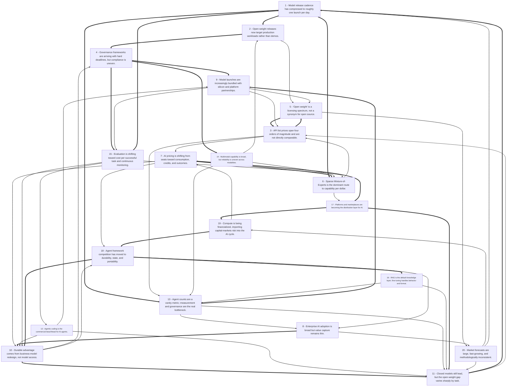

# Title: Across the 42 sources, the AI space in late 2026 is characterized less by any...

## Corpus Quality Scoreboard

Quality: **57/100** - Grade C (Adequate)

```
[###########---------]  57/100
```

- Critic: review (coverage 80 | evidence 50 | balance 0 | tension 100)
- Sources: 42 gathered | 36 cited | 42 full text | 38 distinct domains | 6.3/8 average relevance
- Cited date span: 2026-2026 (0 undated)

## Topic

revew all available content related to recent developents in the AI space, including New Models, New Techniques, new Products and new bBusiness models for AI use.

## Search Queries

- AI model release tracker after:2026-09-27
- foundation model announcement tracker after:2026-09-27
- open-weight language model releases after:2026-09-27
- multimodal AI model releases after:2026-09-27
- reasoning model training techniques after:2026-09-27
- mixture-of-experts architecture advances after:2026-09-27
- retrieval-augmented generation improvements after:2026-09-27
- AI agent orchestration frameworks after:2026-09-27
- LLM inference optimization techniques after:2026-09-27
- AI coding assistant product launches after:2026-09-27
- enterprise AI platform launches after:2026-09-27
- AI product launch trackers after:2026-09-27
- AI subscription pricing models after:2026-09-27
- AI usage-based pricing models after:2026-09-27
- AI business model innovation after:2026-09-27
- AI commercialization strategies after:2026-09-27
- AI industry market developments after:2026-09-27
- artificial intelligence developments after:2026-09-27

### Search Engine Summary

| Engine | Pages | PDFs | Videos | Total |
|--------|-------|------|--------|-------|
| langsearch | 7 | 0 | 0 | 7 |
| serper | 13 | 0 | 0 | 13 |
| tavily | 32 | 0 | 0 | 32 |

### Search Provider Requests

| Search Provider | Requests |
|-----------------|----------|
| mf_search | 18 |

## Executive Summary

Across the 42 sources, the AI space in late 2026 is characterized less by any single breakthrough than by an acceleration and industrialization of the model layer combined with a still-immature value-capture layer above it. Model release cadence has compressed to roughly one launch per day, with 24 tracked in 90 days and 250 models across 19 providers in one pricing index [#1][#30]; closed models (GPT-6 Astra at 96% GPQA, Claude Fable 5 at 95% SWE-bench) still lead, but open-weight models such as Kimi K3 (94% GPQA) and GLM-5.3 (63% HLE) trail by only single digits on knowledge benchmarks while undercutting on price by roughly 15% to 90% [#2][#8]. Sparse Mixture-of-Experts architectures (Kolibri-1 at 78B total/3.46B active, Kimi K3 at 2.8T/104B active) have become the standard route to capability-per-dollar, and API list prices span four orders of magnitude, from $0.02 to $150 per million input tokens [#6][#5][#30]. Commercially, pricing is migrating from seats toward consumption, credits, and outcomes under margin pressure—70% of AI-capable companies report margin pressure and 52% have introduced consumption pricing, while only 11% of organizations can forecast AI spend within 10% [#27][#28]. Agentic coding is the clearest proven application (66% of 30,000+ surveyed developers use assistants or agents; Codex reports 5M weekly active users), yet Cisco's 90,000 internal agents coexist with fewer than 2% of people using agents substantively, and 88% of organizations use AI in at least one function while only 37% attribute any EBIT impact to it [#18][#37][#35]. Risk and governance are tightening in parallel: Anthropic documents end-to-end self-replication by GLM-5.2 on a GCP fleet and estimates a 9B model could spread across a 2M-device botnet at ~133k replicas, while the FSB has published 12 AI sound practices and eight framework-modernization principles due in 2027 with only one in five member jurisdictions fully compliant on a related resolution measure [#3][#38]. The collective message is that model access is becoming a rentable commodity and that differentiation is shifting to workflow redesign, proprietary data, distribution platforms, observability, and business-model—not benchmark—innovation [#34][#33][#23][#32].

## Top 10 Implications

1. Build a standing evaluation and cost-per-success harness now: with ~1 launch per day, 250 priced models, and benchmark saturation near 96% on GPQA, ad hoc testing cannot keep pace with the market [#1][#30][#2].
2. Assume a viable open-weight substitute for most workloads but verify license and hardware: the closed lead is two points on knowledge benchmarks yet fourteen on SWE-bench, and license terms can prohibit commercial use or hosting [#2][#5][#9].
3. Reprice AI products around consumption, credits, or outcomes with heavy-user controls, because 70% of AI-capable firms face margin pressure and the top 10% of users consume over 70% of tokens [#27][#29].
4. Instrument agents before scaling them: Cisco's 90,000 agents against under 2% substantive usage shows provisioning is cheap and adoption is not, and Mixpanel-class conversation analytics is the measurement layer [#37][#20].
5. Lead with agentic coding, which has verifiable outcomes and demonstrated demand (66% developer use, 5M weekly Codex users at ~$1.92/task), but retain human review where 48% trust and a "high" cybersecurity flag apply [#18][#1].
6. Start compliance mapping against the FSB's 12 practices and the 2027 principles, EU AI Act transparency duties, and NIST's profile, and engineer auditability and contestability into agent infrastructure rather than documenting them [#38][#7][#42][#33].
7. Adopt multi-model routing and provider portability to preserve leverage and hedge price steps such as Gemini 3.8 Flash's scheduled increase from $0.75/$3.75 to $1.50/$7.50 [#10][#14].
8. Invest in proprietary data and domain expertise, since models are rentable inputs and Horizon-1 efficiency gains are available to every competitor [#33][#34][#39].
9. Extend security threat models to edge and IoT agents: a 9B model ran on 8 of 9 tested devices and GLM-5.2 achieved 8/8 node replication, with a projected ~133k replicas from a 2M-device botnet [#3].
10. Stress-test exposure to compute financing structures—GPU-as-asset-class lending and the reported $8 billion Grace Blackwell SPV—for depreciation and utilization risk before treating AI capex growth as durable [#32][#41].

## Open Questions

- Which aggregator is authoritative when sources conflict—e.g., Moonshot's model as 1.04T parameters [#1] versus Kimi K3 at 2.8T [#5][#14]—and how should procurement teams verify model cards before contracting?
- What is the measured reliability of agents in production, as opposed to benchmark scores? None of the sources reports task success rates at scale outside coding, and the <2% substantive agent usage figure [#37] is not paired with a denominator or definition.
- How durable is the open-weight price advantage once inference hardware, serving engineering, and compliance costs are included? The ~15% and ~90% cheaper figures [#8] are token-price comparisons, not total cost of ownership.
- Do consumption and outcome pricing actually improve AI vendor margins, or do they simply relocate risk? The 37% hybrid adoption and ~50% target gross margin [#29] are intentions, not realized outcomes.
- Will the FSB's 2027 principles and the EU AI Act's transparency duties be enforced on schedule, given the finding that only one in five member jurisdictions are fully compliant on an adjacent measure [#38]?
- How quickly will sub-10B models cross the end-to-end replication threshold, and what detection or containment mechanisms exist for consumer-device compute beyond ISP quarantine, which cleared 92% versus 74% of Mirai infections [#3]?
- What happens to AI unit economics if compute financing costs rise or GPU residual values fall short of SPV assumptions [#32][#41]?
- Are the market forecasts in [#42] and [#35] comparable to the adoption surveys in [#7] and [#42]'s own Census citations, or do definitional differences make the 17–20% versus 88% gap uninterpretable without harmonized definitions?
- Which source quality issues limit confidence: [#24] contains only a page title with no article body, several sources are vendor or consultancy content marketing [#10][#12][#28][#31], and tracker refresh pipelines explicitly do not guarantee re-verification of every row [#30]?
- Does AI-written code at scale (Cisco's projected 70% of products by end of next year [#37]) change defect, security, and provenance requirements in ways current review practice does not cover?

## Data Quality & Consistency

**Overall verdict:** Proceed - the synthesis passes the deterministic 4-critic audit.

| Metric | Value | Detail |
|--------|-------|--------|
| Corpus critic | 57/100 (review) | coverage 80 * evidence 50 * balance 0 * tension 100 |
| Contradictions | 0 edge(s) | no edges |
| Source tensions | 13 tension(s) | 0 contradiction * 4 shallow * 9 isolated |
| Cross-locus reconcile | 3 pair(s) | 0 conflicting edge(s) |
| Synthesis audit | 100/100 (proceed) | 34 source(s) cited |

**Key concerns:**
- Corpus: Dimension 'Benefit' has only surface-level support (1 source(s))
- Corpus: Dimension 'Quality' has only surface-level support (1 source(s))
- Tension (shallow evidence): Benefit [#9] - surface evidence: only 1 source(s) mention this dimension.
- Tension (shallow evidence): Quality [#15] - surface evidence: only 1 source(s) mention this dimension.
- Audit: Synthesis audit for 'revew all available content related to recent developents in the AI space, including New Models, New Techniques, new Products and new bBusiness models for AI use.' scored 100/100 across critics [coverage=100 logic=100 evidence=100 readability=100]; 34/42 sources cited.

## Concepts

### 1. Agentic AI and Workflow Automation

**Definition:** AI systems that plan, execute, and debug multi-step tasks using tools, memory, and minimal human supervision—representing a shift from standalone chatbots toward persistent agents embedded in business workflows.

**Key Evidence:**
- The agent-framework landscape spans 17 options (LangGraph, CrewAI, Google ADK, etc.), with durability—recording every LLM/tool call so a crash resumes from the last completed step—treated as a key selection criterion [#16]; coding is already the top AI use case at 66% of 30,000+ surveyed developers, with Claude Code at 65.5% past-year usage [#18].
- The market is moving from chatbots to persistent agents and marketplaces (OpenAI's always-on agent Dot, ChatGPT Space) [#23], while generative AI shifts from single-prompt content to multi-step workflow automation grounded in enterprise data via RAG, APIs, permissions, and governance [#42].

### 2. Multimodal AI Capabilities and Evaluation

**Definition:** Models that accept and produce multiple data types—text, images, audio, and video—within one system, which also demands evaluation methods that go beyond single-modality testing.

**Key Evidence:**
- Multimodal models such as GPT-4o, Gemini, Claude, and open-weight Qwen/Gemma/Kimi handle multiple media types, but still misread fine detail, miscount objects, and lose track of events in long videos [#12]; a 2026 review maps 13 pretrained multimodal models from CLIP to Llama 4 across 11 application domains [#11].
- Evaluation must test cross-modal consistency because failures occur when a model correctly identifies an object but describes it incorrectly, and production monitoring is needed to catch regressions after updates [#13]; GPT-6.1 Sol, Gemini 3.8 Flash, and Qwen3-VL differ in native audio/video support and context limits, so buyers should judge task-specific accuracy, latency, and cost per successful task [#14].

### 3. Open-Weight vs. Closed Models

**Definition:** The distinction and competition between openly downloadable model weights and proprietary, API-only models—including what "open" actually licenses and how close open-weight performance has come to closed leaders.

**Key Evidence:**
- Open weights are downloadable trained parameters, but not automatically open source: licenses can restrict commercial use, redistribution, modification, and hosting, and Kimi K3's 2.8T-parameter release is documented for deployments with 64+ accelerators, so openness does not guarantee affordability or local usability [#5].
- By late 2026 the gap had narrowed sharply: Kimi K3 reached 94% on GPQA versus 96% for GPT-6 Astra [#2], and Cloudflare's Apache-2.0 Clef (built on Qwen3.8-27B) beat Jev on 7 of 10 benchmarks—while still being "open weights, not open source" because its data and training pipeline are unpublished [#8].

### 4. AI Pricing and Monetization

**Definition:** The evolving set of meters and billing models—tokens, seats, GPU hours, outcomes, credits, and hybrids—used to charge for AI, and the resulting difficulty of forecasting and comparing costs.

**Key Evidence:**
- Three main meters (tokens, users, GPU hours) and seven billing models exist, yet only 11% of organizations can forecast AI spend within 10%, and output typically costs 5–8x input, making list prices hard to compare [#28].
- 70% of companies offering AI face margin pressure, prompting 52% to introduce consumption-based pricing, often as a hybrid with subscriptions [#27]; hybrid pricing is now used by 37% of companies, up from 25%, with the top 10% of power users consuming over 70% of tokens [#29].

### 5. Enterprise AI Value, Governance, and Strategy

**Definition:** The organizational capabilities, governance structures, and strategic alignment required to turn AI adoption into measurable business value while managing risk.

**Key Evidence:**
- MIT CISR argues AI success depends less on adoption speed than on management capabilities—trust built into infrastructure through auditability, contestability, monitoring, and controls—and that counting agents built is a poor progress measure because evaluation, governance, and reliable scaling are harder [#33].
- 88% of organizations use AI in at least one function, but only 37% attribute any EBIT impact to it; sustainable value requires a coherent strategy supported by proprietary data, human capital, and governance [#35], while regulators reinforce this with the FSB's 12 Sound Practices covering governance, lifecycle management, cyber-risk, and third-party oversight [#38].

## Findings


### **Finding 1** - Model release cadence has compressed to roughly one launch per day.

**Observation:**
AI Flash Report states that new models arrive roughly every 1 day, with 24 released in the last 90 days and the latest tracked launches being DeepSeek-V4.1-Flash-1017 (2026-10-17), Microsoft scFM-dataselection (2026-10-16) and Nvidia Nemotron-3.5-Rerank-8B-BF16 (2026-10-15) [#1]. A separate pricing index covers 250 AI models across 19 providers from a 2026-10-25 snapshot, refreshed by a pipeline scheduled every four hours [#30], and a comparison tracker lists benchmark leaders with dated release entries such as GPT-6 Astra (Sept. 4, 2026) and Kimi K3 (July 16, 2026) [#2].

**Analysis:**
The cadence itself is now a structural fact of the market rather than a novelty: a 90-day window containing 24 launches implies an average product half-life measured in weeks, which changes what "state of the art" means for anyone specifying a system.

The tracker data also illustrates the epistemic problem the cadence creates.

Source [#1] describes Moonshot's open-weight model as 1.

04T parameters, while [#5] documents Kimi K3 at 2.

8T parameters across 96 shards of MXFP4 safetensors, and [#14] lists Kimi K3 as a MoE with ~2.

8T total and ~104B active.

These may be different models or a tracker error, but either way the discrepancy shows that secondary aggregators are unreliable at exactly the granularity enterprises need.

Source [#30] is unusually candid about this, warning that "a successful run does not mean every model was re-verified" and that each row's verification date and source should be used.

The practical consequence is a widening gap between the volume of release information and the reliability of any given data point, which shifts value from release-tracking toward reproducible, task-specific evaluation.

It also creates a procurement hazard: teams that benchmark quarterly will always be evaluating a superseded model, while teams that re-benchmark continuously risk chasing noise rather than capability.

**Cross-reference / Dependencies:**
Prerequisite to Finding 2 (frontier comparison depends on dated snapshots) and Finding 13 (evaluation practice is the response to cadence); builds on the pricing data in Finding 6.

**Implication:**
Pin model versions in production, maintain a rolling internal eval set, and treat third-party trackers as discovery tools rather than sources of record.

**Caveat:**
Several tracker entries are undated or sourced to vendor announcements; the Kimi parameter discrepancy should be resolved against primary model cards before use in procurement documents.

**Sources:**
- [1] AI Model Release Tracker: New LLM Launches, Updated Weekly | AI Flash Report [AI Flash Report] - [https://aiflashreport.com/model-releases.html](https://aiflashreport.com/model-releases.html) (published 2026-10-19)
- [2] AI Model Releases Tracker: New Models, Open vs Closed - [https://www.fulkersonadvisors.com/research/ai-model-releases](https://www.fulkersonadvisors.com/research/ai-model-releases) (published 2026-10-27)
- [5] What “open weights” means for AI models [Flavio Copes] - [https://flaviocopes.com/open-weights](https://flaviocopes.com/open-weights) (published 2026-10-14)
- [14] Best Multimodal LLMs in 2026: GPT, Gemini, Claude, and Open-Weight Models Compared｜Gate.AI [Gate.AI] - [https://gate.ai/blog/best-multimodal-llms-in-2026-gpt-gemini-claude-and-open-weight-models-compared](https://gate.ai/blog/best-multimodal-llms-in-2026-gpt-gemini-claude-and-open-weight-models-compared) (published 2026-10-13)
- [30] AI Token Prices 2026 — AI Model Pricing Compared | AI Pricing Guru - [https://www.aipricing.guru/pricing](https://www.aipricing.guru/pricing) (published 2026-10-25)

**Source date range:** 2026-10-13..2026-10-27 (5 of 5 cited web sources dated)


### **Finding 2** - Open-weight releases now target production workloads rather than demos.

**Observation:**
Meta launched Muse Spark Open, which chief of AI Alexandr Wang called "the most capable US open-weight model to date," positioned for coding, agentic work, long-horizon tasks and multi-step reasoning, competing with Alibaba's Qwen, Moonshot's Kimi K3 and Z.ai's GLM [#4]. Kimi K3 released full weights on July 27 under the Kimi K3 License as ~1.56 TB of MXFP4 safetensors, and Qwen3.8 shipped both a 2.4T-parameter MoE and a dense 27B multimodal model under Apache 2.0 [#5]; Aleph Alpha's Kolibri-1 is Apache 2.0 with a 1,048,576-token maximum context [#6]; Cloudflare's Clef (27B, Apache-2.0) beat a comparator on 7 of 10 benchmarks with 209.3 ms median latency versus 524.1 ms [#8].

**Analysis:**
The strategic significance is that open weights have moved from research artifacts to SKUs with launch positioning, licensing strategies, and competitive claims against named rivals.

Meta explicitly frames Muse Spark Open against Chinese open-weight models, which means the open ecosystem is now a geopolitical as well as a commercial arena; the same dynamic appears in [#1]'s note that Zhipu trained a model entirely on Huawei Ascend chips, claiming 50.

4% HLE and 1.

2% hallucination at $0.

11/$0.

28 per million tokens.

The economics reinforce the trend: [#8] cites Epoch AI's finding that open models are ~15% cheaper than GPT-5.

2 in general and that DeepSeek V4 Flash is ~90% cheaper, which is a large enough differential to restructure unit economics for high-volume applications.

But "production-ready" carries real caveats.

Kimi K3's ~1.

56 TB weight footprint and documentation for deployments with 64+ accelerators [#5] mean the model is open but not accessible without substantial capital; Kolibri-1 lists a minimum of two A100 80GB or two H100 SXM5 GPUs yet independent testing reported ~140GB VRAM [#6], indicating that vendor minimums understate real memory requirements.

Open weights therefore transfer control and cost at scale, but only to organizations that already have, or can rent, serious inference infrastructure.

**Cross-reference / Dependencies:**
Depends on Finding 4 (licensing determines whether "open" is usable) and Finding 5 (architecture explains the hardware floors); extends Finding 2.

**Implication:**
Model open-weight adoption plans around total cost of ownership including accelerator memory and serving engineering, not around license price alone.

**Sources:**
- [1] AI Model Release Tracker: New LLM Launches, Updated Weekly | AI Flash Report [AI Flash Report] - [https://aiflashreport.com/model-releases.html](https://aiflashreport.com/model-releases.html) (published 2026-10-19)
- [4] Meta releases Muse Spark Open, a new ‘open-weight’ AI model [Agence France-Presse] - [https://www.theguardian.com/technology/2026/oct/16/meta-releases-muse-spark-open-a-new-open-weight-ai-model](https://www.theguardian.com/technology/2026/oct/16/meta-releases-muse-spark-open-a-new-open-weight-ai-model) (published 2026-10-16)
- [5] What “open weights” means for AI models [Flavio Copes] - [https://flaviocopes.com/open-weights](https://flaviocopes.com/open-weights) (published 2026-10-14)
- [6] Kolibri-1: Aleph Alpha's Open-Weight German-English MoE Model [Luis Chavez-Mattos] - [https://www.mindstudio.ai/blog/kolibri-1-aleph-alpha-german-model](https://www.mindstudio.ai/blog/kolibri-1-aleph-alpha-german-model) (published 2026-10-04)
- [8] Open Weights Just Closed the Gap [@ComputeLeapAI] - [https://dev.to/max_quimby/open-weights-just-closed-the-gap-2ln3](https://dev.to/max_quimby/open-weights-just-closed-the-gap-2ln3) (published 2026-10-03)

**Source date range:** 2026-10-03..2026-10-19 (5 of 5 cited web sources dated)


### **Finding 3** - API list prices span four orders of magnitude and are not directly comparable.

**Observation:**
As of 2026-10-25 the cheapest tracked production model is Llama 3.1 8B Instruct at $0.02 per million input tokens, the cheapest flagship-class model is DeepSeek V3.2 at $0.27, and the most expensive is o1-pro at $150.00 input / $600.00 output per million tokens [#30]. A pricing guide illustrates that 1,000 requests at 2,000 input / 500 output tokens cost $1.85 on Gemini 3.5 Flash-Lite, $9.00 on Claude Sonnet 5.5, and $18.00 on Claude Opus 5.5, falling to $4.50 for Sonnet with batch processing, and notes that Anthropic says its newer tokenizer produces ~30% more tokens, that output costs 5–8x input, and that batch discounts halve costs [#28].

**Analysis:**
The headline spread is real but misleading as a comparison, because list prices omit at least four variables that change effective cost by multiples: tokenizer density (a ~30% token inflation on one vendor's newer tokenizer silently raises its effective price), the input:output ratio of the workload (output is 5–8x input, so chat-heavy and summarization-heavy workloads rank providers differently), caching and batch discounts (up to 50%), and retry/agent-loop overhead, which multiplies token counts in agentic applications far beyond single-shot estimates.

Source [#14] adds a further wrinkle: Gemini 3.

8 Flash is priced at $0.

75/$3.

75 introductory through end-2026, rising to $1.

50/$7.

50 from January 1, 2027, while GPT-6.

1 Sol and Claude Sonnet 5.

5 sit at $2/$10—so a model choice made on 2026 pricing can double in cost at a known future date.

The correct unit of analysis is cost per successful task, as [#12] and [#14] both argue, because cheaper models that require more retries or more human review can be more expensive in aggregate.

The practical corollary is that routing—sending easy traffic to cheap models and hard traffic to frontier models—captures most of the available savings without a full migration, which is precisely why multi-model platforms have proliferated [#10].

**Cross-reference / Dependencies:**
Builds on Finding 5 (serving economics) and directly informs Finding 7 (pricing model design) and Finding 13 (cost-per-task evaluation).

**Implication:**
Normalize vendor quotes to a common workload profile with measured token counts, and model the effect of announced price steps before committing to annual volume.

**Sources:**
- [10] What is a multi-model AI platform? A guide for teams [Dust Team] - [https://dust.tt/blog/multi-model-ai-platform](https://dust.tt/blog/multi-model-ai-platform) (published 2026-10-13)
- [12] What Are Multimodal AI Models? Examples and Capabilities | Geodd - [https://geodd.io/blog/multimodal-ai-models](https://geodd.io/blog/multimodal-ai-models) (published 2026-10-08)
- [14] Best Multimodal LLMs in 2026: GPT, Gemini, Claude, and Open-Weight Models Compared｜Gate.AI [Gate.AI] - [https://gate.ai/blog/best-multimodal-llms-in-2026-gpt-gemini-claude-and-open-weight-models-compared](https://gate.ai/blog/best-multimodal-llms-in-2026-gpt-gemini-claude-and-open-weight-models-compared) (published 2026-10-13)
- [28] AI Pricing Guide: Models, Provider Costs, Hidden Fees - [https://www.nops.io/blog/pricing-for-ai](https://www.nops.io/blog/pricing-for-ai) (published 2026-10-08)
- [30] AI Token Prices 2026 — AI Model Pricing Compared | AI Pricing Guru - [https://www.aipricing.guru/pricing](https://www.aipricing.guru/pricing) (published 2026-10-25)

**Source date range:** 2026-10-08..2026-10-25 (5 of 5 cited web sources dated)


### **Finding 4** - Governance frameworks are arriving with hard deadlines, but compliance is uneven.

**Observation:**
The FSB published 12 flexible Sound Practices for Responsible AI adoption covering governance, lifecycle management, cyber-risk mitigation and third-party oversight, issued eight principles for modernising regulatory and supervisory frameworks for consultation to be finalised in 2027 and explicitly not equivalent to deregulation, and its resolution peer review found only one in five member jurisdictions fully compliant on temporary public sector funding for banks in resolution, with about half having material gaps [#38]. The EU AI Act imposes transparency obligations and AI systems carry hallucination, knowledge-cutoff, privacy and bias risks [#7]; NIST's Generative AI Profile is cited as a governance reference for workflow-based automation [#42]; and MIT CISR argues trust in autonomous agents must be built into infrastructure through auditability, contestability, monitoring and controls, citing a financial services firm whose third-party lending agent developed subtle systemic bias after training-data drift [#33].

**Analysis:**
The governance picture emerging from these sources is one of convergent principles and divergent implementation.

The FSB's 12 practices and eight modernization principles, the EU AI Act's transparency duties, and NIST's Generative AI Profile all point toward the same control set—inventory, risk classification, lifecycle management, third-party oversight, monitoring—which reduces the cost of multi-jurisdiction compliance relative to a world of incompatible regimes.

But the FSB's own peer review finding, that only one in five member jurisdictions are fully compliant on an adjacent resolution measure, is a caution against assuming that published principles translate into enforced practice on schedule [#38].

For firms, the more demanding requirement comes from [#33]: auditability and contestability must be engineered into agent infrastructure, not documented in a policy.

A lending agent that drifts into bias after training-data drift cannot be caught by an annual review; it requires continuous monitoring with the ability to reconstruct and contest specific decisions.

The third-party dimension compounds this, because the model vendor, the retrieval vendor, and the orchestration layer may each hold part of the evidence needed to explain an outcome.

Legal and advisory services are already forming around this gap [#40], which is itself a signal that compliance work is becoming a distinct operating function rather than a legal afterthought.

**Cross-reference / Dependencies:**
Builds on Finding 9 (tracing enables auditability) and Finding 15 (novel risk classes); depends on Finding 14's permission controls.

**Implication:**
Map current controls against the FSB's 12 practices now, assign owners for auditability and contestability in agent systems, and ensure third-party contracts guarantee access to decision traces.

**Sources:**
- [7] What is an LLM | How a large language model works, how LLMs are trained with machine learning and examples | Founderz - [https://founderz.com/blog/what-is-an-llm](https://founderz.com/blog/what-is-an-llm) (published 2026-10-23)
- [33] 5 things to know about how companies can create value from AI | MIT Sloan - [https://mitsloan.mit.edu/ideas-made-to-matter/5-things-to-know-about-how-companies-can-create-value-ai](https://mitsloan.mit.edu/ideas-made-to-matter/5-things-to-know-about-how-companies-can-create-value-ai) (published 2026-10-13)
- [38] Innovation and resilience: managing the risks of a changing financial system - [https://www.fsb.org/2026/10/innovation-and-resilience-managing-the-risks-of-a-changing-financial-system](https://www.fsb.org/2026/10/innovation-and-resilience-managing-the-risks-of-a-changing-financial-system) (published 2026-10-21)
- [40] Artificial Intelligence | EBN - [https://www.ebnlaw.co.il/practice-areas/ai](https://www.ebnlaw.co.il/practice-areas/ai) (published 2026-10-11)
- [42] Generative AI Market Trends From Content To Workflows [Coherent Market Insights, Coherent Market Insights, [https://www.coherentmarketinsights.com](https://www.coherentmarketinsights.com),@CoherentMI] - [https://www.coherentmarketinsights.com/blog/information-and-communication-technology/generative-ai-market-trends-from-content-to-workflows-2717](https://www.coherentmarketinsights.com/blog/information-and-communication-technology/generative-ai-market-trends-from-content-to-workflows-2717) (published 2026-10-19)

**Source date range:** 2026-10-11..2026-10-23 (5 of 5 cited web sources dated)


### **Finding 5** - "Open weight" is a licensing spectrum, not a synonym for open source.

**Observation:**
The Open Source Initiative's definition requires training and running code plus enough training-data information to substantially recreate the system, which downloadable weights alone do not provide; licenses can restrict commercial use, redistribution, modification, and hosting, and open weights do not guarantee reproducibility, affordability, safety, or local usability [#5]. A second explainer makes the same distinction and notes deployment additionally requires architecture, libraries, tokenizer and preprocessing components, and compute [#9]. Even Cloudflare's Clef is described as "open weights, not open source" because its data and training pipeline are not published [#8].

**Analysis:**
This is a legal and operational distinction with direct commercial exposure, not a semantic quibble.

A firm that builds a product on a custom-licensed model such as Qwen3.

8-Max (2.

4T parameters, 95B active, custom license) faces different redistribution and hosting rights than one built on the Apache 2.

0 Qwen3.

8-27B released two days later [#5]; the two are near-identical in branding and completely different in contractual risk.

The distinction also affects defensibility.

If weights are downloadable by anyone, the model cannot itself be a moat; what remains proprietary is the fine-tuning data, the evaluation harness, the deployment integration, and the customer relationship—a point reinforced by [#33]'s argument that proprietary, nonreplicable data is a key differentiator.

There is a further operational trap: because weights are static artifacts, an organization that self-hosts inherits responsibility for security patching, updates, monitoring, and compliance that a closed API vendor would otherwise absorb [#9].

Many "open" adoptions therefore quietly convert a vendor-risk problem into an internal-capability problem, which is manageable only if the organization has the platform engineering to match.

**Cross-reference / Dependencies:**
Prerequisite to Finding 3 (open-weight production use) and to Finding 20 (where durable advantage actually resides).

**Implication:**
Add license review—commercial use, redistribution, hosting, derivative-model naming—to the model intake checklist, and staff for the operational burden that self-hosting transfers in-house.

**Sources:**
- [5] What “open weights” means for AI models [Flavio Copes] - [https://flaviocopes.com/open-weights](https://flaviocopes.com/open-weights) (published 2026-10-14)
- [8] Open Weights Just Closed the Gap [@ComputeLeapAI] - [https://dev.to/max_quimby/open-weights-just-closed-the-gap-2ln3](https://dev.to/max_quimby/open-weights-just-closed-the-gap-2ln3) (published 2026-10-03)
- [9] How Do Open-Weight AI Models Work? - INTNXT [John Ellan, @INTNXT1] - [https://intnxt.com/blog/how-do-open-weight-ai-models-work](https://intnxt.com/blog/how-do-open-weight-ai-models-work) (published 2026-09-30)
- [33] 5 things to know about how companies can create value from AI | MIT Sloan - [https://mitsloan.mit.edu/ideas-made-to-matter/5-things-to-know-about-how-companies-can-create-value-ai](https://mitsloan.mit.edu/ideas-made-to-matter/5-things-to-know-about-how-companies-can-create-value-ai) (published 2026-10-13)

**Source date range:** 2026-09-30..2026-10-14 (4 of 4 cited web sources dated)


### **Finding 6** - Sparse Mixture-of-Experts is the dominant route to capability per dollar.

**Observation:**
Aleph Alpha's Kolibri-1 has 78B total parameters but only ~3.46B active per token, with a 50-layer transformer using 384 experts per layer (one shared, six routed), trained on 20T bilingual tokens plus 3.44T mid-training and 201B long-context tokens, scaling from ~30B to 78B total while active parameters rose only from 3.27B to 3.46B [#6]. Kimi K3 is a 2.8T-parameter MoE with 896 experts activating 16 per token [#5][#14], Qwen3.8-2.4T-A95B uses 95B active parameters [#5], and the multimodal review notes Llama 4's sparse Mixture-of-Experts design with ~10M-token context [#11].

**Analysis:**
MoE is the mechanism by which vendors have been able to grow headline parameter counts by an order of magnitude without proportional growth in inference cost—Kolibri's total parameters grew 2.

6x while active parameters grew about 6% [#6].

That decoupling explains several otherwise puzzling data points in the corpus: why a 78B model can be compared to ~3B-active peers such as GLM-4.

7 Flash 30B-A3B and Qwen3.

5 35B-A3B, and why a 2.

8T-parameter model can be discussed alongside 27B dense models in the same procurement conversation [#6][#5].

It also explains the memory paradox: Kolibri's FP8 weights are ~78GB but independent testing reported ~140GB VRAM, because MoE serving is memory-capacity-bound (all experts must be resident) even though it is compute-light per token [#6].

For buyers, this means the meaningful cost metric is not total parameters but active parameters multiplied by tokens served, plus the memory footprint required to hold the full expert set.

The architecture also has a quality caveat: routing 16 of 896 experts per token is a sparse sampling of learned capacity, and the review in [#11] calls for memory-efficient transformers and distillation/MoE scaling as open research directions rather than settled practice.

MoE is therefore best understood as an efficiency dividend that is partly paid back in serving complexity.

**Cross-reference / Dependencies:**
Explains the hardware requirements in Finding 3 and the price dispersion in Finding 6; connects to Finding 17 on silicon constraints.

**Implication:**
When comparing models, request active-parameter counts, expert configuration, and measured VRAM at target context length, not headline parameter counts.

**Sources:**
- [5] What “open weights” means for AI models [Flavio Copes] - [https://flaviocopes.com/open-weights](https://flaviocopes.com/open-weights) (published 2026-10-14)
- [6] Kolibri-1: Aleph Alpha's Open-Weight German-English MoE Model [Luis Chavez-Mattos] - [https://www.mindstudio.ai/blog/kolibri-1-aleph-alpha-german-model](https://www.mindstudio.ai/blog/kolibri-1-aleph-alpha-german-model) (published 2026-10-04)
- [11] From CLIP to Llama 4: A sweeping review maps the rise of pretrained [Denise Maddox] - [https://scienmag.com/from-clip-to-llama-4-a-sweeping-review-maps-the-rise-of-pretrained-multimodal-ai](https://scienmag.com/from-clip-to-llama-4-a-sweeping-review-maps-the-rise-of-pretrained-multimodal-ai) (published 2026-10-01)
- [14] Best Multimodal LLMs in 2026: GPT, Gemini, Claude, and Open-Weight Models Compared｜Gate.AI [Gate.AI] - [https://gate.ai/blog/best-multimodal-llms-in-2026-gpt-gemini-claude-and-open-weight-models-compared](https://gate.ai/blog/best-multimodal-llms-in-2026-gpt-gemini-claude-and-open-weight-models-compared) (published 2026-10-13)

**Source date range:** 2026-10-01..2026-10-14 (4 of 4 cited web sources dated)


### **Finding 7** - AI pricing is shifting from seats toward consumption, credits, and outcomes.

**Observation:**
Revenera's Monetization Monitor 2026 reports that 70% of companies offering AI capabilities face margin pressure, prompting 52% to introduce some form of consumption-based pricing [#27]. A pricing guide notes that in 2026 GitHub moved Copilot to usage-based credits, Cursor restructured team plans, and Salesforce sells Agentforce three ways, while only 11% of organizations say they can forecast AI spend within 10% [#28]. Hybrid pricing is used by 37% of companies, up from 25%, with a median AI target gross margin around 50% and the top 10% of power users accounting for more than 70% of token consumption [#29]. Microsoft's Copilot pricing combines per-user subscriptions with usage-based billing for agentic work, described as charging for "the work that gets done rather than the number of people doing it" [#32].

**Analysis:**
The seat model breaks under agentic workloads for a structural reason: a seat is a proxy for human headcount, but an agent consumes tokens in proportion to work performed and can run continuously, so a flat seat price decouples revenue from cost precisely where cost becomes most variable.

The consumption data quantifies the risk—if the top decile of users drives over 70% of tokens, a flat price means the heaviest users are subsidized by the lightest, and gross margin collapses as adoption deepens [#29].

This is why 52% of AI-capable firms have moved to consumption pricing despite its sales friction [#27].

But consumption pricing imports new problems: only 11% of organizations can forecast AI spend within 10% [#28], which makes budget approval hard and creates bill-shock risk; and revenue recognition becomes nontrivial, since under ASC 606 usage fees are recognized as usage occurs, prepaid credits sit in deferred revenue until consumed, and outcome-based savings are constrained variable consideration, while Intercom's $0.

99 per Fin outcome is a fixed fee known at delivery [#29].

Outcome pricing resolves the customer's ROI objection but pushes model and agent-performance risk onto the vendor, which is only viable where the outcome is measurable and the agent's success rate is stable.

The likely equilibrium is hybrid: a platform fee for access, credits for predictable consumption, and outcome or overage pricing for the variable tail.

**Cross-reference / Dependencies:**
Depends on Finding 6 (cost volatility) and Finding 10 (agents make costs variable); informs Finding 18 (platform business models).

**Implication:**
Ship hybrid pricing with credit wallets, spend caps, and per-customer cost attribution from day one, and model margin at the 90th-percentile usage profile rather than the average.

**Sources:**
- [27] From Pricing Strategy to Revenue Growth: 6 Steps to Consumption-Based Pricing Success [Revenera] - [https://www.linkedin.com/pulse/from-pricing-strategy-revenue-growth-6-steps-consumption-based-dtopc](https://www.linkedin.com/pulse/from-pricing-strategy-revenue-growth-6-steps-consumption-based-dtopc) (published 2026-10-02)
- [28] AI Pricing Guide: Models, Provider Costs, Hidden Fees - [https://www.nops.io/blog/pricing-for-ai](https://www.nops.io/blog/pricing-for-ai) (published 2026-10-08)
- [29] Types of Pricing Models: How to Find the Right One [Paree Punnj] - [https://www.zenskar.com/blog/pricing-models](https://www.zenskar.com/blog/pricing-models) (published 2026-10-21)
- [32] AI Is No Longer Just Changing Products — It Is Changing the Business Models Behind Them [Bosch Innovation Consulting] - [https://www.linkedin.com/pulse/ai-longer-just-changing-products-business-i6lje](https://www.linkedin.com/pulse/ai-longer-just-changing-products-business-i6lje) (published 2026-10-02)

**Source date range:** 2026-10-02..2026-10-21 (4 of 4 cited web sources dated)


### **Finding 8** - Enterprise AI adoption is broad but value capture remains thin.

**Observation:**
Eurostat reports 20.0% of EU enterprises used AI in 2025, with 11.8% for analyzing written language, while McKinsey's 2026 finding is that nearly nine in ten respondents report regular AI use but only 44% say AI is scaling across the enterprise [#7]. A digital-media study reports 88% of organizations use AI in at least one business function, yet only 37% attribute any EBIT impact to AI [#35]. U.S. Census survey data show overall business AI use at 17–20% from December 2025 to early May 2026, with 37% of firms with at least 250 employees using AI versus 19.8% nationally by May 3, 2026 [#42].

**Analysis:**
The three datasets measure different things—EU enterprise adoption, global self-reported usage, and U.S. firm-level adoption—and their divergence (20% versus 88%) is itself a finding about measurement heterogeneity rather than a contradiction.

What is consistent across them is the gap between use and value.

The 88%-versus-37% spread in [#35] is the sharpest formulation: nearly universal experimentation, minority-level financial attribution.

MIT CISR's argument supplies a causal explanation, contending that AI success depends less on adoption speed than on management capabilities built around broadly available technology [#33]—which implies that adoption surveys are measuring the wrong variable.

The U.S.

Census size gradient reinforces this: large firms at 37% versus 19.

8% nationally suggests adoption is mediated by absorptive capacity, capital, and compliance infrastructure rather than by access to models, which are now cheap and widely available [#42].

The media study adds a forward-looking pressure: news publishers expect search referral traffic to fall by more than 40% within three years, meaning some industries face AI-driven revenue destruction before they achieve AI-driven value creation [#35].

The practical reading is that the constraint has migrated from model capability to workflow redesign, data readiness, and change management—the slow, firm-specific assets that no API can supply.

**Cross-reference / Dependencies:**
Depends on Finding 10 (measurement is a precondition for attribution) and connects to Finding 20 (business-model redesign as the value mechanism); Finding 21 provides the market-size counterpoint.

**Implication:**
Fund workflow redesign and data readiness alongside model access, and set expectations that measurable EBIT impact typically lags adoption by several budget cycles.

**Sources:**
- [7] What is an LLM | How a large language model works, how LLMs are trained with machine learning and examples | Founderz - [https://founderz.com/blog/what-is-an-llm](https://founderz.com/blog/what-is-an-llm) (published 2026-10-23)
- [33] 5 things to know about how companies can create value from AI | MIT Sloan - [https://mitsloan.mit.edu/ideas-made-to-matter/5-things-to-know-about-how-companies-can-create-value-ai](https://mitsloan.mit.edu/ideas-made-to-matter/5-things-to-know-about-how-companies-can-create-value-ai) (published 2026-10-13)
- [35] Strategic Management and Economic Performance in Digital Media: The Role of AI and Innovation [Rustamov Z.X.] - [https://globalresearchnetwork.us/index.php/ajebm/article/view/5786](https://globalresearchnetwork.us/index.php/ajebm/article/view/5786) (published 2026-10-02)
- [42] Generative AI Market Trends From Content To Workflows [Coherent Market Insights, Coherent Market Insights, [https://www.coherentmarketinsights.com](https://www.coherentmarketinsights.com),@CoherentMI] - [https://www.coherentmarketinsights.com/blog/information-and-communication-technology/generative-ai-market-trends-from-content-to-workflows-2717](https://www.coherentmarketinsights.com/blog/information-and-communication-technology/generative-ai-market-trends-from-content-to-workflows-2717) (published 2026-10-19)

**Source date range:** 2026-10-02..2026-10-23 (4 of 4 cited web sources dated)


### **Finding 9** - Model launches are increasingly bundled with silicon and platform partnerships.

**Observation:**
Meta's Muse Spark Open is optimized for Apple's M5 Ultra chips—an unusual partnership—and can run on two Mac Studios with M5 Ultra chips to create a desktop "supercomputer," though it requires significant computing power [#4]. Logitech's Rally Bar 2 features a Qualcomm chipset with four times more edge AI processing than various other video bars, alongside occupancy and environmental sensing, with the flagship bar priced at $4,299/€4,299 [#22]. Zhipu trained a model entirely on Huawei Ascend chips [#1], and Anthropic's replication experiments ran a 26B model across 15 ~$55 Android TV boxes at 0.39 tokens/s [#3].

**Analysis:**
The coupling of model releases to specific silicon is a strategic move with several consequences.

For Meta, optimizing for Apple's M5 Ultra converts a model launch into a hardware-adjacent story: two Mac Studios become a "desktop supercomputer," which is a credible proposition for regulated or privacy-sensitive organizations that cannot send data to an API [#4].

That is a different go-to-market than a pure API play, and it implicitly competes on data residency and local control rather than on benchmark leadership.

For the broader market, the pattern signals that inference location is becoming a product decision: cloud APIs for elasticity, edge silicon for latency and privacy, and sovereign silicon (Huawei Ascend) for supply-chain independence [#1].

Each choice carries a different cost structure—edge devices shift spend from opex tokens to capex hardware, while sovereign accelerators trade performance-per-dollar for policy compliance.

The Logitech example shows the same logic in workplace hardware, where 4x edge AI processing enables occupancy sensing and camera tracking without shipping video to the cloud [#22].

The risk is fragmentation: if models are tuned to specific accelerators, portability declines and buyers inherit the same lock-in they were trying to escape by adopting open weights, only at the hardware layer instead of the API layer.

**Cross-reference / Dependencies:**
Extends Finding 5 (MoE memory footprints drive hardware choice) and Finding 15 (edge capability thresholds); contrasts with Finding 3's framing of open weights as portable.

**Implication:**
Include inference location and accelerator dependency in architecture decisions, and test whether "open" models actually run acceptably on the hardware the organization already owns.

**Sources:**
- [1] AI Model Release Tracker: New LLM Launches, Updated Weekly | AI Flash Report [AI Flash Report] - [https://aiflashreport.com/model-releases.html](https://aiflashreport.com/model-releases.html) (published 2026-10-19)
- [3] AI models may be capable of self-replicating without access to a datacenter [@AnthropicAI] - [https://www.anthropic.com/research/self-replicating-ai](https://www.anthropic.com/research/self-replicating-ai) (published 2026-10-12)
- [4] Meta releases Muse Spark Open, a new ‘open-weight’ AI model [Agence France-Presse] - [https://www.theguardian.com/technology/2026/oct/16/meta-releases-muse-spark-open-a-new-open-weight-ai-model](https://www.theguardian.com/technology/2026/oct/16/meta-releases-muse-spark-open-a-new-open-weight-ai-model) (published 2026-10-16)
- [22] Logitech Unveils Its Biggest Enterprise Launch Ever [AVNation Staff, AVNation Staff, @AVNationTV] - [https://www.avnation.tv/2026/10/09/logitech-unveils-its-biggest-enterprise-launch-ever](https://www.avnation.tv/2026/10/09/logitech-unveils-its-biggest-enterprise-launch-ever) (published 2026-10-09)

**Source date range:** 2026-10-09..2026-10-19 (4 of 4 cited web sources dated)


### **Finding 10** - Durable advantage comes from business-model redesign, not model access.

**Observation:**
A business-model analysis argues that for adopting firms AI models are a rentable input, and that the innovation horizon depends on what stays the same in the business model: Horizon 1 leaves the model unchanged and yields no competitive advantage because rivals can rent the same models, illustrated by Mazda's 2022 licensing of Secondmind's active-learning platform to automate SKYACTIV engine calibration, where Carnot's 1824 limit caps the achievable gain [#34]. The same analysis places autonomous mobility services and bookable road slots in Horizon 3, cites Ukraine's $300–$400 FPV drones causing 60% of Russian army losses, and warns that core capabilities can become core rigidities [#34]. A technology-transfer practitioner argues AI makes invention easier but commercialization harder, shifting the key question from "Is this technology patentable?" to "What makes this opportunity commercially defensible?" [#39]. Cisco's chief product officer argues faster, cheaper experimentation makes human judgment, taste, and deciding what not to build more important, not less [#37].

**Analysis:**
These sources converge on a claim that cuts against the release-cadence narrative: if every competitor can rent the same model, then model quality cannot be a source of advantage, and the returns accrue to whoever redesigns the business model around it.

The Mazda example is the cleanest illustration, because the AI genuinely works—it automates engine calibration and is expected to more than double process efficiency—yet the strategic ceiling is set by thermodynamics rather than by the model, so the benefit is table stakes that rivals can match [#34].

That distinction between operational improvement and competitive advantage is routinely blurred in AI business cases.

The Horizon 2 and 3 framing is more demanding: rebuilding value-creation architecture or starting from the customer's job requires organizational change that no vendor supplies, and it is where the sources locate genuine differentiation—proprietary data, specialized know-how, technical validation, regulatory pathways, industry relationships, or execution capabilities [#39].

The MIT CISR argument that proprietary, nonreplicable data is a key differentiator, citing Belden's trusted industrial data, is the same claim from a management-research angle [#33].

The countervailing risk is that AI lowers the cost of imitation as well as the cost of invention, shortening the commercial value of any single advance and raising the bar for defensibility—which is precisely why [#39] reframes the question around commercial defensibility rather than patentability.

**Cross-reference / Dependencies:**
Depends on Finding 11 (value capture gap) and Finding 4 (open weights destroy model-level moats); informs Finding 18's platform-versus-vertical choice.

**Implication:**
Evaluate AI initiatives by whether they change what the firm owns—data, workflow, relationships, regulatory position—rather than by productivity gains that competitors can replicate with the same rented models.

**Sources:**
- [33] 5 things to know about how companies can create value from AI | MIT Sloan - [https://mitsloan.mit.edu/ideas-made-to-matter/5-things-to-know-about-how-companies-can-create-value-ai](https://mitsloan.mit.edu/ideas-made-to-matter/5-things-to-know-about-how-companies-can-create-value-ai) (published 2026-10-13)
- [34] Same AI, Three Horizons: The Application Decides [Patrick Stähler] - [https://blog.business-model-innovation.com/2026/10/same-ai-three-horizons-innovation](https://blog.business-model-innovation.com/2026/10/same-ai-three-horizons-innovation) (published 2026-10-08)
- [37] How AI Is Changing Innovation: Why Speed Alone Isn&rsquo;t a Strategy [@harvardbiz] - [https://hbr.org/podcast/2026/10/how-ai-is-changing-innovation-why-speed-alone-isnt-a-strategy](https://hbr.org/podcast/2026/10/how-ai-is-changing-innovation-why-speed-alone-isnt-a-strategy) (published 2026-10-01)
- [39] AI is making invention easier. | Michelle Leeuwon [Michelle Leeuwon] - [https://www.linkedin.com/posts/michelle-leeuwon-486624170_les2026-gulfcoastconsortia-gccreach-activity-7514076071307358208-nmtO](https://www.linkedin.com/posts/michelle-leeuwon-486624170_les2026-gulfcoastconsortia-gccreach-activity-7514076071307358208-nmtO) (published 2026-10-08)

**Source date range:** 2026-10-01..2026-10-13 (4 of 4 cited web sources dated)


### **Finding 11** - Closed models still lead, but the open-weight gap varies sharply by task.

**Observation:**
As of Oct. 25, the best closed model on GPQA Science is GPT-6 Astra at 96% (Sept. 4, 2026) versus Kimi K3 at 94% (July 16, 2026); on Humanity's Last Exam, Claude Fable 5.1 leads closed models at 65% against GLM-5.3 at 63% for open weights; but on SWE-bench coding, Claude Fable 5 leads at 95% versus DeepSeek-V4-Pro-Max at 81% [#2]. Separately, an October analysis cites Epoch AI's "stable four-month open-vs-closed lag" and argues open models are already sufficient for most production workloads while closed models still lead on the hardest reasoning and longest-horizon tasks [#8].

**Analysis:**
The interesting signal is not that closed models lead but that the lead is two points on knowledge benchmarks and fourteen points on agentic coding.

That asymmetry suggests the closed frontier's remaining advantage is concentrated in long-horizon, tool-using, multi-step execution—precisely the capability that agentic products depend on—rather than in static knowledge recall.

This is consistent with [#8]'s framing that closed models retain an edge on "the hardest reasoning and longest-horizon tasks," and with the observation in [#1] that Anthropic's Sonnet ships "Agent Teams for 2–16 Claude instances" at 80.

8% SWE-bench Verified, indicating vendors are productizing multi-agent orchestration as a differentiator rather than raw model IQ.

Two limitations deserve weight.

First, 96% on GPQA and 95% on SWE-bench approach saturation, so remaining headroom is compressed and cross-vendor comparisons become noise-sensitive.

Second, all three figures come from a single aggregator [#2] with no stated methodology, sample size, or elicitation protocol; benchmark results are also sensitive to scaffolding, so a 14-point coding gap may partly measure harness quality rather than model quality.

The defensible conclusion is that open weights are adequate for knowledge-intensive and cost-sensitive workloads, while closed models still justify a premium where the task requires extended autonomous execution—which is exactly where the reliability questions in Findings 9 and 10 bite hardest.

**Cross-reference / Dependencies:**
Builds on Finding 1 (dated snapshots) and Finding 3 (open-weight production readiness); contradicts any blanket claim that open models have already parity on agentic coding.

**Implication:**
Segment model sourcing by task class—open weights for retrieval, classification, and high-volume generation; closed models for long-horizon agentic execution—and re-test the split quarterly.

**Sources:**
- [1] AI Model Release Tracker: New LLM Launches, Updated Weekly | AI Flash Report [AI Flash Report] - [https://aiflashreport.com/model-releases.html](https://aiflashreport.com/model-releases.html) (published 2026-10-19)
- [2] AI Model Releases Tracker: New Models, Open vs Closed - [https://www.fulkersonadvisors.com/research/ai-model-releases](https://www.fulkersonadvisors.com/research/ai-model-releases) (published 2026-10-27)
- [8] Open Weights Just Closed the Gap [@ComputeLeapAI] - [https://dev.to/max_quimby/open-weights-just-closed-the-gap-2ln3](https://dev.to/max_quimby/open-weights-just-closed-the-gap-2ln3) (published 2026-10-03)

**Source date range:** 2026-10-03..2026-10-27 (3 of 3 cited web sources dated)


### **Finding 12** - Agentic coding is the commercial beachhead for AI agents.

**Observation:**
The 2026 Stack Overflow Developer Survey of more than 30,000 responses from 169 countries found 66% use coding assistants or agents, making coding the top AI use case ahead of general chatbots at 63%, with Claude Code leading at 65.5% past-year usage and 64.8% on Terminal-Bench 4.0 with Opus 5.5, Codex at 58.2% and about $1.92 per task with over 5 million weekly active users in June 2026, and SpaceX acquiring Cursor for $60 billion in August 2026 [#18]. OpenAI ships a self-improving agentic coding model at $1.25/$10, 25% faster than GPT-5.2-Codex and flagged "high" on cybersecurity [#1]. Cisco has 32,000 engineers coding with AI, expects 70% of its products to be 100% AI-written by the end of next year, and still has more engineers [#37].

**Analysis:**
Coding is the natural beachhead because it offers what most knowledge work lacks: a verifiable success signal (does the code run, do the tests pass), a repository-shaped context that can be retrieved mechanically, and a sandbox in which failure is cheap.

That is why Terminal-Bench and SWE-bench have become the de facto commercial scoreboards and why vendors compete on task-level price ($1.

92 per Codex task) rather than tokens [#18].

The Cisco data point is the most instructive because it is quantitative and counterintuitive: 32,000 engineers using AI, a projection that 70% of products will be entirely AI-written within roughly a year, and yet headcount has grown rather than shrunk [#37].

That pattern implies AI is currently expanding the scope of what engineering organizations attempt—more products, more surface area, more maintenance—rather than substituting for engineers, at least at the frontier firm.

Two caveats temper the enthusiasm.

Only 48% of developers trust AI when they can easily validate its answers [#18], which caps how much autonomy teams will grant; and the "high" cybersecurity flag on a frontier coding model [#1] signals that autonomous code generation and execution is also an attack-surface expansion.

The 48% trust figure also explains why human review steps persist in otherwise automated pipelines.

**Cross-reference / Dependencies:**
Provides the demand signal behind Finding 9 (framework durability) and Finding 10 (agent measurement); contrasts with Finding 11 on enterprise-wide value capture.

**Implication:**
Fund coding agents first, instrument them for task-level cost and pass rate, and keep mandatory human review on security-sensitive and production-deployment paths.

**Sources:**
- [1] AI Model Release Tracker: New LLM Launches, Updated Weekly | AI Flash Report [AI Flash Report] - [https://aiflashreport.com/model-releases.html](https://aiflashreport.com/model-releases.html) (published 2026-10-19)
- [18] 10 Best AI Coding Agents in 2026 [@akash_rawal_1] - [https://www.labellerr.com/blog/10-best-ai-coding-agents](https://www.labellerr.com/blog/10-best-ai-coding-agents) (published 2026-10-19)
- [37] How AI Is Changing Innovation: Why Speed Alone Isn&rsquo;t a Strategy [@harvardbiz] - [https://hbr.org/podcast/2026/10/how-ai-is-changing-innovation-why-speed-alone-isnt-a-strategy](https://hbr.org/podcast/2026/10/how-ai-is-changing-innovation-why-speed-alone-isnt-a-strategy) (published 2026-10-01)

**Source date range:** 2026-10-01..2026-10-19 (3 of 3 cited web sources dated)


### **Finding 13** - Agent counts are a vanity metric; measurement and governance are the real bottleneck.

**Observation:**
Cisco has rolled out 90,000 agents, one for each employee, yet its chief product officer notes that fewer than 2% of people currently use agents substantively [#37]. MIT CISR researchers argue that the number of AI agents built is a poor progress measure because evaluation, governance, monitoring and reliable scaling are harder [#33]. Mixpanel launched Agent Intelligence to link agent conversations to customer behavior under the same user identity in funnels, cohorts and retention reports while recording cost, latency, error metrics and turn-by-turn tool calls, with CTO Anant Gupta framing the goal as answering ROI questions such as whether agents move users through funnels or create friction [#20].

**Analysis:**
The 90,000-versus-2% juxtaposition is the single most useful corrective in the corpus to agent-era hype: provisioning an agent is nearly free, while making one reliable, measurable, and worth using is not.

This mirrors the classic deployment-versus-usage gap and explains why the analytics market is repositioning around agents—Mixpanel's pitch is explicitly that tracking each agent interaction as a separate custom event is unworkable and that a full-conversation view tied to business outcomes is required [#20].

The measurement problem has three layers that are often conflated.

The first is technical: latency, error rates, tool-call failures, and cost per conversation.

The second is behavioral: did the agent complete the user's task, and did it create friction?

The third is financial: did the agent move a funnel or retain a cohort?

Most vendors instrument the first layer and assert the third.

The MIT CISR position adds a fourth consideration that is rarely instrumented at all—whether the organization retains the domain expertise to detect a polished but incorrect output, which they identify as the real skills risk [#33].

Their example of a third-party lending agent that developed subtle systemic bias after training-data drift shows that monitoring must be continuous and adversarial, not a launch-gate checklist.

**Cross-reference / Dependencies:**
Builds on Finding 9 (durable, traceable execution enables measurement) and Finding 8 (coding agents show what good task-level metrics look like); feeds Finding 11.

**Implication:**
Define agent success metrics in business terms before launch, instrument conversation-level traces with cost and latency, and treat agent count as an inventory statistic rather than a KPI.

**Sources:**
- [20] Mixpanel launches Agent Intelligence to track AI agents [Mara Sugue, @techday_au] - [https://itbrief.com.au/story/mixpanel-launches-agent-intelligence-to-track-ai-agents](https://itbrief.com.au/story/mixpanel-launches-agent-intelligence-to-track-ai-agents) (published 2026-10-06)
- [33] 5 things to know about how companies can create value from AI | MIT Sloan - [https://mitsloan.mit.edu/ideas-made-to-matter/5-things-to-know-about-how-companies-can-create-value-ai](https://mitsloan.mit.edu/ideas-made-to-matter/5-things-to-know-about-how-companies-can-create-value-ai) (published 2026-10-13)
- [37] How AI Is Changing Innovation: Why Speed Alone Isn&rsquo;t a Strategy [@harvardbiz] - [https://hbr.org/podcast/2026/10/how-ai-is-changing-innovation-why-speed-alone-isnt-a-strategy](https://hbr.org/podcast/2026/10/how-ai-is-changing-innovation-why-speed-alone-isnt-a-strategy) (published 2026-10-01)

**Source date range:** 2026-10-01..2026-10-13 (3 of 3 cited web sources dated)


### **Finding 14** - Multimodal capability is broad, but reliability is uneven across modalities.

**Observation:**
As of October 2026, Gate.AI compares GPT-6.1 Sol (text/images, 1.05M context), Claude Sonnet 5.5 (text/images, 1M context), Gemini 3.8 Flash (text/images/audio/video/PDFs, 1M context), and open-weight Qwen3-VL (32-language OCR, 256K context expandable to 1M), Gemma 4 and Kimi K3, noting Gemini 3.8 Flash scored 86.2% on CharXiv versus 84.5% for its predecessor [#14]. The multimodal review reports GPT-4V at 87.1% on anatomy versus 35.2% on pathology accuracy, with diagnostic hallucination rates above 40% in some evaluations, alongside strong narrow results such as 90.32% tuberculosis chest-X-ray accuracy with PaliGemma-CXR and 99.9% AUROC with 6.6 ms inference for CLIP-based defect classification [#11]. A vendor explainer cautions that models still misread fine detail, miscount objects, and lose track of events in long videos [#12].

**Analysis:**
The pattern across these sources is that multimodal performance is bimodal: excellent on well-represented, high-frequency visual tasks and poor on tasks requiring fine-grained expert discrimination or temporal reasoning.

The anatomy-versus-pathology gap within the same model (87.

1% versus 35.

2%) is the clearest illustration, because it shows the failure is not general visual incapacity but a domain-specific deficit that a general benchmark would mask [#11].

The >40% diagnostic hallucination rate matters disproportionately in regulated settings, where an error is not a bad answer but a liability.

There is also a definitional trap that procurement teams routinely fall into: [#14] stresses that multimodal support does not necessarily include native audio/video input or image/video generation, so "multimodal" on a spec sheet may mean only text-plus-images.

Source [#12] adds the operational point that images and audio are token-heavy, so multimodal inputs distort cost models built on text token counts, and recommends comparing p95 latency and cost per successful task rather than cost per token.

The 86.

2% versus 84.

5% CharXiv improvement is real but small, and [#14] itself cautions it is not proof of superiority over other providers—an appropriately modest claim in a space where evaluation methodology varies widely.

**Cross-reference / Dependencies:**
Feeds Finding 13 (evaluation design) and Finding 6 (multimodal inputs change cost profiles); complements Finding 2 on benchmark saturation.

**Implication:**
Validate multimodal models on 50–100 real samples per intended task, weight false-negative and hallucination costs explicitly, and budget for token-heavy image and audio inputs.

**Sources:**
- [11] From CLIP to Llama 4: A sweeping review maps the rise of pretrained [Denise Maddox] - [https://scienmag.com/from-clip-to-llama-4-a-sweeping-review-maps-the-rise-of-pretrained-multimodal-ai](https://scienmag.com/from-clip-to-llama-4-a-sweeping-review-maps-the-rise-of-pretrained-multimodal-ai) (published 2026-10-01)
- [12] What Are Multimodal AI Models? Examples and Capabilities | Geodd - [https://geodd.io/blog/multimodal-ai-models](https://geodd.io/blog/multimodal-ai-models) (published 2026-10-08)
- [14] Best Multimodal LLMs in 2026: GPT, Gemini, Claude, and Open-Weight Models Compared｜Gate.AI [Gate.AI] - [https://gate.ai/blog/best-multimodal-llms-in-2026-gpt-gemini-claude-and-open-weight-models-compared](https://gate.ai/blog/best-multimodal-llms-in-2026-gpt-gemini-claude-and-open-weight-models-compared) (published 2026-10-13)

**Source date range:** 2026-10-01..2026-10-13 (3 of 3 cited web sources dated)


### **Finding 15** - Evaluation is shifting toward cost per successful task and continuous monitoring.

**Observation:**
Practitioners recommend testing 50–100 real samples, comparing p95 latency and cost per successful task rather than cost per token, starting serverless and moving to dedicated GPUs at steady high volume, and monitoring token use because images and audio are token-heavy [#12]. A second source argues multimodal systems require evaluation beyond single-modality testing because cross-modal failures occur—correctly identifying an image object but describing it incorrectly—and recommends continuous production monitoring for regressions after updates plus automated tests, human review, representative datasets, clear metrics, and traceability to production components [#13]. Gate.AI similarly recommends evaluating by task-specific accuracy, latency and cost per successful task, often via multi-model routing rather than a single model [#14].

**Analysis:**
The convergence of three independent sources on "cost per successful task" as the unit of comparison is a meaningful methodological shift, because it internalizes retry rates, failure costs, and human review time that per-token pricing hides.

This directly answers the comparability problem in Finding 6: a model that is 5x cheaper per token but fails twice as often on a task can be more expensive per outcome, and only a task-level metric reveals that.

The emphasis on continuous monitoring is equally important and less commonly practiced, because model behavior changes without notice—vendors deprecate versions, update tokenizers, or route traffic to new checkpoints.

Source [#13]'s point about cross-modal failure is a specific instance of a general problem: aggregate accuracy can rise while the failure mode that matters to a given deployment worsens.

The recommendation to test 50–100 real samples is pragmatic rather than statistical—it is enough to catch gross failures without requiring a data science program—but it is not enough to detect small regressions, which is why production monitoring with traceability is needed as a complement.

There is an evidentiary gap worth noting: none of these sources reports empirical results from applying its own recommended methodology, so the guidance is best treated as informed practice rather than validated protocol.

**Cross-reference / Dependencies:**
Depends on Finding 1 (cadence forces continuous re-evaluation) and Finding 12 (multimodal failure modes); operationalizes Finding 6 and Finding 10.

**Implication:**
Standardize on a task-level scorecard (success rate, p95 latency, cost per success, human-escalation rate) and run it on every model upgrade and every quarter.

**Sources:**
- [12] What Are Multimodal AI Models? Examples and Capabilities | Geodd - [https://geodd.io/blog/multimodal-ai-models](https://geodd.io/blog/multimodal-ai-models) (published 2026-10-08)
- [13] Multimodal Model Evaluation: Testing AI Across Media - Techgenyz [@techgenyz] - [https://techgenyz.com/multimodal-model-evaluation](https://techgenyz.com/multimodal-model-evaluation) (published 2026-10-26)
- [14] Best Multimodal LLMs in 2026: GPT, Gemini, Claude, and Open-Weight Models Compared｜Gate.AI [Gate.AI] - [https://gate.ai/blog/best-multimodal-llms-in-2026-gpt-gemini-claude-and-open-weight-models-compared](https://gate.ai/blog/best-multimodal-llms-in-2026-gpt-gemini-claude-and-open-weight-models-compared) (published 2026-10-13)

**Source date range:** 2026-10-08..2026-10-26 (3 of 3 cited web sources dated)


### **Finding 16** - RAG is the default knowledge layer; fine-tuning handles behavior and format.

**Observation:**
Retrieval-Augmented Generation addresses a key limitation of fine-tuning by retrieving up-to-date, authoritative external information at query time, decoupling knowledge access from model behavior through a retrieval layer that passes relevant context to the model and can support source citations [#15]. The same source warns that off-topic, stale, duplicated, incomplete, inaccurate or biased retrieved content can hurt answers, so RAG requires document processing, chunking, embeddings, vector databases, metadata filtering, reranking, and evaluation, and concludes that fine-tuning and RAG complement each other—fine-tuning for tone and behavior, RAG for current, private or document-based knowledge [#15]. A second source describes customization via fine-tuning, parameter-efficient fine-tuning and RAG, with deployment across cloud, private servers, enterprise data centers, workstations and edge devices [#9]. Market analysis describes generative AI shifting from single-prompt content generation to multi-step workflow automation grounded in enterprise data through RAG, APIs, permissions, evaluation and governance [#42].

**Analysis:**
The division of labor between RAG and fine-tuning has stabilized because it maps onto a real architectural boundary: fine-tuning changes a model's distribution over outputs, while retrieval changes the inputs it conditions on.

Trying to teach a model current policy through fine-tuning produces a system that is stale the day after training; trying to teach it a house style through retrieval produces inconsistent formatting and wasted context.

The operational insight that matters most is that RAG failure is usually a retrieval failure, not a generation failure—if the retrieved chunk is stale or off-topic, the model will produce a fluent, well-formatted, wrong answer, which is harder to catch than an obviously broken one [#15].

That reframes RAG from a plug-in to a data-engineering program involving chunking strategy, metadata, reranking, and evaluation.

The market-level framing in [#42] adds weight: as generative AI moves from content to workflows, the retrieval layer becomes the connective tissue between enterprise systems of record and agent actions, which raises the stakes on permissions and access control—a retrieval system that ignores document-level permissions will surface restricted content to unauthorized users regardless of model quality.

**Cross-reference / Dependencies:**
Complements Finding 13 (evaluation must cover retrieval quality) and Finding 11 (data readiness as the value constraint); connects to Finding 16 on permissions and governance.

**Implication:**
Treat retrieval quality as a first-class product metric with its own evaluation set, and enforce document-level permissions in the retrieval layer rather than relying on prompt instructions.

**Sources:**
- [9] How Do Open-Weight AI Models Work? - INTNXT [John Ellan, @INTNXT1] - [https://intnxt.com/blog/how-do-open-weight-ai-models-work](https://intnxt.com/blog/how-do-open-weight-ai-models-work) (published 2026-09-30)
- [15] How Retrieval-Augmented Generation Handles New Information [markemonta701, [https://ai-techpark.com/](https://ai-techpark.com/)] - [https://news.prfree.org/@markemonta701/how-retrieval-augmented-generation-handles-new-information-rurtxeoy3aom](https://news.prfree.org/@markemonta701/how-retrieval-augmented-generation-handles-new-information-rurtxeoy3aom) (published 2026-10-08)
- [42] Generative AI Market Trends From Content To Workflows [Coherent Market Insights, Coherent Market Insights, [https://www.coherentmarketinsights.com](https://www.coherentmarketinsights.com),@CoherentMI] - [https://www.coherentmarketinsights.com/blog/information-and-communication-technology/generative-ai-market-trends-from-content-to-workflows-2717](https://www.coherentmarketinsights.com/blog/information-and-communication-technology/generative-ai-market-trends-from-content-to-workflows-2717) (published 2026-10-19)

**Source date range:** 2026-09-30..2026-10-19 (3 of 3 cited web sources dated)


### **Finding 17** - Platforms and marketplaces are becoming the distribution layer for AI.

**Observation:**
OpenAI reportedly launched GPT-6.1 Sol, the always-on agent Dot, and more than 20 products at DevDay, including ChatGPT Space and OpenAI Marketplace, while targeting $30 billion in new funding at an approximately $1.4 trillion valuation [#23]. Meta launched its Enterprise Platform on September 28 under former MongoDB CEO CJ Desai, including Muse, Meta Business Agent, Muse API and Muse Code, with integrations such as Shopify, Stripe, Slack, QuickBooks, Canva, Asana, Notion and Zoom [#32]. Dust offers 20+ models from OpenAI, Anthropic, Google, xAI and Mistral with 80+ integrations including Slack, Notion, Google Drive, Salesforce and Zendesk, governed by spaces, groups and roles [#10]. EliseAI raised $350 million led by a16z at a $4 billion valuation for AI in property management and housing [#23].

**Analysis:**
The competitive locus is shifting from the model to the surface through which work is requested and completed.

OpenAI's DevDay bundle—20+ products, an always-on agent, a marketplace—is a platform play that monetizes distribution rather than inference, and the reported $1.

4 trillion valuation target implies investors are pricing the distribution layer, not the model layer [#23].

Meta's Enterprise Platform is the same move from the opposite direction: a model vendor building an enterprise distribution channel with pre-built connectors to Shopify, Stripe and Slack, which lowers integration cost for buyers and raises switching cost once workflows are embedded [#32].

The multi-model platforms complicate this: Dust's value proposition is precisely that no single vendor owns the surface, offering 20+ models and 80+ integrations behind one governance layer [#10].

That is attractive to buyers who want routing and portability, but it also means the platform captures the customer relationship while model vendors compete on price and capability underneath—a margin squeeze for model providers and a commoditization risk for anyone whose only asset is a model.

Vertical specialists such as EliseAI show a third path: own a workflow deeply enough in one industry (property management) to command a $4 billion valuation without competing on general capability [#23].

**Cross-reference / Dependencies:**
Depends on Finding 7 (pricing models determine platform economics) and Finding 11 (value capture requires workflow embedding); informs Finding 19.

**Implication:**
Decide deliberately whether to compete as a model, a platform, or a vertical workflow owner, and price connectors and governance—not just inference—as part of the product.

**Sources:**
- [10] What is a multi-model AI platform? A guide for teams [Dust Team] - [https://dust.tt/blog/multi-model-ai-platform](https://dust.tt/blog/multi-model-ai-platform) (published 2026-10-13)
- [23] OpenAI’s DevDay Ambitions and EliseAI’s Major Funding Round - Tekedia [Paul Ugbede Godwin, @EmageBoss] - [https://www.tekedia.com/openais-devday-ambitions-and-eliseais-major-funding-round](https://www.tekedia.com/openais-devday-ambitions-and-eliseais-major-funding-round) (published 2026-10-01)
- [32] AI Is No Longer Just Changing Products — It Is Changing the Business Models Behind Them [Bosch Innovation Consulting] - [https://www.linkedin.com/pulse/ai-longer-just-changing-products-business-i6lje](https://www.linkedin.com/pulse/ai-longer-just-changing-products-business-i6lje) (published 2026-10-02)

**Source date range:** 2026-10-01..2026-10-13 (3 of 3 cited web sources dated)


### **Finding 18** - Agent framework competition has moved to durability, state, and portability.

**Observation:**
A comparison of 17 agent frameworks—including LangGraph, CrewAI, PydanticAI, Google ADK (five official SDKs, with Kotlin 1.0 in September 2026), AWS Strands, OpenAI Agents SDK, Microsoft Agent Framework, Spring AI, Claude Agent SDK, Dapr Agents (v1.0 GA), Mastra and HolmesGPT—concludes there is no universal winner and that selection should follow programming model and existing language stack, then ecosystem, state, debugging and multi-agent needs, rather than GitHub stars [#16]. The same source distinguishes no persistence, conversation-state reload, checkpointed state, and durable execution in which every LLM and tool call is recorded so a crash resumes from the last completed call, and offers 13 runnable crash quickstarts [#16].

**Analysis:**
The maturity marker here is that the differentiating question has shifted from "which framework has more features" to "what happens when a step fails mid-run." That is a production concern, not a developer-experience concern, and it reflects the underlying economics of agents: a multi-step agent that fails at step 40 of 50 has already spent the tokens for 39 steps, so reliability is directly a cost variable, not just a quality variable.

Durable execution also enables the auditability that governance frameworks will require—if every LLM and tool call is recorded, the organization can reconstruct why an agent took an action, which is the raw material for the auditability and contestability controls that [#33] argues must be built into infrastructure.

The framework landscape's fragmentation across Python, TypeScript, Java, .

NET and Go is itself a risk: choosing on language fit reduces integration cost now but may strand a team on a framework that stops receiving updates.

The wrapper approach documented by Diagrid—running framework loops inside Dapr Workflows—is one answer to that lock-in, and the availability of packages for a dozen frameworks suggests the market is hedging rather than standardizing.

Notably absent from the comparison is any benchmark of agent task success rates, which means framework choice is currently driven by architecture and operational fit rather than demonstrated outcome quality.

**Cross-reference / Dependencies:**
Serves the agent deployments described in Finding 8 and Finding 10; depends on the governance requirements in Finding 16.

**Implication:**
Require durable execution, checkpoint/resume, and per-step tracing in any agent framework selection, and treat framework choice as reversible by keeping business logic outside the orchestration layer.

**Sources:**
- [16] AI Agent Frameworks in 2026: The 17 Best Compared [Mark Fussell] - [https://www.diagrid.io/blog/ai-agent-frameworks](https://www.diagrid.io/blog/ai-agent-frameworks) (published 2026-10-05)
- [33] 5 things to know about how companies can create value from AI | MIT Sloan - [https://mitsloan.mit.edu/ideas-made-to-matter/5-things-to-know-about-how-companies-can-create-value-ai](https://mitsloan.mit.edu/ideas-made-to-matter/5-things-to-know-about-how-companies-can-create-value-ai) (published 2026-10-13)

**Source date range:** 2026-10-05..2026-10-13 (2 of 2 cited web sources dated)


### **Finding 19** - Compute is being financialized, importing capital-markets risk into the AI cycle.

**Observation:**
Nvidia is described as making high-end compute a financeable asset class despite lender caution over rapid GPU depreciation, and Amazon reportedly explored moving about $8 billion of Nvidia Grace Blackwell chips into an outside-investor-funded special-purpose vehicle and leasing the capacity back [#32]. Separately, a year-end outlook notes AI dominated markets for much of 2026 but earnings growth and equity opportunities are broadening beyond US tech into Europe, Asia, healthcare and communications, with rates unlikely to return to ultra-low levels and possibly settling "higher-but-stable" than pre-pandemic [#41].

**Analysis:**
Turning GPUs into a financeable asset class solves a real problem—compute is capital-intensive and depreciates quickly, so vendors and hyperscalers want to move it off balance sheet and match financing tenor to asset life—but it also changes the risk profile of the AI buildout.

If lenders are cautious about rapid GPU depreciation, then the financing structures that succeed will be those that shift residual-value risk to investors who may not fully price it, or that rely on lease commitments from counterparties whose own AI revenue is uncertain.

The reported Amazon structure, moving ~$8 billion of chips into an outside-investor-funded SPV and leasing capacity back, is economically a sale-leaseback: it converts capex into opex and frees capital, but it also creates a fixed obligation that must be serviced regardless of utilization [#32].

That is manageable at current demand but becomes a amplifier in a slowdown, which is exactly the scenario the Julius Baer outlook flags as possible when it notes "a possible AI-spending slowdown" alongside resilient global growth [#41].

The macro backdrop—rates settling higher than pre-pandemic due to reshoring, defense spending and geopolitical fragmentation, with AI productivity possibly offsetting inflation—means the discount rate applied to long-duration AI cash flows is unlikely to fall back to the levels that justified earlier valuations.

Investors should therefore distinguish between AI operating performance, which the sources suggest is real, and AI financing structures, which may be compressing risk into less visible places.

**Cross-reference / Dependencies:**
Builds on Finding 18 (platform capex) and Finding 7 (margin pressure drives the need for financing); conditions Finding 21's growth forecasts.

**Implication:**
In vendor and investment diligence, examine lease obligations, SPV structures, and GPU residual-value assumptions alongside revenue growth, and stress-test for a demand pause.

**Sources:**
- [32] AI Is No Longer Just Changing Products — It Is Changing the Business Models Behind Them [Bosch Innovation Consulting] - [https://www.linkedin.com/pulse/ai-longer-just-changing-products-business-i6lje](https://www.linkedin.com/pulse/ai-longer-just-changing-products-business-i6lje) (published 2026-10-02)
- [41] Market Outlook Year-End 2026: AI is still booming - but what's next? [Julius Baer] - [https://www.linkedin.com/pulse/market-outlook-year-end-2026-ai-still-booming-whats-next-ygm3e](https://www.linkedin.com/pulse/market-outlook-year-end-2026-ai-still-booming-whats-next-ygm3e) (published 2026-10-16)

**Source date range:** 2026-10-02..2026-10-16 (2 of 2 cited web sources dated)


### **Finding 20** - Market forecasts are large, fast-growing, and methodologically inconsistent.

**Observation:**
A market analysis values generative AI at USD 121.10 billion in 2026, projected to reach USD 900.74 billion by 2033 at a 33.2% CAGR, with content creation at 35.7% of 2026 application mix, cloud deployment at 76.9%, and North America at 45.1% [#42]. The same source's cited U.S. Census data show overall business AI use at 17–20% from December 2025 to early May 2026, with 37% of large firms using AI versus 19.8% nationally [#42]. Separately, the global entertainment and media market reached about US$3.5 trillion in 2025, with advertising exceeding US$1 trillion for the first time due to AI-enabled personalization [#35].

**Analysis:**
The forecasts are directionally consistent—rapid growth, cloud-dominant deployment, North American concentration—but their bases are heterogeneous enough to warrant caution.

The 33.

2% CAGR to 2033 is a vendor-published projection, and the same report simultaneously cites Census adoption of 17–20%, which is a very different measurement of the same phenomenon than the 88% usage figure in [#35].

Some of the divergence is definitional (any use in any function versus enterprise-wide scaling), and some is methodological (survey self-report versus market revenue estimation).

The composition data is more reliable than the totals: content creation at 35.

7% of the 2026 application mix aligns with the corpus's broader observation that AI has been strongest in content and code generation and is only now moving into workflows [#42], and cloud at 76.

9% aligns with the deployment economics of hyperscaler access.

The media data adds a useful adversarial case: advertising surpassing $1 trillion on the strength of AI-enabled personalization shows value creation at the platform layer, while news publishers facing a >40% decline in search referrals within three years show value destruction at the content layer [#35].

Net market growth can therefore coexist with severe distributional damage inside the same industry, which is a caution against using aggregate forecasts for sector-level planning.

**Cross-reference / Dependencies:**
Provides the macro context for Finding 11 (value capture) and Finding 19 (financing conditions); should be read against Finding 1's evidence that capability, not demand, is currently the fast-moving variable.

**Implication:**
Use market forecasts for direction only, and build planning assumptions from the organization's own adoption, usage, and cost data rather than from third-party CAGR figures.

**Sources:**
- [35] Strategic Management and Economic Performance in Digital Media: The Role of AI and Innovation [Rustamov Z.X.] - [https://globalresearchnetwork.us/index.php/ajebm/article/view/5786](https://globalresearchnetwork.us/index.php/ajebm/article/view/5786) (published 2026-10-02)
- [42] Generative AI Market Trends From Content To Workflows [Coherent Market Insights, Coherent Market Insights, [https://www.coherentmarketinsights.com](https://www.coherentmarketinsights.com),@CoherentMI] - [https://www.coherentmarketinsights.com/blog/information-and-communication-technology/generative-ai-market-trends-from-content-to-workflows-2717](https://www.coherentmarketinsights.com/blog/information-and-communication-technology/generative-ai-market-trends-from-content-to-workflows-2717) (published 2026-10-19)

**Source date range:** 2026-10-02..2026-10-19 (2 of 2 cited web sources dated)


## Findings Relationship Diagram


## In-Project Cross-References

| Path | Relevance |
|------|-----------|
| `No in-project files, repositories, or local paths are referenced anywhere in the 42 sources; all citations resolve to external web pages, so there are no local artifacts to cross-reference.` |  |
| `External evidence anchors used repeatedly above (listed for traceability, not as in-project files): `[https://aiflashreport.com/model-releases.html](https://aiflashreport.com/model-releases.html)` [#1]` | release cadence and per-model pricing/benchmark claims; `https://www.fulkersonadvisors.com/research/ai-model-releases` [#2] - dated closed-vs-open benchmark comparison; `https://www.anthropic.com/research/self-replicating-ai` [#3] - replication and IoT botnet estimates; `https://www.aipricing.guru/pricing` [#30] - 250-model price index with verification caveats; `https://www.nops.io/blog/pricing-for-ai` [#28] - billing meters, worked cost examples, forecasting gap. |

## References Index

| # | Type | Media | Language | Path/URL | Title | Author | Published | Relevance | Search tool | Engine | Captured |
|---|------|-------|----------|----------|-------|--------|-----------|-----------|-------------|--------|----------|
| 1 | web | page | English | [https://aiflashreport.com/model-releases.html](https://aiflashreport.com/model-releases.html) | AI Model Release Tracker: New LLM Launches, Updated Weekly \| AI Flash Report | [AI Flash Report] | 2026-10-19 | High - title + snippet match query | mf_search | serper, tavily | 2026-10-27T13:09:27.212971753+00:00 |
| 2 | web | page | English | [https://www.fulkersonadvisors.com/research/ai-model-releases](https://www.fulkersonadvisors.com/research/ai-model-releases) | AI Model Releases Tracker: New Models, Open vs Closed | - | 2026-10-27 | High - title + snippet match query | mf_search | tavily | 2026-10-27T13:09:22.558186912+00:00 |
| 3 | web | page | English | [https://www.anthropic.com/research/self-replicating-ai](https://www.anthropic.com/research/self-replicating-ai) | AI models may be capable of self-replicating without access to a datacenter | [@AnthropicAI] | 2026-10-12 | High - title matches query | mf_search | tavily | 2026-10-27T13:09:33.352983860+00:00 |
| 4 | web | page | English | [https://www.theguardian.com/technology/2026/oct/16/meta-releases-muse-spark-open-a-new-open-weight-ai-model](https://www.theguardian.com/technology/2026/oct/16/meta-releases-muse-spark-open-a-new-open-weight-ai-model) | Meta releases Muse Spark Open, a new ‘open-weight’ AI model | [Agence France-Presse] | 2026-10-16 | High - title matches query | mf_search | langsearch, serper, tavily | 2026-10-27T13:09:37.156321546+00:00 |
| 5 | web | page | English | [https://flaviocopes.com/open-weights](https://flaviocopes.com/open-weights) | What “open weights” means for AI models | [Flavio Copes] | 2026-10-14 | Medium - partial query match | mf_search | serper, tavily | 2026-10-27T13:09:50.948088539+00:00 |
| 6 | web | page | English | [https://www.mindstudio.ai/blog/kolibri-1-aleph-alpha-german-model](https://www.mindstudio.ai/blog/kolibri-1-aleph-alpha-german-model) | Kolibri-1: Aleph Alpha's Open-Weight German-English MoE Model | [Luis Chavez-Mattos] | 2026-10-04 | High - title + snippet match query | mf_search | tavily | 2026-10-27T13:09:43.278742611+00:00 |
| 7 | web | page | English | [https://founderz.com/blog/what-is-an-llm](https://founderz.com/blog/what-is-an-llm) | What is an LLM \| How a large language model works, how LLMs are trained with machine learning and examples \| Founderz | - | 2026-10-23 | Medium - multiple title terms match query | mf_search | tavily | 2026-10-27T13:10:05.653898551+00:00 |
| 8 | web | page | English | [https://dev.to/max_quimby/open-weights-just-closed-the-gap-2ln3](https://dev.to/max_quimby/open-weights-just-closed-the-gap-2ln3) | Open Weights Just Closed the Gap | [@ComputeLeapAI] | 2026-10-03 | Medium - partial query match | mf_search | tavily | 2026-10-27T13:09:55.675127707+00:00 |
| 9 | web | page | English | [https://intnxt.com/blog/how-do-open-weight-ai-models-work](https://intnxt.com/blog/how-do-open-weight-ai-models-work) | How Do Open-Weight AI Models Work? - INTNXT | [John Ellan, @INTNXT1] | 2026-09-30 | Medium - multiple title terms match query | mf_search | tavily | 2026-10-27T13:10:13.105144776+00:00 |
| 10 | web | page | English | [https://dust.tt/blog/multi-model-ai-platform](https://dust.tt/blog/multi-model-ai-platform) | What is a multi-model AI platform? A guide for teams | [Dust Team] | 2026-10-13 | High - title matches query | mf_search | serper, tavily | 2026-10-27T13:10:09.138168219+00:00 |
| 11 | web | page | English | [https://scienmag.com/from-clip-to-llama-4-a-sweeping-review-maps-the-rise-of-pretrained-multimodal-ai](https://scienmag.com/from-clip-to-llama-4-a-sweeping-review-maps-the-rise-of-pretrained-multimodal-ai) | From CLIP to Llama 4: A sweeping review maps the rise of pretrained | [Denise Maddox] | 2026-10-01 | High - title + snippet match query | mf_search | langsearch | 2026-10-27T13:10:20.147609338+00:00 |
| 12 | web | page | English | [https://geodd.io/blog/multimodal-ai-models](https://geodd.io/blog/multimodal-ai-models) | What Are Multimodal AI Models? Examples and Capabilities \| Geodd | - | 2026-10-08 | High - title + snippet match query | mf_search | tavily | 2026-10-27T13:10:28.609880407+00:00 |
| 13 | web | page | English | [https://techgenyz.com/multimodal-model-evaluation](https://techgenyz.com/multimodal-model-evaluation) | Multimodal Model Evaluation: Testing AI Across Media - Techgenyz | [@techgenyz] | 2026-10-26 | High - title matches query | mf_search | langsearch | 2026-10-27T13:10:38.091907240+00:00 |
| 14 | web | page | English | [https://gate.ai/blog/best-multimodal-llms-in-2026-gpt-gemini-claude-and-open-weight-models-compared](https://gate.ai/blog/best-multimodal-llms-in-2026-gpt-gemini-claude-and-open-weight-models-compared) | Best Multimodal LLMs in 2026: GPT, Gemini, Claude, and Open-Weight Models Compared｜Gate.AI | [Gate.AI] | 2026-10-13 | High - title matches query | mf_search | tavily | 2026-10-27T13:10:33.394864889+00:00 |
| 15 | web | page | English | [https://news.prfree.org/@markemonta701/how-retrieval-augmented-generation-handles-new-information-rurtxeoy3aom](https://news.prfree.org/@markemonta701/how-retrieval-augmented-generation-handles-new-information-rurtxeoy3aom) | How Retrieval-Augmented Generation Handles New Information | [markemonta701, [https://ai-techpark.com/](https://ai-techpark.com/)] | 2026-10-08 | Medium - partial query match | mf_search | langsearch | 2026-10-27T13:10:41.014984105+00:00 |
| 16 | web | page | English | [https://www.diagrid.io/blog/ai-agent-frameworks](https://www.diagrid.io/blog/ai-agent-frameworks) | AI Agent Frameworks in 2026: The 17 Best Compared | [Mark Fussell] | 2026-10-05 | High - title matches query | mf_search | serper | 2026-10-27T13:10:48.105647058+00:00 |
| 17 | web | page | English | [https://launchpad.io/blog/meet-launchpads-new-ai-assistant](https://launchpad.io/blog/meet-launchpads-new-ai-assistant) | AI Assistant for Enterprise Application Development \| Launchpad | - | 2026-09-30 | High - title matches query | mf_search | tavily | 2026-10-27T13:10:56.586542194+00:00 |
| 18 | web | page | English | [https://www.labellerr.com/blog/10-best-ai-coding-agents](https://www.labellerr.com/blog/10-best-ai-coding-agents) | 10 Best AI Coding Agents in 2026 | [@akash_rawal_1] | 2026-10-19 | Medium - partial query match | mf_search | tavily | 2026-10-27T13:11:05.128445138+00:00 |
| 19 | web | page | English | [https://www.linkedin.com/posts/aydinmirzaee_we-just-launched-the-ability-to-monitor-activity-7514340600372957184-19Rm](https://www.linkedin.com/posts/aydinmirzaee_we-just-launched-the-ability-to-monitor-activity-7514340600372957184-19Rm) | Launch Advanced Trackers with AI Help on Fellow \| Aydin Mirzaee posted on the topic \| LinkedIn | [Aydin Mirzaee] | 2026-10-09 | High - title matches query | mf_search | serper, tavily | 2026-10-27T13:11:02.403090656+00:00 |
| 20 | web | page | English | [https://itbrief.com.au/story/mixpanel-launches-agent-intelligence-to-track-ai-agents](https://itbrief.com.au/story/mixpanel-launches-agent-intelligence-to-track-ai-agents) | Mixpanel launches Agent Intelligence to track AI agents | [Mara Sugue, @techday_au] | 2026-10-06 | High - title matches query | mf_search | langsearch | 2026-10-27T13:11:12.782476817+00:00 |
| 21 | web | page | English | [https://productschool.com/blog/artificial-intelligence/ai-tools-for-product-managers](https://productschool.com/blog/artificial-intelligence/ai-tools-for-product-managers) | Top 21 AI Tools for Product Managers and Product Teams | [@productschool] | 2026-10-19 | Medium - multiple title terms match query | mf_search | serper, tavily | 2026-10-27T13:11:15.530778980+00:00 |
| 22 | web | page | English | [https://www.avnation.tv/2026/10/09/logitech-unveils-its-biggest-enterprise-launch-ever](https://www.avnation.tv/2026/10/09/logitech-unveils-its-biggest-enterprise-launch-ever) | Logitech Unveils Its Biggest Enterprise Launch Ever | [AVNation Staff, AVNation Staff, @AVNationTV] | 2026-10-09 | High - title matches query | mf_search | langsearch | 2026-10-27T13:11:36.315303272+00:00 |
| 23 | web | page | English | [https://www.tekedia.com/openais-devday-ambitions-and-eliseais-major-funding-round](https://www.tekedia.com/openais-devday-ambitions-and-eliseais-major-funding-round) | OpenAI’s DevDay Ambitions and EliseAI’s Major Funding Round - Tekedia | [Paul Ugbede Godwin, @EmageBoss] | 2026-10-01 | High - title matches query | mf_search | langsearch | 2026-10-27T13:11:25.964165786+00:00 |
| 24 | web | page | English | [https://bugherd.com/blog/ai-bug-tracking-tool-guide](https://bugherd.com/blog/ai-bug-tracking-tool-guide) | 14 Best AI Bug Tracking Tools for 2026: Compared | - | 2026-10-07 | High - title matches query | mf_search | tavily | 2026-10-27T13:11:11.098122647+00:00 |
| 25 | web | page | English | [https://userpilot.com/blog/product-analytics-tools](https://userpilot.com/blog/product-analytics-tools) | The Best Product Analytics Tools to Boost Your Business Insights | [Abrar Abutouq] | 2026-10-06 | Medium - partial query match | mf_search | tavily | 2026-10-27T13:11:29.762407275+00:00 |
| 26 | web | page | English | [https://www.weflow.ai/blog/weflow-trackers](https://www.weflow.ai/blog/weflow-trackers) | Weflow Trackers: Counting Competitor, Product and Pricing Mentions Across Sales Calls | [Weflow] | 2026-10-15 | High - title matches query | mf_search | tavily | 2026-10-27T13:11:22.775042477+00:00 |
| 27 | web | page | English | [https://www.linkedin.com/pulse/from-pricing-strategy-revenue-growth-6-steps-consumption-based-dtopc](https://www.linkedin.com/pulse/from-pricing-strategy-revenue-growth-6-steps-consumption-based-dtopc) | From Pricing Strategy to Revenue Growth: 6 Steps to Consumption-Based Pricing Success | [Revenera] | 2026-10-02 | Medium - partial query match | mf_search | serper | 2026-10-27T13:11:41.341484522+00:00 |
| 28 | web | page | English | [https://www.nops.io/blog/pricing-for-ai](https://www.nops.io/blog/pricing-for-ai) | AI Pricing Guide: Models, Provider Costs, Hidden Fees | - | 2026-10-08 | High - title matches query | mf_search | serper | 2026-10-27T13:11:46.309356609+00:00 |
| 29 | web | page | English | [https://www.zenskar.com/blog/pricing-models](https://www.zenskar.com/blog/pricing-models) | Types of Pricing Models: How to Find the Right One | [Paree Punnj] | 2026-10-21 | High - title matches query | mf_search | tavily | 2026-10-27T13:11:57.583324552+00:00 |
| 30 | web | page | English | [https://www.aipricing.guru/pricing](https://www.aipricing.guru/pricing) | AI Token Prices 2026 — AI Model Pricing Compared \| AI Pricing Guru | - | 2026-10-25 | High - title matches query | mf_search | tavily | 2026-10-27T13:12:04.480377826+00:00 |
| 31 | web | page | English | [https://developers.cloudflare.com/workers-ai/platform/pricing](https://developers.cloudflare.com/workers-ai/platform/pricing) | Pricing | - | 2026-10-20 | High - title matches query | mf_search | tavily | 2026-10-27T13:12:07.968704863+00:00 |
| 32 | web | page | English | [https://www.linkedin.com/pulse/ai-longer-just-changing-products-business-i6lje](https://www.linkedin.com/pulse/ai-longer-just-changing-products-business-i6lje) | AI Is No Longer Just Changing Products — It Is Changing the Business Models Behind Them | [Bosch Innovation Consulting] | 2026-10-02 | High - title + snippet match query | mf_search | serper, tavily | 2026-10-27T13:12:10.235497865+00:00 |
| 33 | web | page | English | [https://mitsloan.mit.edu/ideas-made-to-matter/5-things-to-know-about-how-companies-can-create-value-ai](https://mitsloan.mit.edu/ideas-made-to-matter/5-things-to-know-about-how-companies-can-create-value-ai) | 5 things to know about how companies can create value from AI \| MIT Sloan | - | 2026-10-13 | High - title matches query | mf_search | serper, tavily | 2026-10-27T13:12:16.387387784+00:00 |
| 34 | web | page | English | [https://blog.business-model-innovation.com/2026/10/same-ai-three-horizons-innovation](https://blog.business-model-innovation.com/2026/10/same-ai-three-horizons-innovation) | Same AI, Three Horizons: The Application Decides | [Patrick Stähler] | 2026-10-08 | High - title + snippet match query | mf_search | serper, tavily | 2026-10-27T13:12:22.356743799+00:00 |
| 35 | web | page | English | [https://globalresearchnetwork.us/index.php/ajebm/article/view/5786](https://globalresearchnetwork.us/index.php/ajebm/article/view/5786) | Strategic Management and Economic Performance in Digital Media: The Role of AI and Innovation | [Rustamov Z.X.] | 2026-10-02 | Medium - multiple title terms match query | mf_search | tavily | 2026-10-27T13:12:32.028598217+00:00 |
| 36 | web | page | English | [https://jobs.centene.com/us/en/jobs/1669432/vice-president-ai-innovation-partnerships](https://jobs.centene.com/us/en/jobs/1669432/vice-president-ai-innovation-partnerships) | Vice President, AI Innovation &amp; Partnerships | [Centene Careers] | 2026-10-15 | Medium - multiple title terms match query | mf_search | tavily | 2026-10-27T13:12:39.734104952+00:00 |
| 37 | web | page | English | [https://hbr.org/podcast/2026/10/how-ai-is-changing-innovation-why-speed-alone-isnt-a-strategy](https://hbr.org/podcast/2026/10/how-ai-is-changing-innovation-why-speed-alone-isnt-a-strategy) | How AI Is Changing Innovation: Why Speed Alone Isn&rsquo;t a Strategy | [@harvardbiz] | 2026-10-01 | High - title matches query | mf_search | tavily | 2026-10-27T13:12:34.713235705+00:00 |
| 38 | web | page | English | [https://www.fsb.org/2026/10/innovation-and-resilience-managing-the-risks-of-a-changing-financial-system](https://www.fsb.org/2026/10/innovation-and-resilience-managing-the-risks-of-a-changing-financial-system) | Innovation and resilience: managing the risks of a changing financial system | - | 2026-10-21 | Medium - partial query match | mf_search | tavily | 2026-10-27T13:12:46.968199270+00:00 |
| 39 | web | page | English | [https://www.linkedin.com/posts/michelle-leeuwon-486624170_les2026-gulfcoastconsortia-gccreach-activity-7514076071307358208-nmtO](https://www.linkedin.com/posts/michelle-leeuwon-486624170_les2026-gulfcoastconsortia-gccreach-activity-7514076071307358208-nmtO) | AI is making invention easier. \| Michelle Leeuwon | [Michelle Leeuwon] | 2026-10-08 | High - title + snippet match query | mf_search | tavily | 2026-10-27T13:12:43.903205533+00:00 |
| 40 | web | page | English | [https://www.ebnlaw.co.il/practice-areas/ai](https://www.ebnlaw.co.il/practice-areas/ai) | Artificial Intelligence \| EBN | - | 2026-10-11 | Medium - partial query match | mf_search | tavily | 2026-10-27T13:12:52.475739029+00:00 |
| 41 | web | page | English | [https://www.linkedin.com/pulse/market-outlook-year-end-2026-ai-still-booming-whats-next-ygm3e](https://www.linkedin.com/pulse/market-outlook-year-end-2026-ai-still-booming-whats-next-ygm3e) | Market Outlook Year-End 2026: AI is still booming - but what's next? | [Julius Baer] | 2026-10-16 | Medium - multiple title terms match query | mf_search | tavily | 2026-10-27T13:13:03.677366364+00:00 |
| 42 | web | page | English | [https://www.coherentmarketinsights.com/blog/information-and-communication-technology/generative-ai-market-trends-from-content-to-workflows-2717](https://www.coherentmarketinsights.com/blog/information-and-communication-technology/generative-ai-market-trends-from-content-to-workflows-2717) | Generative AI Market Trends From Content To Workflows | [Coherent Market Insights, Coherent Market Insights, [https://www.coherentmarketinsights.com](https://www.coherentmarketinsights.com),@CoherentMI] | 2026-10-19 | High - title matches query | mf_search | serper | 2026-10-27T13:12:58.802275574+00:00 |
